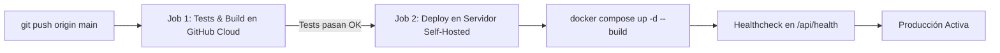

# Guía de Despliegue en Servidor Self-Hosted — SIGO-Dental

Esta guía describe cómo opera el pipeline de **Integración y Despliegue Continuo (CI/CD)** en servidores propios (*self-hosted*), cómo registrar el runner de GitHub Actions y cómo realizar despliegues manuales.

---

## 1. Arquitectura del Pipeline CI/CD

El flujo se define en [`.github/workflows/deploy.yml`](../.github/workflows/deploy.yml) y consta de dos fases:



1. **Job 1 (`test`):** Se ejecuta en la nube de GitHub (`ubuntu-latest`).
   - Compila y ejecuta los tests unitarios en Go (`server_test.go`).
   - Compila la aplicación frontend con TypeScript y Vite.
   - Si algo falla, el despliegue se detiene automáticamente, protegiendo el servidor.
2. **Job 2 (`deploy`):** Se ejecuta directamente en tu servidor (`runs-on: self-hosted`).
   - Se activa únicamente al hacer `push` a la rama `main` o al disparar manualmente el workflow.
   - Ejecuta [`scripts/deploy.sh`](../scripts/deploy.sh), que levanta o actualiza los contenedores con Docker Compose y realiza el healthcheck.

---

## 2. Configurar el GitHub Actions Runner en tu Servidor

Si aún no has registrado tu servidor como **Self-Hosted Runner** en GitHub, sigue estos sencillos pasos:

### 2.1 Obtener el token de registro
1. Ve a tu repositorio en GitHub: `https://github.com/angelcontres/sigo-dental/settings/actions/runners`
2. Haz clic en **New self-hosted runner**.
3. Selecciona tu sistema operativo (generalmente **Linux**) y arquitectura (**x64** o **ARM64**).

### 2.2 Instalar el runner en el servidor (Ejemplo Linux)
Conéctate por SSH a tu servidor y ejecuta:

```bash
# Crear directorio de trabajo
mkdir actions-runner && cd actions-runner

# Descargar la última versión del runner (GitHub te dará la URL exacta)
curl -o actions-runner-linux-x64.tar.gz -L https://github.com/actions/runner/releases/download/v2.321.0/actions-runner-linux-x64-2.321.0.tar.gz

# Descomprimir
tar xzf ./actions-runner-linux-x64.tar.gz

# Configurar el runner con el token generado por GitHub
./config.sh --url https://github.com/angelcontres/sigo-dental --token TU_TOKEN_DE_REGISTRO

# Instalar y arrancar como servicio del sistema (daemon permanente)
sudo ./svc.sh install
sudo ./svc.sh start
```

### 2.3 Permisos de Docker para el Runner
El usuario que ejecuta el runner debe tener permisos para usar Docker sin `sudo`:

```bash
# Agregar el usuario al grupo docker
sudo usermod -aG docker $USER

# Aplicar los cambios de grupo (o reiniciar sesión)
newgrp docker

# Verificar que puedes ejecutar docker sin sudo
docker ps
```

---

## 3. Despliegue Manual (Alternativa sin GitHub Actions)

Si deseas actualizar o levantar el sistema directamente desde la terminal del servidor sin esperar a GitHub Actions:

```bash
# 1. Entrar al directorio del proyecto
cd /ruta/hacia/proyecto_odontologo

# 2. Obtener los últimos cambios
git pull origin main

# 3. Ejecutar el script automatizado de despliegue
chmod +x scripts/deploy.sh
./scripts/deploy.sh
```

---

## 4. Personalización de Variables de Entorno

El despliegue lee la configuración desde un archivo `.env` en la raíz. Si no existe, genera uno automáticamente a partir de [`.env.example`](../.env.example).

Para personalizar puertos o contraseñas en producción:
```bash
cp .env.example .env
nano .env
```

Variables clave:
| Variable | Descripción | Valor por defecto |
|---|---|---|
| `POSTGRES_PASSWORD` | Contraseña de base de datos PostgreSQL | `sigo_password_change_me` |
| `SIGO_JWT_SECRET` | Clave secreta para tokens JWT | `sigo-production-secret-change-me` |
| `PORT_FRONTEND` | Puerto expuesto en el host para el frontend | `80` |
| `PORT_BACKEND` | Puerto expuesto en el host para la API REST | `8080` |
| `PORT_POSTGRES` | Puerto expuesto en el host para PostgreSQL | `5432` |

---

## 5. Comandos de Operación y Monitoreo

```bash
# Ver estado de los contenedores
docker compose ps

# Ver logs en tiempo real
docker compose logs -f

# Ver logs de un servicio específico
docker compose logs -f backend
docker compose logs -f frontend

# Reiniciar servicios
docker compose restart

# Detener la aplicación
docker compose down
```
