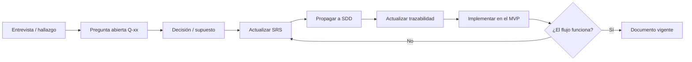

# Documentación — SIGO-Dental

Índice maestro de la documentación del **Sistema Integral de Gestión Odontológica y
Expediente Clínico Digital**.

- **Etapa:** Fase 1 — Levantamiento y diseño, con MVP funcional entregado.
- **Versión del conjunto documental:** `v0.2.0` (modo prototipo, documento vivo).
- **Fecha de corte:** 2026-10-29.
- **Idioma:** español (código y nombres técnicos en inglés cuando corresponda).

> **Modo MVP:** no hay stakeholders formales ni aprobaciones con firma. Los documentos se
> actualizan a medida que se construye el prototipo; el alcance realmente implementado está
> en [`MVP-1-HORA.md`](MVP-1-HORA.md).

---

## 1. Mapa de documentos

### 1.0 MVP

| Documento | Ruta | Estado |
|---|---|---|
| Alcance, plan de 60 minutos y guion de demo | [`MVP-1-HORA.md`](MVP-1-HORA.md) | Vigente |
| Aplicación funcional (HTML/CSS/JS) | [`../app/index.html`](../app/index.html) | Completado |

### 1.1 Requisitos

| Documento | Ruta | Estado |
|---|---|---|
| SRS (especificación principal) | [`SRS/SRS-SIGO-Dental.md`](SRS/SRS-SIGO-Dental.md) | Vigente (referencia) |
| Casos de uso detallados | [`SRS/A-casos-de-uso.md`](SRS/A-casos-de-uso.md) | Borrador |
| Matriz de trazabilidad | [`SRS/B-matriz-trazabilidad.md`](SRS/B-matriz-trazabilidad.md) | Borrador |
| Catálogo tabular de requisitos | [`SRS/C-catalogo-requisitos.csv`](SRS/C-catalogo-requisitos.csv) | Borrador |
| Glosario | [`GLOSARIO.md`](GLOSARIO.md) | Borrador |

### 1.2 Levantamiento (Fase 1)

| Documento | Ruta | Estado |
|---|---|---|
| Plan de levantamiento | [`levantamiento/PLAN-LEVANTAMIENTO.md`](levantamiento/PLAN-LEVANTAMIENTO.md) | Borrador |
| Preguntas y decisiones abiertas | [`levantamiento/PREGUNTAS-ABIERTAS.md`](levantamiento/PREGUNTAS-ABIERTAS.md) | Vivo |
| Plantilla de entrevista | [`plantillas/entrevista.md`](plantillas/entrevista.md) | Lista |
| Plantilla de historia de usuario | [`plantillas/historia-usuario.md`](plantillas/historia-usuario.md) | Lista |
| Plantilla de acta de reunión | [`plantillas/acta-reunion.md`](plantillas/acta-reunion.md) | Lista |

### 1.3 Diseño (SDD)

El SDD está dividido por dominio; cada carpeta contiene un documento autónomo y legible.
El índice detallado, con dependencias y estado, está en [`SDD/README.md`](SDD/README.md).

| # | Dominio | Ruta |
|---|---|---|
| 01 | Visión y alcance del diseño | [`SDD/01-vision-alcance/DESIGN-VISION.md`](SDD/01-vision-alcance/DESIGN-VISION.md) |
| 02 | Arquitectura y ADR | [`SDD/02-arquitectura/ARQUITECTURA.md`](SDD/02-arquitectura/ARQUITECTURA.md) |
| 03 | Modelo de datos | [`SDD/03-modelo-datos/MODELO-DATOS.md`](SDD/03-modelo-datos/MODELO-DATOS.md) |
| 04 | Diseño funcional por módulo | [`SDD/04-diseno-funcional/`](SDD/04-diseno-funcional/) |
| 05 | Contratos de API e integraciones | [`SDD/05-apis/API-CONTRATOS.md`](SDD/05-apis/API-CONTRATOS.md) |
| 06 | Seguridad y privacidad | [`SDD/06-seguridad/SEGURIDAD.md`](SDD/06-seguridad/SEGURIDAD.md) |
| 07 | Infraestructura y DevOps | [`SDD/07-infraestructura/INFRAESTRUCTURA-DEVOPS.md`](SDD/07-infraestructura/INFRAESTRUCTURA-DEVOPS.md) |
| 08 | UI/UX y design system | [`SDD/08-ui-ux/UI-UX.md`](SDD/08-ui-ux/UI-UX.md) |
| 09 | Pruebas y calidad | [`SDD/09-pruebas/PLAN-PRUEBAS.md`](SDD/09-pruebas/PLAN-PRUEBAS.md) |
| 10 | Operaciones y soporte | [`SDD/10-operaciones/OPERACIONES.md`](SDD/10-operaciones/OPERACIONES.md) |
| 11 | Plan de entrega y riesgos | [`SDD/11-plan-entrega/PLAN-ENTREGA.md`](SDD/11-plan-entrega/PLAN-ENTREGA.md) |

---

## 2. Convenciones documentales

### 2.1 Identificadores

| Prefijo | Significado | Ejemplo |
|---|---|---|
| `RF-xx` | Requisito funcional | `RF-03` |
| `RNF-xx` | Requisito no funcional | `RNF-04` |
| `RN-xx` | Regla de negocio | `RN-01` |
| `UC-xx` | Caso de uso | `UC-05` |
| `HU-xx` | Historia de usuario | `HU-12` |
| `ADR-xxx` | Architecture Decision Record | `ADR-002` |
| `MD-xx` | Módulo de diseño | `MD-03` |
| `TP-xx` | Caso de prueba (test plan) | `TP-14` |
| `Q-xx` | Pregunta abierta | `Q-07` |
| `R-xx` | Riesgo | `R-03` |

Los identificadores son **inmutables**: si un requisito se elimina, se marca como
`Retirado` y su número no se vuelve a usar.

### 2.2 Estados de un documento

| Estado | Significado |
|---|---|
| `Borrador` | En elaboración; puede cambiar sin aviso. |
| `En revisión` | Congelado para revisión. |
| `Vigente` | Alineado con el prototipo actual. |
| `Obsoleto` | Reemplazado por otro documento (se indica cuál). |

> En este proyecto no se usa el estado `Aprobado` ni se requieren firmas: el prototipo es la
> validación. Un documento pasa a `Vigente` cuando el código lo refleja.

### 2.3 Versionado

- `0.y.z`: borrador (cambios libres).
- `1.0.0` se reserva para una eventual versión estabilizada del sistema completo.
- Cambios: `MAJOR` si cambia el alcance, `MINOR` si agrega requisitos,
  `PATCH` si corrige redacción.

### 2.4 Diagramas

Todos los diagramas se escriben en **Mermaid** dentro del Markdown, para que se versionen
como texto y se rendericen en GitHub/GitLab. No se aceptan imágenes binarias como única
fuente de un diagrama.

### 2.5 Priorización

Se usa **MoSCoW** (`Must`, `Should`, `Could`, `Won't`) combinado con la fase de entrega.
Un `Must` sin fase asignada es un error de planificación.

---

## 3. Flujo de trabajo documental

Regla de oro: **ningún requisito sin criterio de aceptación verificable** y **ningún
componente de diseño sin requisito que lo justifique**.

---

## 4. Próximos pasos

1. Usar el MVP como guion de demo y anotar los ajustes de flujo que aparezcan.
2. Resolver las preguntas bloqueantes `Q-01` a `Q-05` de
   [PREGUNTAS-ABIERTAS](levantamiento/PREGUNTAS-ABIERTAS.md) si el proyecto continúa.
3. Si se pasa a producto: reemplazar `localStorage` por PostgreSQL y exponer una API
   NestJS (ver [`MVP-1-HORA.md`](MVP-1-HORA.md), sección 8).
4. Definir el alcance de la Fase 2 (núcleo administrativo) y estimar los Sprints 1–4.
5. Revisar los ADR `001` a `006` y el modelo de datos antes de escribir código de backend.

