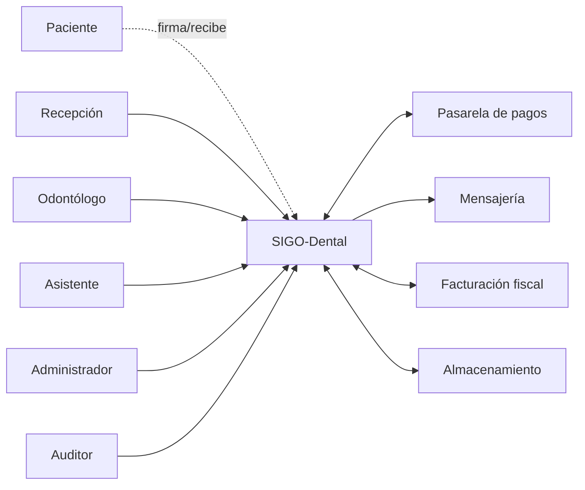

# 01 — Visión y alcance del diseño

| Campo | Valor |
|---|---|
| Documento | Visión de diseño |
| Versión | 0.1.0 |
| Base | SRS §2–§5 |
| Audiencia | Arquitectura, desarrollo, PO, seguridad |

---

## 1. Problema y objetivo

La clínica gestiona hoy su operación con una combinación de papel, planillas y
herramientas aisladas. Eso produce duplicidad de pacientes, pérdida de historia clínica,
dificultad para conciliar caja e inventario y poca visibilidad para la dirección.

**Objetivo de diseño:** construir una plataforma web única, segura y auditable que soporte
el ciclo clínico-administrativo completo, usable en tablet durante la atención y lo
suficientemente modular para crecer sin reescribir.

---

## 2. Principios de diseño

| # | Principio | Implicancia práctica |
|---|---|---|
| P-01 | **El expediente clínico es la fuente de verdad.** | Nada clínico se guarda fuera del expediente; no hay borrados físicos. |
| P-02 | **La historia no se reescribe, se amplía.** | Hallazgos y notas se versionan; correcciones por adenda. |
| P-03 | **La seguridad es un requisito, no una capa.** | RBAC, MFA, cifrado, auditoría y minimización desde el modelo. |
| P-04 | **Simple primero, extensible después.** | Monolito modular; sin microservicios ni multi-cloud prematuros. |
| P-05 | **La tablet manda en la clínica.** | Controles grandes, bajo scroll, alto contraste, tolerancia al error. |
| P-06 | **Todo dato tiene dueño y trazabilidad.** | `sede_id`, `created_by`, `updated_by`, auditoría. |
| P-07 | **Los documentos emitidos son inmutables.** | Presupuestos aprobados, notas firmadas, facturas y consentimientos. |
| P-08 | **El sistema debe poder auditarse sin la aplicación.** | Logs y documentos verificables por hash; exports. |
| P-09 | **Fallar de forma segura y visible.** | Sin pérdida de datos; errores claros; reintentos idempotentes. |
| P-10 | **Accesible para todos.** | WCAG 2.2 AA, alternativas al color, teclado. |

---

## 3. Atributos de calidad (escenarios)

| Atributo | Escenario | Respuesta esperada | Requisito |
|---|---|---|---|
| Rendimiento | Odontólogo abre un expediente con 10 estudios y odontograma. | Render < 1,5 s p95. | RNF-01 |
| Concurrencia | 150 usuarios trabajan en hora pico. | p95 estable; sin errores 5xx. | RNF-03 |
| Disponibilidad | Falla un nodo de aplicación en horario clínico. | Servicio continúa; alerta. | RNF-02 |
| Seguridad | Usuario de recepción intenta abrir una nota clínica. | 403 + evento de auditoría. | RNF-06/07 |
| Privacidad | Se exporta un listado de pacientes. | Solo campos permitidos; auditoría. | RNF-09 |
| Auditabilidad | Auditor reconstruye quién modificó una nota. | Historial completo e íntegro. | RNF-07 |
| Usabilidad | Odontólogo registra una nota SOEP en tablet. | ≤ 3 minutos; sin errores. | RNF-15 |
| Mantenibilidad | Se cambia la regla de comisión. | Cambio localizado en un módulo y sus tests. | RNF-16 |
| Recuperación | Se corrompe la base de datos. | RTO ≤ 4 h, RPO ≤ 15 min. | RNF-19 |
| Interoperabilidad | Se integra un laboratorio o PACS. | Adaptador sin tocar el núcleo. | RNF-21 |

---

## 4. Límites del sistema

### 4.1 Dentro del límite

- Aplicación web, API, workers, base de datos, almacenamiento de objetos.
- Autenticación, autorización, auditoría.
- Integraciones mediante adaptadores (pagos, mensajería, fiscal).

### 4.2 Fuera del límite

- Infraestructura de red de la clínica y dispositivos.
- Proveedores externos (pasarela, WhatsApp, autoridad fiscal).
- Contabilidad general y nómina.
- PACS/DICOM y FHIR en v1.

### 4.3 Actores y sistemas externos

---

## 5. Restricciones de diseño

| ID | Restricción | Decisión |
|---|---|---|
| DC-01 | Equipo ≤ 8 personas. | Monolito modular, una sola base de datos. |
| DC-02 | Un país, una moneda, un idioma en v1. | Configuración regional centralizada. |
| DC-03 | Datos de salud sensibles. | Cifrado, minimización, retención y auditoría. |
| DC-04 | Tablet ≥ 10.5" en sillón. | UI táctil y odontograma con áreas ≥ 44 px. |
| DC-05 | Presupuesto de infraestructura acotado. | Contenedores, una región, escalado horizontal simple. |
| DC-06 | Integración fiscal variable por país. | Puerto/adaptador aislado. |
| DC-07 | Sin app nativa en v1. | SPA responsive; PWA evaluada después. |

---

## 6. Riesgos de diseño

| ID | Riesgo | Impacto | Mitigación |
|---|---|---|---|
| RD-01 | El odontograma resulta complejo de modelar y renderizar. | Alto | Modelo de hallazgos + spike técnico en E1; prototipo validado. |
| RD-02 | Requisitos legales cambian por país. | Alto | Parametrización y asesoría legal temprana. |
| RD-03 | Datos históricos sucios. | Alto | Perfilado, dry-run y limpieza (RF-25). |
| RD-04 | Baja adopción por usabilidad en tablet. | Alto | Diseño participativo y pruebas con usuarios reales. |
| RD-05 | Acoplamiento entre módulos. | Medio | Límites explícitos + revisión de dependencias. |
| RD-06 | Crecimiento de adjuntos. | Medio | S3 + ciclo de vida + límites por archivo. |
| RD-07 | Dependencia de proveedor de mensajería. | Medio | Adaptador y fallback por canal. |
| RD-08 | Complejidad de la facturación fiscal. | Medio | Aislar en adaptador; POS propio primero. |

---

## 7. Criterios de éxito del diseño

1. Un desarrollador nuevo puede entender la arquitectura y levantar el entorno en menos de
   un día.
2. Un cambio en un módulo no obliga a modificar otro (bajo acoplamiento verificable).
3. Los flujos clínicos críticos se completan en tablet sin ayuda del mouse.
4. Toda acción sensible es auditable y reconstruible.
5. El sistema cumple los SLO con el volumen objetivo sin rediseño.
