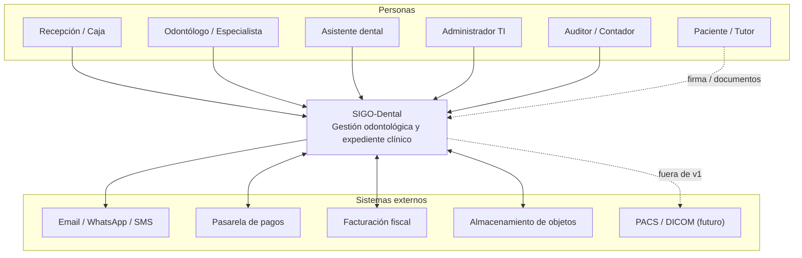
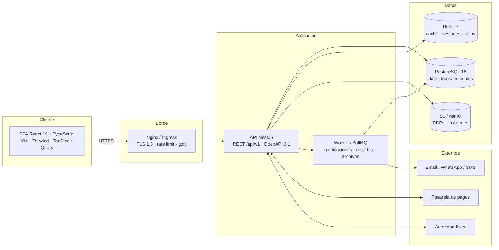
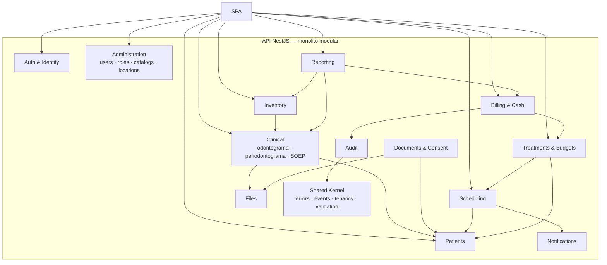
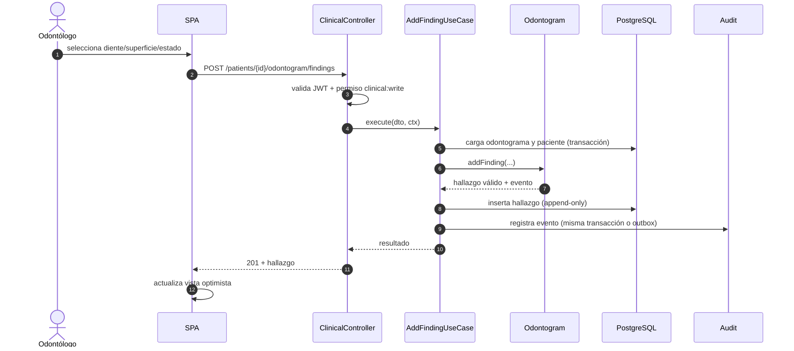
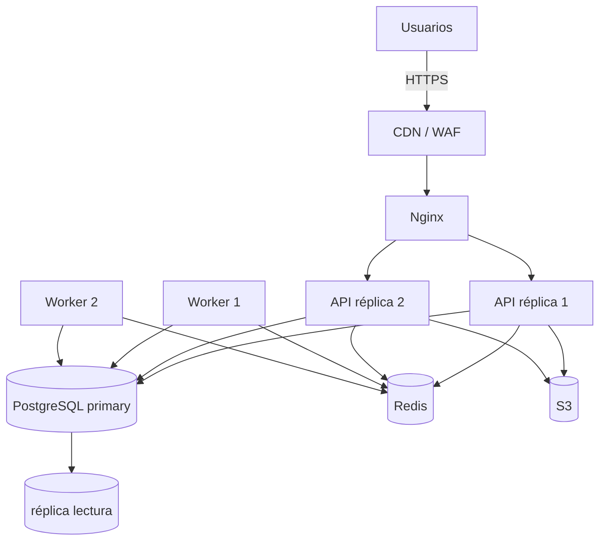

# 02 — Arquitectura del sistema

| Campo | Valor |
|---|---|
| Documento | Arquitectura de software |
| Versión | 0.1.0 |
| Estilo | Monolito modular (modular monolith) |
| Base | SRS §4–§8, [ADR-001](adr/ADR-001-estilo-arquitectonico.md) |
| Audiencia | Desarrollo, DevOps, seguridad |

---

## 1. Resumen ejecutivo

SIGO-Dental se implementa como un **monolito modular** con una SPA React, una API NestJS por
módulos de dominio, PostgreSQL como fuente de verdad, Redis para caché/colas, almacenamiento
S3 para archivos y workers para tareas asíncronas. Los módulos se comunican por interfaces
internas y eventos de dominio; no comparten tablas ajenas.

Esta decisión prioriza velocidad de entrega, consistencia transaccional y simplicidad
operativa para un equipo reducido, sin cerrar la puerta a extraer servicios en el futuro
(ADR-001).

---

## 2. Vista de contexto (C4 nivel 1)



**Responsabilidades del sistema:** autenticar y autorizar, gestionar el expediente clínico,
agendar, facturar, controlar inventario, emitir documentos y auditar. **No** es responsable
de la red de la clínica, del hosting de correo ni de la validez legal de los textos.

---

## 3. Vista de contenedores (C4 nivel 2)



| Contenedor | Tecnología | Responsabilidad | Escalado |
|---|---|---|---|
| SPA | React + Vite | Interfaz, estado de sesión, validaciones de cliente. | CDN / estático. |
| Nginx | Nginx | TLS, compresión, rate limit, estáticos. | Stateless. |
| API | NestJS | Casos de uso, reglas de negocio, autorización. | Horizontal (N réplicas). |
| Workers | BullMQ | Jobs asíncronos e idempotentes. | Horizontal por cola. |
| PostgreSQL | 16 | Persistencia transaccional. | Vertical + réplicas de lectura. |
| Redis | 7 | Caché, rate limit, colas, locks. | Gestionado. |
| Object storage | S3/MinIO | Archivos y PDFs. | Gestionado. |

---

## 4. Vista de componentes (C4 nivel 3)



### 4.1 Módulos y límites

| Módulo | Agregados principales | Expone | Consume |
|---|---|---|---|
| Auth & Identity | User, Role, Permission, Session | `authenticate`, `authorize`, `currentUser` | Admin |
| Patients | Patient, Guardian, Coverage, Alert | `getPatient`, `searchPatients` | — |
| Clinical | ClinicalNote, Odontogram, Finding, PeriodontalExam | `getRecord`, `addFinding`, `signNote` | Patients, Files, Audit |
| Documents & Consent | Consent, Prescription, Document | `issueConsent`, `sign`, `issuePrescription` | Patients, Files, Audit |
| Scheduling | Appointment, StatusHistory, ScheduleBlock | `book`, `transition`, `availability` | Patients, Notifications, Audit |
| Treatments | TreatmentPlan, Budget, Item, Task, Approval | `createBudget`, `approve`, `listTasks` | Patients, Scheduling |
| Billing & Cash | Invoice, Payment, CashSession, Commission | `charge`, `closeCash`, `settle` | Treatments, Audit |
| Inventory | Item, Stock, Movement, ProcedureBOM | `consume`, `adjust`, `stockByLocation` | Clinical, Admin |
| Notifications | Template, Message, Delivery | `enqueue`, `send` | Scheduling, Documents |
| Administration | Location, Chair, Catalog, Setting | `getConfig`, CRUD | — |
| Audit | AuditEvent | `record`, `query` | Todos (solo escritura) |
| Reporting | Read models / queries | `report` | Billing, Clinical, Inventory |
| Files | FileObject, Attachment | `presign`, `confirm`, `download` | — |
| Shared Kernel | `Money`, `DateRange`, `Result`, `DomainEvent`, `TenantContext` | Utilidades | — |

**Reglas de dependencia:**

1. Un módulo no importa repositorios de otro; solo su *facade* pública.
2. `Audit` y `Notifications` se alimentan por eventos; no bloquean la transacción principal.
3. `Reporting` es de solo lectura y no modifica agregados.
4. `Shared Kernel` no depende de ningún módulo de negocio.

---

## 5. Arquitectura interna de un módulo

Se usa una organización **hexagonal pragmática**:

```text
modules/patients/
├── patients.module.ts
├── api/
│   ├── patients.controller.ts        # HTTP, DTOs, validación
│   └── dto/
├── application/
│   ├── create-patient.usecase.ts     # orquestación + transacción
│   ├── search-patients.usecase.ts
│   └── ports/                        # interfaces de repositorio
├── domain/
│   ├── patient.entity.ts             # invariantes
│   ├── patient.events.ts
│   └── errors.ts
└── infrastructure/
    ├── prisma-patient.repository.ts
    └── mappers/
```

| Capa | Puede depender de | No puede depender de |
|---|---|---|
| `api` | `application`, DTOs | `infrastructure` directa |
| `application` | `domain`, puertos | HTTP, Prisma, framework |
| `domain` | nada externo | framework, ORM, red |
| `infrastructure` | `domain`, puertos, Prisma | `api` |

El dominio no conoce NestJS ni Prisma. Esto permite probar reglas sin base de datos y
cambiar persistencia sin tocar negocio.

---

## 6. Flujos críticos

### 6.1 Registro de un hallazgo en el odontograma



### 6.2 Reserva de turno con validación de solapamiento

1. Se valida sesión, permiso y sede.
2. Se abre transacción con aislamiento `SERIALIZABLE` (o `SELECT ... FOR UPDATE` sobre el
   sillón) y se verifica solapamiento de sillón y profesional.
3. Se inserta el turno y su historial inicial.
4. Se escribe un evento `AppointmentBooked` en la tabla `outbox`.
5. Commit. Un worker toma el evento y encola la notificación.
6. Si la notificación falla, se reintenta sin afectar el turno.

### 6.3 Cobro con pagos mixtos

1. Se bloquea la sesión de caja (`FOR UPDATE`) y se valida que esté abierta.
2. Se cargan los ítems y se calcula total con `Money` (decimal, sin flotantes).
3. Se valida `sum(pagos) ≤ total` y se registra cada pago.
4. Se emite el comprobante con numeración correlativa por sede (secuencia atómica).
5. Se registra movimiento de caja y evento de auditoría.
6. Commit; la impresión/email es posterior y no bloquea.

### 6.4 Descargo de insumos al completar un procedimiento

1. El caso de uso `CompleteProcedure` marca la tarea como `realizada`.
2. Publica `ProcedureCompleted` (outbox).
3. El módulo de inventario consume el evento, lee el BOM y descuenta stock de la sede.
4. Si no hay stock, deja un movimiento pendiente y alerta; no revierte la atención clínica
   (consistencia eventual controlada).

---

## 7. Persistencia y transacciones

- **Una base de datos PostgreSQL** con esquemas por módulo (`patients`, `clinical`,
  `scheduling`, `billing`, etc.) para separar responsabilidades sin perder transacciones.
- **Prisma** como ORM y motor de migraciones versionadas.
- **Transacciones** en los casos de uso que modifican más de un agregado.
- **Outbox pattern** para eventos confiables (§8).
- **Optimistic locking** con `version` en entidades editables (paciente, presupuesto).
- **Soft delete** (`deleted_at`) salvo tablas append-only.
- ** Dinero:** `numeric(14,2)` + moneda ISO-4217; nunca `float`.

---

## 8. Eventos y trabajos asíncronos

| Tipo | Mecanismo | Ejemplos |
|---|---|---|
| Eventos de dominio | Tabla `outbox` → worker | `PatientCreated`, `AppointmentBooked`, `ProcedureCompleted`, `InvoiceIssued` |
| Jobs programados | BullMQ repeatable | recordatorios 48/24 h, no-show automático, reportes, purga |
| Jobs bajo demanda | BullMQ | generación de PDF, exportaciones, escaneo antivirus |
| Integraciones | Cola con reintentos y dead-letter | pagos, facturación fiscal, mensajería |

**Reglas:** todo job debe ser **idempotente** (clave de idempotencia), tener reintentos con
backoff exponencial, dead-letter queue y trazabilidad por `correlation_id`.

---

## 9. Multi-sede (tenancy)

- Cada entidad operativa lleva `location_id` (sede).
- El `TenantContext` se construye desde el JWT y la sede activa; el repositorio aplica el
  filtro de forma obligatoria.
- Los roles globales (Administrador, Auditor) pueden consultar el consolidado.
- Se evalúa Row-Level Security de PostgreSQL como defensa en profundidad (ADR-003).
- Los archivos se almacenan con prefijo `locations/{location_id}/...` y URLs firmadas.

---

## 10. Caché

| Dato | Dónde | TTL | Invalidación |
|---|---|---|---|
| Catálogos (procedimientos, insumos) | Redis | 10 min | Al escribir el catálogo. |
| Permisos del usuario | Redis | 5 min | Al cambiar rol/permisos. |
| Configuración de sede | Redis | 15 min | Al actualizar sede. |
| Disponibilidad de agenda | No se cachea | — | Consulta directa. |
| Datos clínicos | **No se cachean** | — | — |

---

## 11. Manejo de errores

- Formato **RFC 7807** (`application/problem+json`).
- Código de error de dominio estable (`PATIENT_DUPLICATE`, `APPOINTMENT_OVERLAP`).
- `correlation_id` en todas las respuestas y logs.
- Los errores de validación devuelven detalle por campo.
- Nunca se expone stack trace ni SQL al cliente.
- Errores esperados → 4xx; inesperados → 5xx + alerta.

Ejemplo:

```json
{
  "type": "https://sigo-dental/errors/appointment-overlap",
  "title": "El horario se superpone con otro turno",
  "status": 409,
  "code": "APPOINTMENT_OVERLAP",
  "detail": "El sillón 2 ya tiene un turno de 10:00 a 10:45.",
  "correlationId": "01J9Z8K3...",
  "errors": [{ "field": "startsAt", "message": "Horario ocupado" }]
}
```

---

## 12. Observabilidad

| Señal | Herramienta | Uso |
|---|---|---|
| Métricas | Prometheus | RED (rate, errors, duration) y USE. |
| Logs | Loki / JSON estructurado | Diagnóstico con `correlation_id`. |
| Trazas | OpenTelemetry + Tempo/Jaeger | Latencia por caso de uso y dependencia. |
| Errores | Sentry | Excepciones con contexto. |
| SLO | Grafana | Disponibilidad, latencia, errores, saturación. |

No se registran datos clínicos ni credenciales en logs. Los identificadores se
seudonimizan cuando corresponde.

---

## 13. Despliegue (vista física)



- Contenedores inmutables, configuración por variables de entorno.
- Migraciones `expand → migrate → contract` para despliegues sin downtime.
- Health checks `/health/live` y `/health/ready`.
- Rollback por imagen anterior; migraciones compatibles hacia atrás.

---

## 14. Decisiones registradas

| ADR | Decisión | Estado |
|---|---|---|
| [ADR-001](adr/ADR-001-estilo-arquitectonico.md) | Monolito modular | Propuesto |
| [ADR-002](adr/ADR-002-stack-tecnologico.md) | React + NestJS + PostgreSQL | Propuesto |
| [ADR-003](adr/ADR-003-multi-sede.md) | Aislamiento por sede con `location_id` | Propuesto |
| [ADR-004](adr/ADR-004-inmutabilidad-auditoria.md) | Inmutabilidad clínica y auditoría encadenada | Propuesto |
| [ADR-005](adr/ADR-005-almacenamiento-archivos.md) | S3 con URLs firmadas | Propuesto |
| [ADR-006](adr/ADR-006-autenticacion-mfa.md) | Auth propia con JWT + TOTP | Propuesto |

---

## 15. Riesgos técnicos y mitigaciones

| Riesgo | Mitigación |
|---|---|
| Acoplamiento entre módulos | Reglas de dependencia + revisión en PR + tests de arquitectura. |
| Latencia del odontograma | Índices, paginación de estudios, render incremental, medición con k6. |
| Bloqueos por concurrencia en agenda | Transacciones cortas, locks por recurso, reintentos. |
| Crecimiento de adjuntos | S3 + lifecycle + límites + compresión de imágenes. |
| Deriva de esquema | Migraciones versionadas y revisadas; staging obligatorio. |
| Fuga de datos en logs | Linter de logs + revisión de seguridad. |
