# 03 — Modelo de datos

| Campo | Valor |
|---|---|
| Documento | Modelo de datos lógico y físico (preliminar) |
| Versión | 0.1.0 |
| Motor | PostgreSQL 16 |
| ORM | Prisma |
| Base | SRS §7, ADR-003, ADR-004 |
| Audiencia | Backend, datos, QA, seguridad |

---

## 1. Convenciones

| Tema | Convención |
|---|---|
| Nombres | Tablas y columnas en `snake_case`, en inglés. |
| Claves primarias | `uuid` (UUID v7 generado en aplicación) para evitar colisiones y orden temporal. |
| Fechas | `timestamptz` en UTC; la zona de la sede se aplica en presentación. |
| Dinero | `numeric(14,2)` + código ISO-4217; nunca `float`. |
| Borrado | Lógico (`deleted_at`) salvo tablas append-only. |
| Auditoría | `created_at`, `created_by`, `updated_at`, `updated_by`. |
| Versión | `version integer` para *optimistic locking* en agregados editables. |
| Esquemas | `identity`, `patients`, `clinical`, `scheduling`, `treatments`, `billing`, `inventory`, `notifications`, `audit`, `shared`. |
| Enums | `varchar` con `CHECK` o tipos enum de PostgreSQL, versionados por migración. |
| Índices | Claves foráneas, búsquedas por documento/teléfono, agenda por rango, auditoría por fecha. |

---

## 2. Vista general

```mermaid
erDiagram
    LOCATION ||--o{ CHAIR : "tiene"
    LOCATION ||--o{ APP_USER_LOCATION : "asigna"
    APP_USER ||--o{ APP_USER_LOCATION : "trabaja"
    APP_USER ||--o{ USER_ROLE : "tiene"
    ROLE ||--o{ USER_ROLE : "asigna"
    ROLE ||--o{ ROLE_PERMISSION : "incluye"
    PERMISSION ||--o{ ROLE_PERMISSION : "otorga"
    APP_USER ||--o| PROFESSIONAL : "perfil"

    PATIENT ||--o{ PATIENT_GUARDIAN : "tutor"
    PATIENT ||--o{ PATIENT_COVERAGE : "cobertura"
    PATIENT ||--o{ MEDICAL_HISTORY : "anamnesis"
    PATIENT ||--o{ PATIENT_ALERT : "alertas"
    PATIENT ||--o{ APPOINTMENT : "turnos"
    PATIENT ||--o{ CLINICAL_NOTE : "notas"
    PATIENT ||--o{ ODONTOGRAM : "odontogramas"
    PATIENT ||--o{ BUDGET : "presupuestos"
    PATIENT ||--o{ INVOICE : "facturas"
    PATIENT ||--o{ CONSENT : "consentimientos"
    PATIENT ||--o{ PRESCRIPTION : "recetas"
    PATIENT ||--o{ ATTACHMENT : "documentos"

    APPOINTMENT ||--o{ APPOINTMENT_STATUS_HISTORY : "historial"
    APPOINTMENT ||--o{ APPOINTMENT_REMINDER : "recordatorios"
    APPOINTMENT }o--|| CHAIR : "ocupa"
    APPOINTMENT }o--|| PROFESSIONAL : "atiende"
    APPOINTMENT }o--o| PROCEDURE : "motivo"

    ODONTOGRAM ||--o{ ODONTOGRAM_FINDING : "hallazgos"
    ODONTOGRAM ||--o{ PERIODONTAL_EXAM : "estudios"
    PERIODONTAL_EXAM ||--o{ PERIODONTAL_SITE : "sitios"

    TREATMENT_PLAN ||--o{ BUDGET : "versiones"
    BUDGET ||--o{ BUDGET_ITEM : "items"
    BUDGET ||--o{ BUDGET_APPROVAL : "aprobaciones"
    BUDGET_ITEM ||--o{ TREATMENT_TASK : "genera"
    PROCEDURE ||--o{ BUDGET_ITEM : "presta"
    PROCEDURE ||--o{ PROCEDURE_PRICE : "precio"
    PROCEDURE ||--o{ PROCEDURE_SUPPLY : "consume"

    INVOICE ||--o{ INVOICE_ITEM : "detalle"
    INVOICE ||--o{ PAYMENT : "pagos"
    CASH_SESSION ||--o{ CASH_MOVEMENT : "movimientos"
    CASH_SESSION ||--o{ PAYMENT : "registra"
    PROFESSIONAL ||--o{ COMMISSION_RULE : "regla"
    PROFESSIONAL ||--o{ COMMISSION_SETTLEMENT : "liquidacion"
    COMMISSION_SETTLEMENT ||--o{ COMMISSION_ITEM : "detalle"

    SUPPLY ||--o{ STOCK : "existencias"
    SUPPLY ||--o{ STOCK_MOVEMENT : "movimientos"
    LOCATION ||--o{ STOCK : "almacena"
    LOCATION ||--o{ CASH_SESSION : "caja"

    APP_USER ||--o{ AUDIT_EVENT : "genera"
    APP_USER ||--o{ NOTIFICATION : "recibe"
```



---

## 3. Identidad, roles y sedes

### 3.1 `identity.app_user`

| Columna | Tipo | Restricción | Descripción |
|---|---|---|---|
| `id` | uuid | PK | Identificador. |
| `email` | citext | UNIQUE, NOT NULL | Login. |
| `password_hash` | text | NOT NULL | Argon2id. |
| `full_name` | text | NOT NULL | Nombre visible. |
| `status` | varchar(20) | CHECK (`active`,`inactive`,`locked`) | Estado. |
| `mfa_enabled` | boolean | DEFAULT false | MFA activa. |
| `mfa_secret_enc` | bytea | NULL | Secreto TOTP cifrado. |
| `failed_attempts` | integer | DEFAULT 0 | Intentos fallidos. |
| `locked_until` | timestamptz | NULL | Bloqueo temporal. |
| `last_login_at` | timestamptz | NULL | Último acceso. |
| `created_at` / `updated_at` | timestamptz | NOT NULL | Auditoría. |
| `deleted_at` | timestamptz | NULL | Baja lógica. |

### 3.2 `identity.role`, `permission`, `user_role`, `role_permission`

- `role(code)` único: `ADMIN`, `RECEPTION`, `DENTIST`, `ASSISTANT`, `AUDITOR`.
- `permission(code)` con formato `recurso:accion` (ej. `clinical:write`).
- `user_role` y `role_permission` con PK compuesta y `ON DELETE CASCADE` controlado.
- `user_location(user_id, location_id)` define el alcance de sede.

### 3.3 `shared.location`, `shared.chair`

| Tabla | Columnas clave |
|---|---|
| `location` | `id`, `code` (UNIQUE), `name`, `timezone`, `address`, `tax_id`, `active` |
| `chair` | `id`, `location_id` (FK), `name`, `active`, UNIQUE(`location_id`,`name`) |

### 3.4 `identity.professional`

`id`, `user_id` (UNIQUE FK), `license_number` (UNIQUE), `specialty`, `default_commission_rule_id`, `active`.

---

## 4. Pacientes

### 4.1 `patients.patient`

| Columna | Tipo | Restricción |
|---|---|---|
| `id` | uuid | PK |
| `first_name`, `last_name` | text | NOT NULL |
| `document_type` | varchar(20) | NOT NULL |
| `document_number` | varchar(40) | NOT NULL |
| `birth_date` | date | NOT NULL |
| `sex` | varchar(20) | CHECK |
| `phone`, `email` | text | phone NOT NULL |
| `address` | text | NOT NULL |
| `notes` | text | NULL |
| `created_at`, `updated_at`, `deleted_at` | timestamptz | |
| `version` | integer | DEFAULT 1 |

**Índices:** UNIQUE(`document_type`,`document_number`); trigram en `first_name`,
`last_name`; `phone`; `birth_date`.
**Regla:** paciente global, no lleva `location_id` (ADR-003).

### 4.2 Tablas relacionadas

| Tabla | Campos clave | Notas |
|---|---|---|
| `coverage` | `id`, `name`, `type`, `active` | Catálogo de seguros/convenios. |
| `patient_guardian` | `patient_id`, `full_name`, `document`, `relationship`, `phone` | Obligatorio si menor. |
| `patient_coverage` | `patient_id`, `coverage_id`, `member_no`, `valid_from`, `valid_to`, `is_primary` | Varias coberturas. |
| `emergency_contact` | `patient_id`, `name`, `phone`, `relationship` | Uno o más. |
| `medical_history` | `patient_id`, `version`, `data` (jsonb), `signed_by`, `signed_at`, `reason` | Versionada. |
| `allergy` | `patient_id`, `substance`, `severity`, `reaction`, `active` | Alerta crítica. |
| `medical_condition` | `patient_id`, `code`, `name`, `severity`, `critical`, `active` | — |
| `patient_alert` | `patient_id`, `type`, `severity`, `message`, `active`, `resolved_by`, `resolved_at` | Badge. |

---

## 5. Dominio clínico

### 5.1 `clinical.clinical_note`

| Columna | Tipo | Notas |
|---|---|---|
| `id` | uuid | PK |
| `patient_id` | uuid | FK |
| `appointment_id` | uuid | NULL |
| `author_id` | uuid | FK `app_user` |
| `type` | varchar(20) | `soep`, `addendum` |
| `subjective`, `objective`, `assessment`, `plan` | text | Contenido SOEP |
| `status` | varchar(20) | `draft`, `signed`, `locked` |
| `signed_at` | timestamptz | NULL |
| `content_hash` | text | SHA-256 al firmar |
| `supersedes_id` | uuid | FK a la nota original (adenda) |
| `created_at` | timestamptz | |

**Inmutable** después de `signed_at` (ADR-004). Sin `UPDATE`/`DELETE` vía aplicación.

### 5.2 `clinical.odontogram`

`id`, `patient_id`, `version`, `notation` (`FDI`,`UNIVERSAL`), `dentition`
(`permanent`,`deciduous`,`mixed`), `status` (`draft`,`signed`), `signed_by`, `signed_at`,
`created_at`.

### 5.3 `clinical.odontogram_finding`

| Columna | Tipo | Descripción |
|---|---|---|
| `id` | uuid | PK |
| `odontogram_id` | uuid | FK |
| `tooth_fdi` | varchar(2) | Notación canónica (ej. `36`) |
| `tooth_set` | varchar(10) | `permanent`, `deciduous` |
| `surfaces` | text[] | Subconjunto de `M,D,O,V,L` |
| `condition_code` | varchar(30) | Catálogo (caries, restoration, ...) |
| `status` | varchar(20) | `existing`, `required`, `completed` |
| `note` | text | NULL |
| `created_by` | uuid | FK |
| `created_at` | timestamptz | |
| `supersedes_id` | uuid | Corrección |

**Regla:** formato de `tooth_fdi` validado contra el set; `surfaces` no vacío para
condiciones por superficie; `completed` es inmutable.

### 5.4 Periodontograma

`periodontal_exam(id, patient_id, exam_date, status, signed_by, signed_at, notes)`.
`periodontal_site(id, exam_id, tooth_fdi, site, probing_depth_mm, gingival_margin_mm,
cal_mm, bleeding, suppuration, mobility, furcation, plaque)`.
`site` ∈ `{DB, B, MB, DL, L, ML}`. `cal_mm` se calcula en aplicación/trigger.

### 5.5 Documentos, consentimientos y recetas

| Tabla | Campos clave |
|---|---|
| `attachment` | `id`, `patient_id`, `location_id`, `category`, `file_key`, `mime`, `size`, `sha256`, `status`, `uploaded_by`, `created_at` |
| `consent` | `id`, `patient_id`, `procedure_id`, `template_version`, `content_hash`, `signed_by`, `signer_type`, `method`, `signed_at`, `pdf_file_id`, `status`, `revoked_at` |
| `prescription` | `id`, `patient_id`, `author_id`, `issued_at`, `status`, `pdf_file_id` |
| `prescription_item` | `id`, `prescription_id`, `medication_id`, `dose`, `route`, `frequency`, `duration`, `instructions` |

---

## 6. Agenda

### 6.1 `scheduling.appointment`

| Columna | Tipo | Notas |
|---|---|---|
| `id` | uuid | PK |
| `patient_id` | uuid | FK |
| `location_id` | uuid | FK, NOT NULL |
| `chair_id` | uuid | FK |
| `professional_id` | uuid | FK |
| `procedure_id` | uuid | NULL |
| `starts_at`, `ends_at` | timestamptz | `ends_at > starts_at` |
| `status` | varchar(20) | Ver máquina de estados |
| `reason` | text | Motivo de consulta |
| `notes` | text | Internas |
| `created_by`, `updated_by` | uuid | |
| `version` | integer | Optimistic lock |

**Restricciones anti-solapamiento (PostgreSQL):**

```sql
-- Requiere btree_gist
ALTER TABLE scheduling.appointment
  ADD CONSTRAINT appointment_no_overlap
  EXCLUDE USING gist (
    chair_id WITH =,
    tstzrange(starts_at, ends_at, '[)') WITH &&
  )
  WHERE (status IN ('PROGRAMADA','CONFIRMADA','EN_SALA','EN_ATENCION'));
```

Análogo para `professional_id`. La aplicación valida antes para dar un error amigable; la
base de datos garantiza la invariante ante concurrencia.

### 6.2 Otras tablas

| Tabla | Campos |
|---|---|
| `appointment_status_history` | `id`, `appointment_id`, `from_status`, `to_status`, `changed_by`, `changed_at`, `reason` |
| `schedule_block` | `id`, `location_id`, `professional_id`, `chair_id`, `starts_at`, `ends_at`, `reason` |
| `appointment_reminder` | `id`, `appointment_id`, `channel`, `scheduled_at`, `sent_at`, `status`, `provider_id`, `error`, `idempotency_key` UNIQUE |

---

## 7. Tratamientos y presupuestos

| Tabla | Campos clave |
|---|---|
| `treatments.procedure` | `id`, `code` UNIQUE, `name`, `category`, `duration_min`, `tax_rate`, `active` |
| `treatments.procedure_price` | `id`, `procedure_id`, `location_id`, `price`, `valid_from`, `valid_to` |
| `treatments.treatment_plan` | `id`, `patient_id`, `diagnosis`, `status`, `created_by` |
| `treatments.budget` | `id`, `patient_id`, `plan_id`, `version`, `status`, `currency`, `valid_until`, `subtotal`, `discount_total`, `tax_total`, `total`, `approved_at`, `created_by` |
| `treatments.budget_item` | `id`, `budget_id`, `procedure_id`, `tooth_fdi`, `surfaces`, `quantity`, `unit_price`, `discount`, `lab_cost`, `tax_rate`, `total`, `phase`, `session` |
| `treatments.budget_approval` | `id`, `budget_id`, `approved_by`, `signer_type`, `method`, `scope`, `content_hash`, `signed_at` |
| `treatments.treatment_task` | `id`, `budget_item_id`, `patient_id`, `status`, `appointment_id`, `completed_at` |

**Snapshot de precio:** `budget_item.unit_price` se copia al crear el ítem (RN-15); no se
recalcula si cambia el catálogo.

---

## 8. Finanzas

| Tabla | Campos clave |
|---|---|
| `billing.cash_session` | `id`, `location_id`, `opened_by`, `opened_at`, `opening_amount`, `closed_by`, `closed_at`, `counted_amount`, `expected_amount`, `difference`, `status`, `approved_by` |
| `billing.cash_movement` | `id`, `cash_session_id`, `type`, `method`, `amount`, `reference`, `created_by`, `created_at` |
| `billing.invoice` | `id`, `location_id`, `patient_id`, `series`, `number`, `status`, `subtotal`, `tax_total`, `total`, `issued_at`, `fiscal_uuid`, `pdf_file_id` |
| `billing.invoice_item` | `id`, `invoice_id`, `description`, `quantity`, `unit_price`, `tax_rate`, `total`, `budget_item_id` |
| `billing.payment` | `id`, `invoice_id`, `method`, `amount`, `reference`, `paid_at`, `cash_session_id`, `gateway_id`, `status` |
| `billing.credit_note` | `id`, `invoice_id`, `reason`, `amount`, `issued_at`, `fiscal_uuid` |
| `billing.commission_rule` | `id`, `professional_id`, `procedure_id`, `type`, `value`, `base`, `active` |
| `billing.commission_settlement` | `id`, `professional_id`, `period_start`, `period_end`, `status`, `total`, `closed_at` |
| `billing.commission_item` | `id`, `settlement_id`, `payment_id`, `base_amount`, `deduction`, `amount` |

**Numeración:** secuencia por `location_id` y serie, asignada dentro de la transacción de
emisión; nunca se reutiliza.

---

## 9. Inventario

| Tabla | Campos clave |
|---|---|
| `inventory.supply` | `id`, `code` UNIQUE, `name`, `unit`, `min_stock`, `reference_cost`, `active` |
| `inventory.stock` | `location_id`, `supply_id`, `quantity`, `updated_at` — PK compuesta |
| `inventory.stock_movement` | `id`, `location_id`, `supply_id`, `type`, `quantity`, `unit_cost`, `lot`, `expires_at`, `reference_type`, `reference_id`, `reason`, `created_by`, `created_at` |
| `inventory.procedure_supply` | `procedure_id`, `supply_id`, `quantity` — PK compuesta (BOM) |

**Invariante:** `stock.quantity >= 0`; el descargo se hace en transacción con
`SELECT ... FOR UPDATE` y `CHECK (quantity >= 0)`.

---

## 10. Notificaciones, auditoría y gobierno

### 10.1 `notifications.notification`

`id`, `patient_id`, `appointment_id`, `channel`, `template_code`, `payload` (jsonb),
`status`, `provider_message_id`, `sent_at`, `error`, `idempotency_key` (UNIQUE).

### 10.2 `audit.audit_event`

| Columna | Tipo | Notas |
|---|---|---|
| `id` | uuid | PK |
| `occurred_at` | timestamptz | UTC |
| `actor_id` | uuid | NULL para sistema |
| `actor_role` | varchar(40) | Rol al momento |
| `location_id` | uuid | NULL si global |
| `action` | varchar(60) | `login`, `read`, `create`, `update`, `delete`, `export` |
| `entity` | varchar(60) | Tabla/agregado |
| `entity_id` | uuid | Afectado |
| `before` / `after` | jsonb | Diff cuando aplica |
| `ip` | inet | Origen |
| `user_agent` | text | — |
| `correlation_id` | uuid | Trazabilidad |
| `prev_hash` | text | Cadena |
| `hash` | text | SHA-256 del evento + prev_hash |

**Índices:** (`occurred_at`), (`actor_id`,`occurred_at`), (`entity`,`entity_id`),
(`location_id`,`occurred_at`).
**Permisos:** `INSERT`/`SELECT` para la app; sin `UPDATE`/`DELETE`.

### 10.3 Otras tablas

| Tabla | Campos |
|---|---|
| `shared.outbox_event` | `id`, `aggregate_type`, `aggregate_id`, `event_type`, `payload`, `occurred_at`, `processed_at`, `attempts` |
| `shared.setting` | `key`, `value` (jsonb), `scope` (`global`,`location`), `location_id`, `updated_by` |
| `shared.import_batch` | `id`, `type`, `filename`, `status`, `total_rows`, `ok_rows`, `error_rows`, `report` (jsonb), `created_by`, `created_at` |

---

## 11. Reglas de integridad y triggers

| Regla | Implementación |
|---|---|
| Inmutabilidad de notas firmadas | Trigger `BEFORE UPDATE OR DELETE`. |
| Inmutabilidad de hallazgos `completed` | Trigger condicional por estado. |
| Inmutabilidad de facturas emitidas | Trigger + estado `issued`. |
| No solapamiento de sillón/profesional | `EXCLUDE USING gist` + validación de servicio. |
| Stock no negativo | `CHECK (quantity >= 0)` + transacción con lock. |
| Suma de pagos ≤ total | Validación transaccional + constraint diferido. |
| Precio histórico | Copia en `budget_item` al crear. |
| Fechas coherentes | `CHECK (ends_at > starts_at)`, `CHECK (valid_to >= valid_from)`. |
| Documento único | `UNIQUE (document_type, document_number)`. |
| Auditoría encadenada | Trigger/app que calcula `hash` con `prev_hash`. |

---

## 12. Índices mínimos

```sql
-- Pacientes
CREATE INDEX patient_name_trgm ON patients.patient
  USING gin (lower(first_name || ' ' || last_name) gin_trgm_ops);
CREATE INDEX patient_phone_idx ON patients.patient (phone);
CREATE INDEX patient_document_idx ON patients.patient (document_number);

-- Agenda
CREATE INDEX appointment_location_time_idx
  ON scheduling.appointment (location_id, starts_at);
CREATE INDEX appointment_professional_time_idx
  ON scheduling.appointment (professional_id, starts_at);

-- Clínico
CREATE INDEX finding_odontogram_idx ON clinical.odontogram_finding (odontogram_id);
CREATE INDEX note_patient_date_idx ON clinical.clinical_note (patient_id, created_at DESC);
CREATE INDEX audit_entity_idx ON audit.audit_event (entity, entity_id);

-- Finanzas / stock
CREATE INDEX payment_invoice_idx ON billing.payment (invoice_id);
CREATE INDEX stock_movement_supply_idx ON inventory.stock_movement (supply_id, created_at);
```

Extensiones requeridas: `btree_gist`, `pg_trgm`, `citext`, `pgcrypto`.

---

## 13. Datos semilla

| Catálogo | Contenido inicial |
|---|---|
| Roles y permisos | 5 roles + matriz de permisos de §06. |
| Sedes/sillones | Configurables por el administrador. |
| Procedimientos | Catálogo base de odontología general (a validar con la clínica). |
| Condiciones de odontograma | caries, restauración, endodoncia, implante, prótesis, exodoncia, sellante, corona, ausente. |
| Medicamentos | Catálogo base con principio activo (revisión clínica). |
| Motivos de cancelación | Configurables. |
| Plantillas de consentimiento | Aprobadas por asesoría legal (Q-09). |
| Tipos de documento y monedas | Según país (Q-01). |

---

## 14. Migraciones y evolución

1. Migraciones versionadas con Prisma, revisadas por pares.
2. Estrategia `expand → migrate → contract` para cambios incompatibles.
3. Nunca se elimina una columna en el mismo release que deja de usarse.
4. Los datos históricos se preservan; los *backfills* corren como jobs idempotentes.
5. Cada migración se prueba en staging con una copia seudonimizada.
6. Las vistas materializadas de reportes se refrescan por job y se documentan.
