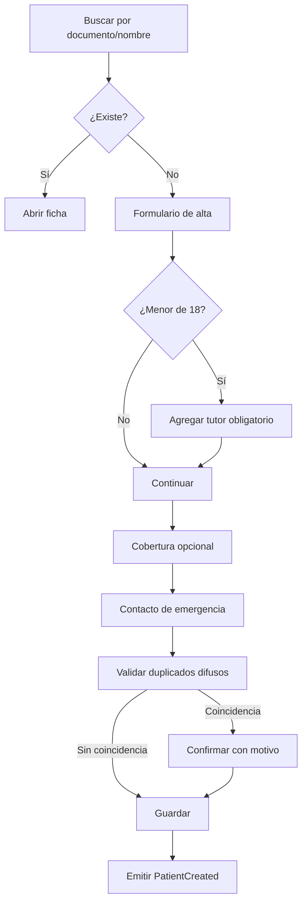

# MD-01 — Pacientes y expediente base

| Campo | Valor |
|---|---|
| Módulo | `patients` |
| Requisitos | RF-01, RF-02, RF-19, RN-08, RN-09, RN-16 |
| Casos de uso | UC-01, UC-02 |
| Dependencias | Auth, Files, Audit, Administration |

---

## 1. Responsabilidad

Gestionar la identidad del paciente, sus tutores, coberturas, antecedentes médicos y
alertas. Es la puerta de entrada al expediente clínico y el punto de referencia de todos los
demás módulos.

**No es responsabilidad de este módulo:** agenda, notas clínicas, presupuestos ni cobros.

---

## 2. Pantallas y componentes

| Pantalla | Contenido | Roles |
|---|---|---|
| Buscador global | Input con debounce, filtros, resultados con badge de alerta. | Todos |
| Ficha del paciente | Datos demográficos, contacto, coberturas, tutores, alertas, accesos rápidos. | Recepción, Odontología, Admin |
| Alta/edición | Formulario por pasos con validación inline. | Recepción, Admin |
| Anamnesis | Secciones colapsables, alertas, firma. | Odontología |
| Historial de cambios | Timeline de versiones y auditoría resumida. | Admin, Auditor |

**Cabecera persistente del expediente:** nombre, edad, documento, teléfono, sede, badge de
alerta crítica y botón de emergencia (contacto).

---

## 3. Flujos

### 3.1 Alta de paciente



### 3.2 Búsqueda

- Índice trigram sobre nombre completo + índice exacto sobre documento.
- Consulta mínima: 3 caracteres (documento: 1).
- Orden: coincidencia exacta de documento → prefijo de apellido → similitud.
- Se excluyen pacientes con `deleted_at` salvo que el usuario tenga `patients:read_deleted`.
- Cada resultado muestra badge si tiene alerta activa.
- La búsqueda se registra en auditoría solo cuando se abre el expediente (no cada tecla).

### 3.3 Anamnesis y alertas

1. Se carga la última versión firmada.
2. El profesional edita y agrega condiciones/alergias.
3. Al guardar, se crea una nueva versión (no se sobrescribe).
4. Las alergias críticas generan `patient_alert` con `severity = critical`.
5. La alerta se muestra en todas las pantallas del paciente y en prescripción.
6. Resolver una alerta exige rol clínico, motivo y queda auditado.

---

## 4. Reglas de dominio

| Regla | Implementación |
|---|---|
| Documento único por tipo/país | `UNIQUE (document_type, document_number)` + normalización. |
| Menor requiere tutor | Validación en caso de uso y constraint diferido. |
| Baja lógica | `deleted_at`; nunca `DELETE`. |
| Alerta crítica no ocultable | El frontend no permite desactivar el badge; el backend lo devuelve siempre. |
| Datos mínimos | Validación de campos obligatorios en DTO + dominio. |
| Normalización | Teléfono E.164, email minúsculas, nombres con *trim* y colapso de espacios. |
| Duplicados | Búsqueda difusa (documento, nombre+dob, teléfono) antes de crear. |

---

## 5. API (resumen)

| Método | Ruta | Permiso | Descripción |
|---|---|---|---|
| GET | `/api/v1/patients?q=` | `patients:read` | Búsqueda paginada. |
| POST | `/api/v1/patients` | `patients:create` | Alta. |
| GET | `/api/v1/patients/{id}` | `patients:read` | Ficha. |
| PATCH | `/api/v1/patients/{id}` | `patients:update` | Edición con `version`. |
| DELETE | `/api/v1/patients/{id}` | `patients:delete` | Baja lógica. |
| GET | `/api/v1/patients/{id}/history` | `patients:read` | Versiones de anamnesis. |
| POST | `/api/v1/patients/{id}/medical-history` | `clinical:write` | Nueva versión firmada. |
| POST | `/api/v1/patients/{id}/alerts/{alertId}/resolve` | `clinical:write` | Resolver alerta. |
| GET | `/api/v1/patients/{id}/timeline` | `patients:read` | Timeline clínico-administrativo. |

**Ejemplo de respuesta de búsqueda:**

```json
{
  "data": [
    {
      "id": "0192f...",
      "fullName": "María González",
      "document": "30123456",
      "age": 42,
      "phone": "+5491123456789",
      "lastVisitAt": "2026-10-12T14:30:00Z",
      "alerts": [{ "severity": "critical", "label": "Alergia a penicilina" }]
    }
  ],
  "page": { "nextCursor": null, "total": 1 }
}
```

---

## 6. Permisos

| Acción | Recepción | Odontólogo | Asistente | Auditor | Admin |
|---|---|---|---|---|---|
| Buscar/leer ficha | ✔ | ✔ | ✔ | ✔ (solo lectura) | ✔ |
| Crear/editar datos | ✔ | ✔ | ✖ | ✖ | ✔ |
| Ver alertas | ✔ | ✔ | ✔ | ✔ | ✔ |
| Editar anamnesis | ✖ | ✔ | ✖ | ✖ | ✖ |
| Resolver alerta | ✖ | ✔ | ✖ | ✖ | ✖ |
| Baja lógica | ✖ | ✖ | ✖ | ✖ | ✔ |

El administrador no puede leer el contenido clínico sin una justificación auditada
(`clinical:read` separado de `patients:read`).

---

## 7. Eventos

| Evento | Cuándo | Consumidores |
|---|---|---|
| `PatientCreated` | Alta exitosa. | Notifications (bienvenida), Reporting. |
| `PatientUpdated` | Cambio de datos. | Reporting, Audit. |
| `PatientMerged` | Fusión de duplicados. | Todos (actualiza referencias). |
| `CriticalAlertAdded` | Alergia/condición crítica. | Notifications (opcional), Reporting. |

---

## 8. Casos borde

| Caso | Comportamiento |
|---|---|
| Paciente sin documento (extranjero/indocumentado) | Tipo `OTHER` con número interno generado; se permite con autorización. |
| Gemelos con mismo nombre y fecha | Se diferencian por documento/tutor; la advertencia de duplicado no bloquea si se confirma. |
| Paciente que cumple 18 años | El tutor queda histórico; no se borra. |
| Fusión de duplicados | Se mueve el historial al paciente maestro, se marca el otro como `merged_into` y se audita. |
| Teléfono inválido | Se guarda normalizado si es posible; si no, error de validación. |
| Paciente fallecido | Estado `deceased`; bloquea nuevas citas, conserva historia. |

---

## 9. Métricas

- Tiempo medio de alta de paciente (< 2 min).
- Tasa de duplicados detectados/confirmados.
- Porcentaje de fichas con alertas completas.
- Búsquedas sin resultado (calidad de datos).

---

## 10. Pendientes

- Definir reglas exactas de documento por país (`Q-01`).
- Validar si se admite paciente sin documento y con qué autorización.
- Definir política de fusión de duplicados con el área legal.
