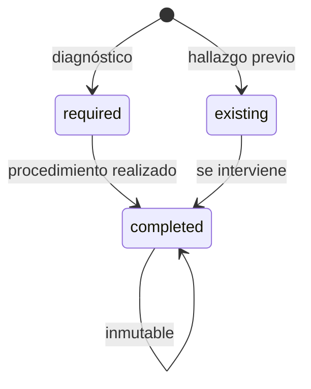
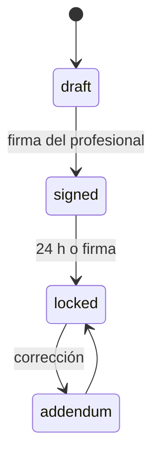
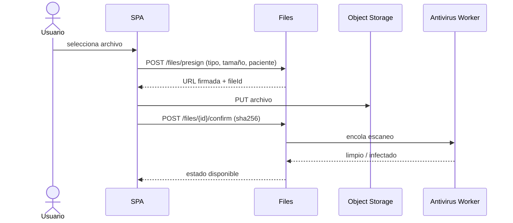

# MD-02 — Odontograma, periodontograma, SOEP y documentos

| Campo | Valor |
|---|---|
| Módulo | `clinical` |
| Requisitos | RF-03, RF-04, RF-05, RF-20, RN-01, RN-13 |
| Casos de uso | UC-03, UC-04 |
| Dependencias | Patients, Files, Audit |

---

## 1. Responsabilidad

Registrar el estado dental y periodontal del paciente, la evolución clínica y los documentos
de apoyo, con inmutabilidad y trazabilidad. Es el corazón clínico del sistema.

---

## 2. Modelo de odontograma

### 2.1 Piezas y notación

El sistema almacena siempre la **notación FDI canónica** y deriva la Universal para
presentación.

**Dentición permanente (32):** cuadrantes 1–4, piezas 1–8.

| Cuadrante FDI | Universal | Regla |
|---|---|---|
| 1 (superior derecho) | 1–8 | `universal = 9 - posición` (18→1, 11→8) |
| 2 (superior izquierdo) | 9–16 | `universal = 8 + posición` (21→9, 28→16) |
| 3 (inferior izquierdo) | 17–24 | `universal = 16 + posición` (31→17, 38→24) |
| 4 (inferior derecho) | 25–32 | `universal = 33 - posición` (41→32, 48→25) |

**Dentición decidua (20):** cuadrantes 5–8, piezas 1–5.

| Cuadrante FDI | Universal | Regla |
|---|---|---|
| 5 (superior derecho) | A–E | letra = `5 - posición` (55→A, 51→E) |
| 6 (superior izquierdo) | F–J | letra = `5 + posición` (61→F, 65→J) |
| 7 (inferior izquierdo) | K–O | letra = `10 + posición` (71→K, 75→O) |
| 8 (inferior derecho) | P–T | letra = `20 - posición` (81→P, 85→T) |

Al cambiar la notación solo cambia la etiqueta; los datos no se migran.

### 2.2 Superficies

Códigos internos: `M` mesial, `D` distal, `O` oclusal/incisal, `V` vestibular, `L`
lingual/palatino.

- En anteriores, `O` se rotula "Incisal".
- En posteriores, `L` se rotula "Palatino" en el maxilar y "Lingual" en la mandíbula.
- La UI muestra cinco regiones; el usuario puede seleccionar varias a la vez (multi-tap).
- Para condiciones de diente completo (implante, ausente, corona), se usa `surfaces = ['ALL']`.

### 2.3 Catálogo de condiciones

| Código | Etiqueta | Color base | Patrón / ícono | Superficie |
|---|---|---|---|---|
| `CARIES` | Caries | Rojo | Punto | Sí |
| `RESTORATION` | Restauración existente | Azul | Rayado | Sí |
| `ENDODONTICS_DONE` | Endodoncia realizada | Violeta | Círculo | No (raíz) |
| `ENDODONTICS_NEEDED` | Endodoncia requerida | Naranja | Círculo punteado | No |
| `IMPLANT` | Implante | Verde oscuro | Tornillo | No |
| `FIXED_PROSTHESIS` | Prótesis fija | Celeste | Corona | No |
| `REMOVABLE_PROSTHESIS` | Prótesis removible | Celeste claro | Puente | No |
| `EXTRACTION` | Exodoncia | Negro | X | No |
| `SEALANT` | Sellante | Amarillo | Punto | Sí |
| `CROWN` | Corona | Dorado | Anillo | No |
| `MISSING` | Ausente | Gris | X tenue | No |
| `IN_TREATMENT` | En tratamiento | Turquesa | Línea | Sí |

**Accesibilidad:** el color nunca es el único indicador; cada condición lleva patrón e ícono,
y el detalle textual está disponible en la ficha del diente (RNF-13).

### 2.4 Estados del hallazgo

- `existing`: condición ya presente al examen.
- `required`: diagnóstico que requiere tratamiento.
- `completed`: procedimiento realizado; **inmutable** (RN-01).

---

## 3. Interacción en tablet

| Gesto | Acción |
|---|---|
| Tap en diente | Abre panel de diente. |
| Tap en superficie | Selecciona/deselecciona superficie. |
| Doble tap | Vista detalle del diente con historial. |
| Pinch | Zoom del arco. |
| Arrastrar | Paneo con zoom activo. |
| Botón "Deshacer" | Revierte el último hallazgo no guardado. |

**Requisitos de UI:**

- Área táctil mínima 44×44 px por superficie.
- Zoom 100–300 % sin pérdida de calidad (SVG).
- Modo diestro/zurdo para el panel lateral.
- Confirmación visual y háptica (si el dispositivo lo soporta) al guardar.
- Guardado optimista con rollback y mensaje claro si falla.

**Rendimiento:** SVG generado una vez por arco; solo se re-renderiza el diente afectado.
Carga inicial < 1,5 s p95 (RNF-01).

---

## 4. Versionado y firma

1. Al abrir un examen, se crea un `odontogram` en `draft` (o se reutiliza el borrador del día).
2. Los hallazgos se agregan de a uno, con eventos.
3. El odontólogo revisa y firma: `status = signed`, se calcula `content_hash` y se bloquea.
4. Un examen firmado no se edita (RN-13). Para corregir:
   - **Adenda** sobre un hallazgo, o
   - **Nuevo examen** que referencia al anterior (`supersedes_id`).
5. Se puede comparar cualquier par de exámenes y resaltar diferencias.

---

## 5. Periodontograma

### 5.1 Sitios

Por diente: `DB` (disto-vestibular), `B` (vestibular), `MB` (mesio-vestibular), `DL`
(disto-lingual), `L` (lingual), `ML` (mesio-lingual).

### 5.2 Cálculos

- `CAL (NIC) = gingival_margin_mm + probing_depth_mm`.
- Profundidad de sondaje válida: 0–15 mm.
- Margen gingival: −5 a +10 mm (negativo = recesión).
- Movilidad Miller 0–III; furca I–III; sangrado/supuración booleanos.
- Se muestran promedios, sitios ≥ 4 mm y porcentaje de sangrado.

### 5.3 Visualización

- Gráfico de barras por diente/sitio con escala de color accesible.
- Tabla editable con navegación por teclado (tabulador entre sitios).
- Comparación con el estudio anterior: flechas de mejora/empeoramiento.
- Export PDF con leyenda y firma.

---

## 6. Notas SOEP

### 6.1 Estructura

| Campo | Obligatorio | Descripción |
|---|---|---|
| Subjetivo | Sí | Relato del paciente. |
| Objetivo | Sí | Hallazgos del examen. |
| Evaluación | Sí | Diagnóstico/impresión. |
| Plan | Sí | Conducta a seguir. |

Se permite texto enriquecido limitado (negrita, listas) y adjuntar referencias a dientes.

### 6.2 Bloqueo y adendas

- Job cada 15 min bloquea notas firmadas cuya ventana venció.
- Una adenda es una nueva nota (`type = addendum`, `supersedes_id`) firmada.
- No se permite `DELETE`; solo baja lógica con auditoría y motivo (y aun así permanece
  consultable por auditoría).

### 6.3 Firma

- Registra `author_id`, `signed_at`, `content_hash` (SHA-256 de la representación canónica),
  IP, user-agent y `correlation_id`.
- El hash se recalcula al verificar; si no coincide, se alerta.

---

## 7. Documentos y adjuntos

### 7.1 Flujo de carga

### 7.2 Reglas

- Límite por archivo configurable (50 MB por defecto); cuota por paciente.
- Tipos permitidos configurables; validación por *magic number*, no solo extensión.
- Antivirus obligatorio antes de habilitar descarga.
- Metadatos: categoría, fecha, profesional, diente/tratamiento, descripción.
- Versión nueva conserva la anterior; nunca se sobrescribe.
- Descarga con URL firmada de ≤ 5 min y auditoría del acceso.

---

## 8. API (resumen)

| Método | Ruta | Permiso |
|---|---|---|
| GET | `/api/v1/patients/{id}/odontograms` | `clinical:read` |
| POST | `/api/v1/patients/{id}/odontograms` | `clinical:write` |
| GET | `/api/v1/odontograms/{id}` | `clinical:read` |
| POST | `/api/v1/odontograms/{id}/findings` | `clinical:write` |
| POST | `/api/v1/odontograms/{id}/sign` | `clinical:sign` |
| GET | `/api/v1/odontograms/{id}/compare?with=` | `clinical:read` |
| POST | `/api/v1/patients/{id}/periodontal-exams` | `clinical:write` |
| POST | `/api/v1/periodontal-exams/{id}/sign` | `clinical:sign` |
| POST | `/api/v1/patients/{id}/notes` | `clinical:write` |
| POST | `/api/v1/notes/{id}/sign` | `clinical:sign` |
| POST | `/api/v1/notes/{id}/addendum` | `clinical:sign` |
| POST | `/api/v1/files/presign` | `files:write` |
| POST | `/api/v1/files/{id}/confirm` | `files:write` |
| GET | `/api/v1/files/{id}/download` | `files:read` |

---

## 9. Permisos

| Acción | Odontólogo | Asistente | Recepción | Auditor |
|---|---|---|---|---|
| Leer expediente clínico | ✔ | ✔ | ✖ | ✔ (con justificación) |
| Crear hallazgos | ✔ | ✔ (borrador) | ✖ | ✖ |
| Firmar odontograma/nota | ✔ | ✖ | ✖ | ✖ |
| Ver documentos | ✔ | ✔ | ✖ | ✔ |
| Subir documentos | ✔ | ✔ | ✖ | ✖ |

---

## 10. Casos borde

| Caso | Comportamiento |
|---|---|
| Diente extraído y luego implante | Se conserva el hallazgo de exodoncia y se agrega implante como nuevo hallazgo. |
| Corrección de un diente mal seleccionado | Adenda que anula el hallazgo anterior; ambos visibles. |
| Examen firmado por error | No se edita; se crea nuevo examen y se referencia. |
| Tablet sin conexión momentánea | Se guarda en cola local y se reintenta; no se pierde el borrador. |
| Archivo duplicado | Se detecta por hash y se advierte antes de subir. |
| Nota con caracteres especiales | Se normaliza y se conserva el original en el hash. |

---

## 11. Pruebas asociadas

`TP-05` (odontograma y notaciones), `TP-06` (inmutabilidad), `TP-07` (periodontograma),
`TP-08` (SOEP y bloqueo), `TP-24` (adjuntos), `TP-29` (accesibilidad/tablet).
