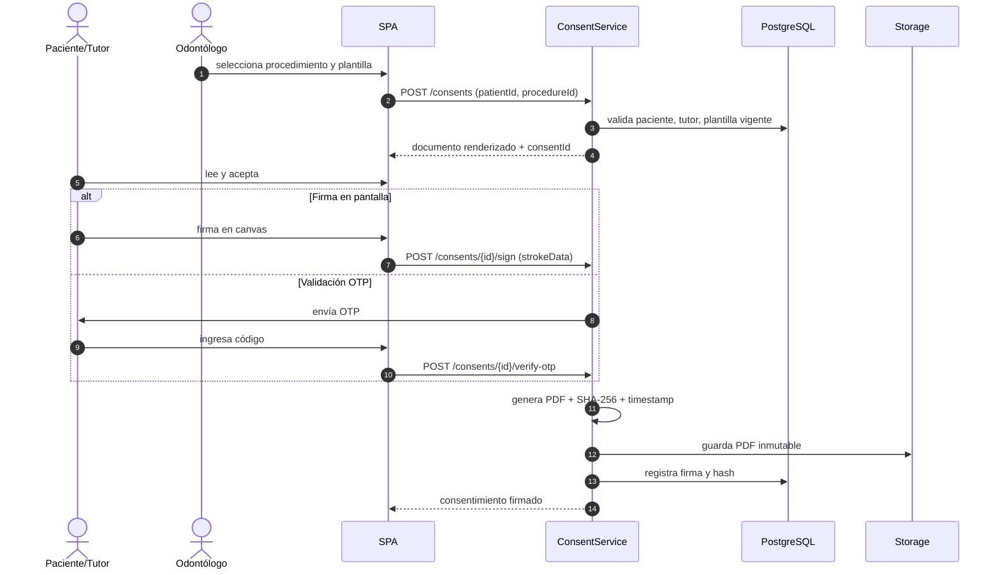

# MD-03 — Consentimientos informados y recetas

| Campo | Valor |
|---|---|
| Módulo | `documents` |
| Requisitos | RF-06, RF-21, RN-08, RN-12 |
| Casos de uso | UC-05, UC-18 |
| Dependencias | Patients, Files, Audit, Clinical |

---

## 1. Responsabilidad

Emitir documentos legales y clínicos —consentimientos y recetas— con firma, sellado,
almacenamiento inmutable y trazabilidad. Garantizar que no se realicen procedimientos
invasivos sin consentimiento vigente.

---

## 2. Consentimientos

### 2.1 Plantillas

| Campo | Descripción |
|---|---|
| `template_code` | Identificador estable (ej. `ENDO_01`). |
| `version` | Semver interno; los documentos emitidos conservan la versión usada. |
| `procedure_type` | Tipo de procedimiento al que aplica. |
| `body` | Texto legal con variables (`{{patient}}`, `{{procedure}}`, `{{risks}}`). |
| `approved_by` | Responsable legal de la clínica. |
| `effective_from` / `effective_to` | Vigencia. |
| `active` | Alta/baja. |

El texto es responsabilidad de la clínica (Q-09); el sistema no redacta cláusulas legales.

### 2.2 Flujo de firma

### 2.3 Reglas

| Regla | Detalle |
|---|---|
| Tutor | Paciente menor de 18 o incapaz: firma el tutor (RN-08). |
| Validez | Consentimiento vigente mientras no se revoque ni venza (configurable). |
| Procedimiento invasivo | Sin consentimiento vigente, el sistema bloquea el registro (RN-12), salvo urgencia con justificación. |
| Inmutabilidad | El PDF y el registro firmado no se modifican. |
| Revocación | Se registra motivo y fecha; el original permanece. |
| Copia | Se envía por email si el paciente lo autoriza. |
| Verificación | Hash + timestamp permiten verificar integridad. |

### 2.4 Contenido mínimo del PDF

- Identificación de la clínica y sede.
- Nombre y documento del paciente (y tutor si aplica).
- Procedimiento, riesgos, beneficios, alternativas.
- Profesional, matrícula y fecha/hora.
- Declaración de comprensión y aceptación.
- Firma (imagen del trazo o constancia de OTP).
- Identificador único y hash.
- Versión de la plantilla.

---

## 3. Recetas

### 3.1 Estructura

| Campo | Obligatorio |
|---|---|
| Paciente | Sí |
| Profesional y matrícula | Sí |
| Fecha | Sí |
| Medicamento (principio activo, presentación) | Sí |
| Dosis, vía, frecuencia, duración | Sí |
| Indicaciones | No |
| Firma | Sí |

### 3.2 Validaciones

1. **Alergias:** si el medicamento o su familia coincide con una alergia activa, se bloquea
   y se exige justificación firmada (RN-16).
2. **Interacciones:** lista configurable de pares; se advierte, no siempre bloquea.
3. **Dosis:** rangos máximos configurables por medicamento; advertencia si se excede.
4. **Embarazo/lactancia:** advertencia si hay condición registrada.
5. **Duplicado:** no se permite la misma receta dos veces en menos de 24 h sin confirmación.

### 3.3 Emisión y anulación

- Al firmar se genera un PDF con numeración, hash y sello de tiempo.
- Se registra el canal de entrega (impreso, email, WhatsApp) y su estado.
- La anulación requiere motivo y genera un documento de anulación; la receta original no se
  borra.
- El paciente puede solicitar una copia; se audita cada descarga.

---

## 4. Modelo de datos

| Tabla | Campos |
|---|---|
| `clinical.consent_template` | `id`, `code`, `version`, `procedure_type`, `body`, `approved_by`, `effective_from`, `effective_to`, `active` |
| `clinical.consent` | `id`, `patient_id`, `procedure_id`, `template_id`, `content_hash`, `signer_type`, `signed_by`, `method`, `signed_at`, `pdf_file_id`, `status`, `revoked_at`, `revocation_reason` |
| `clinical.prescription` | `id`, `patient_id`, `author_id`, `issued_at`, `status`, `pdf_file_id`, `delivery_channel`, `delivery_status` |
| `clinical.prescription_item` | `id`, `prescription_id`, `medication_id`, `dose`, `route`, `frequency`, `duration_days`, `instructions` |
| `clinical.medication` | `id`, `name`, `active_ingredient`, `presentation`, `concentration`, `allergy_family`, `max_dose`, `active` |

---

## 5. API (resumen)

| Método | Ruta | Permiso |
|---|---|---|
| GET | `/api/v1/consent-templates?procedureType=` | `clinical:read` |
| POST | `/api/v1/patients/{id}/consents` | `clinical:write` |
| POST | `/api/v1/consents/{id}/sign` | `clinical:sign` |
| POST | `/api/v1/consents/{id}/verify-otp` | `public` (token de un solo uso) |
| POST | `/api/v1/consents/{id}/revoke` | `clinical:write` |
| GET | `/api/v1/consents/{id}/pdf` | `clinical:read` |
| POST | `/api/v1/patients/{id}/prescriptions` | `clinical:write` |
| POST | `/api/v1/prescriptions/{id}/sign` | `clinical:sign` |
| POST | `/api/v1/prescriptions/{id}/void` | `clinical:sign` |
| GET | `/api/v1/medications?q=` | `clinical:read` |

---

## 6. Seguridad y privacidad

- El PDF se almacena cifrado; la descarga requiere URL firmada y permiso.
- El OTP se envía al teléfono/email registrado, con límite de intentos y vencimiento (5 min).
- El trazo de la firma se almacena como imagen vectorial; no se usa para biometría.
- Los documentos se excluyen de logs y de respuestas de error.
- La verificación pública de un documento se hace por `consentId` + hash, sin exponer datos
  clínicos.

---

## 7. Casos borde

| Caso | Comportamiento |
|---|---|
| Paciente se niega a firmar | Se registra negativa con motivo; no se puede realizar el procedimiento. |
| Firma ilegible | Se acepta el trazo; se adjunta documento escaneado si la clínica lo requiere. |
| OTP no llega | Reenvío con espera; alternativa de firma en pantalla. |
| Plantilla vencida | Se bloquea y se indica la versión vigente. |
| Procedimiento de urgencia | Se permite con justificación y auditoría; se completa el consentimiento después. |
| Medicamento sin catálogo | No se permite; el administrador debe agregarlo. |

---

## 8. Pruebas asociadas

`TP-09` (consentimiento y firma), `TP-25` (recetas y alergias), `TP-24` (almacenamiento de
PDFs), `TP-28` (seguridad de enlaces y OTP).
