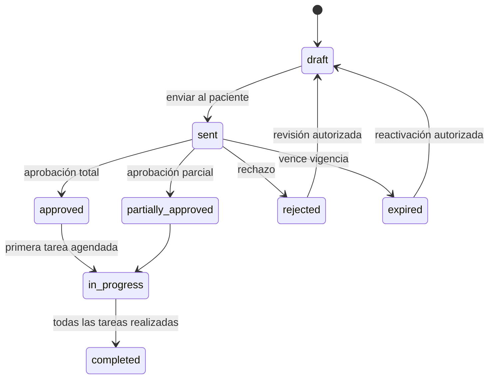
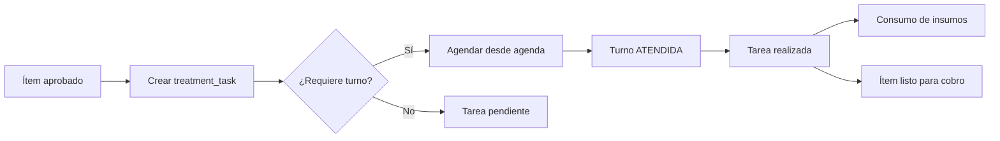

# MD-04 — Tratamientos y presupuestos

| Campo | Valor |
|---|---|
| Módulo | `treatments` |
| Requisitos | RF-07, RF-08, RN-05, RN-15 |
| Casos de uso | UC-06, UC-07 |
| Dependencias | Patients, Scheduling, Billing, Audit |

---

## 1. Responsabilidad

Convertir el diagnóstico en un plan de tratamiento económico: presupuestos por fases,
aprobación del paciente y generación de tareas agendables que alimentan la agenda y la
facturación.

---

## 2. Ciclo de vida del presupuesto



| Estado | Editable | Descripción |
|---|---|---|
| `draft` | Sí | En elaboración. |
| `sent` | No (genera versión) | Enviado al paciente. |
| `approved` | No | Aprobado totalmente. |
| `partially_approved` | No | Algunos ítems aprobados. |
| `rejected` | No | Rechazado con motivo. |
| `expired` | No | Venció la vigencia. |
| `in_progress` | No | Con tareas en ejecución. |
| `completed` | No | Todas las tareas realizadas. |

**Versionado:** cualquier cambio sobre `sent` o posterior crea una nueva versión
(`version + 1`) y conserva la anterior (RN-05). La aprobación se vincula a la versión
aprobada.

---

## 3. Cálculo económico

### 3.1 Fórmulas

```text
line_subtotal   = round(quantity × unit_price, 2)
line_discount   = round(line_subtotal × discount_rate, 2)
line_tax_base   = line_subtotal - line_discount
line_tax        = round(line_tax_base × tax_rate, 2)
line_total      = line_tax_base + line_tax

budget.subtotal = Σ line_subtotal
budget.discount = Σ line_discount
budget.tax      = Σ line_tax
budget.total    = budget.subtotal - budget.discount + budget.tax
```

- Redondeo **half-up** a 2 decimales por línea y por total; se documenta la política.
- El precio se copia del catálogo al crear el ítem (RN-15) y no cambia después.
- El costo de laboratorio se registra por ítem/fase y **no** se muestra al paciente por
  defecto.
- Los descuentos por encima del umbral requieren aprobación con usuario y motivo.

### 3.2 Fases y sesiones

- `phase`: agrupación clínica (ej. "Fase 1: urgencia", "Fase 2: rehabilitación").
- `session`: número de visita estimada dentro de la fase.
- El paciente puede aprobar por fase o por ítem.
- La agenda sugiere la duración según el procedimiento y la fase.

---

## 4. Aprobación

### 4.1 Reglas

1. Solo se aprueba un presupuesto `sent` y vigente.
2. El firmante es el paciente o su tutor (RN-08).
3. Se registra `scope` (`total` o `partial`), los ítems aprobados, método (canvas/OTP),
   hash y timestamp.
4. Los ítems no aprobados quedan `not_approved` y no generan tareas.
5. Un presupuesto rechazado requiere motivo.
6. La aprobación es inmutable; un cambio posterior genera nueva versión y nueva aprobación.

### 4.2 Generación de tareas



- Cada `budget_item` aprobado genera **una** tarea (idempotente).
- La tarea referencia presupuesto, ítem y paciente.
- Al marcar el turno como `ATENDIDA`, la tarea pasa a `completed` si el procedimiento se
  realizó.
- Una tarea puede reprogramarse sin perder el vínculo.

---

## 5. Pantallas

| Pantalla | Contenido |
|---|---|
| Editor de presupuesto | Tabla de ítems, fases, totales en vivo, selector de procedimiento y diente. |
| Vista de envío | Preview del PDF, validez, condiciones y botón de envío. |
| Aprobación | Checklist de ítems, firma, resumen de totales. |
| Seguimiento | Estado por ítem/fase, tareas, turnos vinculados. |
| Historial | Versiones y aprobaciones. |

**UX:** el odontólogo puede crear el presupuesto desde el odontograma (seleccionar hallazgo
`required` → agregar al presupuesto), lo que reduce la doble carga.

---

## 6. API (resumen)

| Método | Ruta | Permiso |
|---|---|---|
| GET | `/api/v1/patients/{id}/budgets` | `budgets:read` |
| POST | `/api/v1/patients/{id}/budgets` | `budgets:write` |
| GET | `/api/v1/budgets/{id}` | `budgets:read` |
| PATCH | `/api/v1/budgets/{id}` | `budgets:write` |
| POST | `/api/v1/budgets/{id}/send` | `budgets:write` |
| POST | `/api/v1/budgets/{id}/duplicate` | `budgets:write` |
| POST | `/api/v1/budgets/{id}/approve` | `budgets:approve` |
| POST | `/api/v1/budgets/{id}/reject` | `budgets:approve` |
| GET | `/api/v1/budgets/{id}/pdf` | `budgets:read` |
| GET | `/api/v1/patients/{id}/treatment-tasks` | `treatments:read` |
| PATCH | `/api/v1/treatment-tasks/{id}` | `treatments:write` |

---

## 7. Permisos

| Acción | Odontólogo | Recepción | Asistente | Admin | Auditor |
|---|---|---|---|---|---|
| Crear/editar presupuesto | ✔ | ✔ (sin diagnóstico) | ✖ | ✔ | ✖ |
| Aplicar descuento | ✔ hasta umbral | ✖ | ✖ | ✔ | ✖ |
| Enviar | ✔ | ✔ | ✖ | ✔ | ✖ |
| Registrar aprobación | ✔ | ✔ | ✖ | ✔ | ✖ |
| Ver costos de laboratorio | ✔ | ✖ | ✖ | ✔ | ✔ |
| Ver presupuesto del paciente | ✔ | ✔ | ✔ (lectura) | ✔ | ✔ |

---

## 8. Casos borde

| Caso | Comportamiento |
|---|---|
| Presupuesto sin ítems | No se puede enviar. |
| Ítem con precio 0 | Permitido solo con autorización (cortesía). |
| Aprobación parcial de un ítem por cantidad | Se aprueba la cantidad indicada; el resto queda pendiente. |
| Presupuesto vencido | Se bloquea el envío/aprobación; requiere reactivación. |
| Cambio de precio del catálogo | No afecta ítems existentes (RN-15). |
| Paciente aprueba y luego se arrepiente | Se registra revocación; no se borra la aprobación. |
| Ítem duplicado | Se advierte y se permite si es intencional (ej. ambos cuadrantes). |
| Descuento mayor al permitido | Requiere aprobación de un rol con `budgets:approve_discount`. |

---

## 9. Métricas

- Tasa de aprobación de presupuestos.
- Tiempo medio entre envío y aprobación.
- Ticket promedio y valor por fase.
- Porcentaje de ítems aprobados vs. propuestos.

---

## 10. Pruebas asociadas

`TP-10` (cálculos, versiones, descuentos), `TP-11` (aprobación parcial y tareas),
`TP-15` (vínculo con cobro).
