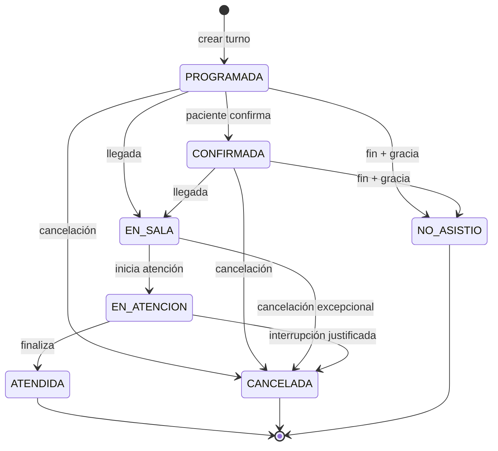
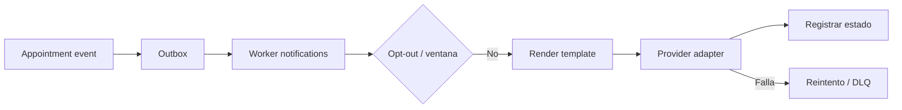

# MD-05 — Agenda y notificaciones

| Campo | Valor |
|---|---|
| Módulo | `scheduling` |
| Requisitos | RF-09, RF-10, RF-11, RN-03, RN-04, RN-14 |
| Casos de uso | UC-08, UC-09, UC-10 |
| Dependencias | Patients, Administration, Treatments, Notifications, Audit |

---

## 1. Responsabilidad

Gestionar la disponibilidad de sillones y profesionales, la reserva de turnos, su ciclo de
vida y las comunicaciones asociadas. Es el módulo de mayor concurrencia del sistema.

---

## 2. Conceptos

| Concepto | Descripción |
|---|---|
| **Sede** | Lugar físico con horario y zona horaria. |
| **Sillón** | Recurso físico único dentro de una sede. |
| **Profesional** | Odontólogo con matrícula y especialidad. |
| **Bloqueo** | Intervalo no disponible (vacaciones, reunión, mantenimiento). |
| **Turno** | Reserva de un intervalo para un paciente con un profesional en un sillón. |
| **Tarea de tratamiento** | Ítem aprobado que puede convertirse en turno. |

---

## 3. Disponibilidad

### 3.1 Cálculo

```text
disponible(sede, profesional, sillón, rango) =
    horario_de_sede(rango)
  ∩ horario_de_profesional(rango)
  − bloqueos(sede, profesional, sillón)
  − turnos_activos(sede, profesional, sillón)
```

- Granularidad mínima: 5 minutos (configurable).
- Duración sugerida: `procedure.duration_min`; editable por recepción.
- Zona horaria: se calcula en la zona de la sede y se persiste en UTC (RN-14).
- Feriados: catálogo por sede; si no está cargado, se advierte.

### 3.2 Consulta de slots

`GET /api/v1/availability?locationId=&professionalId=&chairId=&from=&to=&procedureId=`

Devuelve intervalos libres de al menos la duración pedida. La consulta usa índices por
`(location_id, starts_at)` y `(professional_id, starts_at)`; no se cachea.

---

## 4. Máquina de estados



| Transición | Rol habilitado | Efectos |
|---|---|---|
| `PROGRAMADA → CONFIRMADA` | Recepción, paciente (futuro) | `confirmed_at`, evento, recordatorios. |
| `→ EN_SALA` | Recepción | `checked_in_at`, aviso al profesional. |
| `→ EN_ATENCION` | Odontólogo | `started_at`, abre nota clínica. |
| `→ ATENDIDA` | Odontólogo | `finished_at`, tarea `completed`, descargo de insumos. |
| `→ CANCELADA` | Recepción/Admin | Motivo obligatorio, libera el slot, notifica. |
| `→ NO_ASISTIO` | Recepción/Sistema | Tras gracia configurable; registra. |

Toda transición se inserta en `appointment_status_history` (append-only) con usuario,
timestamp y motivo.

---

## 5. Validaciones de solapamiento

Se validan **dos dimensiones**:

1. **Sillón:** no puede haber dos turnos activos en el mismo sillón (RN-03).
2. **Profesional:** no puede estar en dos lugares a la vez (RN-04).

Implementación en dos capas:

- **Servicio:** consulta y error amigable con alternativas.
- **Base de datos:** `EXCLUDE USING gist` con `tstzrange` y estados activos; garantiza la
  invariante ante concurrencia.

Estados que ocupan agenda: `PROGRAMADA`, `CONFIRMADA`, `EN_SALA`, `EN_ATENCION`.
`ATENDIDA`, `CANCELADA` y `NO_ASISTIO` liberan el slot (aunque quedan para historial).

---

## 6. Reprogramación y cancelación

- Reprogramar = cancelar + crear, o mover el mismo turno si no cambió de estado.
- Se conserva el historial y se notifica al paciente.
- Política de cancelación configurable (ventana mínima, cargo). En v1 no se cobra
  automáticamente; se registra (`Q-12`).
- Cancelación masiva por bloqueo de sede: se listan turnos afectados y se notifica en lote.

---

## 7. Notificaciones

### 7.1 Eventos y plantillas

| Evento | Canal | Momento |
|---|---|---|
| `AppointmentBooked` | Email (E1); WhatsApp/SMS (E3) | Al crear. |
| `AppointmentConfirmed` | Igual | Al confirmar. |
| `AppointmentReminder48h` | Igual | 48 h antes. |
| `AppointmentReminder24h` | Igual | 24 h antes. |
| `AppointmentCancelled` | Igual | Al cancelar. |
| `AppointmentRescheduled` | Igual | Al mover. |
| `NoShowFollowUp` | Email | Tras no-show. |

### 7.2 Reglas

- **Minimización:** el mensaje incluye fecha, hora, sede y profesional; **no** diagnóstico ni
  procedimiento detallado.
- **Opt-out:** respetado por paciente y por canal.
- **Ventana horaria:** no se envían mensajes entre 21:00 y 08:00 (configurable).
- **Idempotencia:** `idempotency_key = hash(appointment_id, template, channel, scheduled_at)`.
- **Reintentos:** 3 con backoff (1 min, 5 min, 15 min); luego dead-letter y alerta.
- **Fallback:** si WhatsApp falla, se intenta email si está habilitado.
- **Estado:** `queued`, `sent`, `delivered`, `read`, `failed`, `skipped`.

### 7.3 Arquitectura



---

## 8. Pantallas

| Pantalla | Contenido |
|---|---|
| Calendario día | Columnas por sillón/profesional, tarjetas de turno, arrastrar y soltar. |
| Semana / mes | Vista resumida con indicadores de ocupación. |
| Detalle de turno | Paciente, procedimiento, estado, historial, acciones. |
| Lista de espera | Pacientes sin slot asignado (Could, E3). |
| Bloqueos | CRUD de bloqueos por sede/profesional/sillón. |
| Recordatorios | Estado de envíos y fallos. |

**Tablet:** vista día con scroll horizontal por sillón, tarjetas grandes, acciones por
long-press. **Escritorio:** vista semana con drag & drop.

---

## 9. API (resumen)

| Método | Ruta | Permiso |
|---|---|---|
| GET | `/api/v1/availability` | `scheduling:read` |
| GET | `/api/v1/appointments?from=&to=&locationId=` | `scheduling:read` |
| POST | `/api/v1/appointments` | `scheduling:write` |
| GET | `/api/v1/appointments/{id}` | `scheduling:read` |
| PATCH | `/api/v1/appointments/{id}` | `scheduling:write` |
| POST | `/api/v1/appointments/{id}/transition` | `scheduling:write` |
| POST | `/api/v1/appointments/{id}/cancel` | `scheduling:write` |
| POST | `/api/v1/appointments/{id}/reschedule` | `scheduling:write` |
| GET | `/api/v1/appointments/{id}/history` | `scheduling:read` |
| POST | `/api/v1/schedule-blocks` | `scheduling:write` |
| GET | `/api/v1/notifications?status=failed` | `notifications:read` |
| POST | `/api/v1/notifications/{id}/retry` | `notifications:write` |

---

## 10. Permisos

| Acción | Recepción | Odontólogo | Asistente | Admin |
|---|---|---|---|---|
| Ver agenda | ✔ | ✔ (propias sedes) | ✔ | ✔ |
| Crear/reprogramar | ✔ | ✔ | ✖ | ✔ |
| Cambiar estado clínico | ✖ | ✔ (`EN_ATENCION`/`ATENDIDA`) | ✖ | ✔ |
| Cancelar | ✔ | ✔ | ✖ | ✔ |
| Configurar bloqueos | ✔ | ✔ (propios) | ✖ | ✔ |
| Reenviar notificación | ✔ | ✖ | ✖ | ✔ |

---

## 11. Casos borde

| Caso | Comportamiento |
|---|---|
| Dos recepcionistas reservan el mismo slot a la vez | La restricción de BD rechaza una; se muestra error y alternativas. |
| Turno que cruza medianoche | Se valida contra el horario de la sede; se advierte. |
| Cambio de horario de verano | Se recalcula en la zona de la sede; pruebas específicas (RN-14). |
| Profesional atiende en dos sedes el mismo día | Se valida traslado mínimo configurable (opcional). |
| Paciente con alerta crítica | Se muestra badge al abrir el turno. |
| Turno sin procedimiento | Permitido; duración manual. |
| Bloqueo que se superpone a turnos | Se listan y se requiere resolución antes de guardar. |
| Proveedor de mensajería caído | Reintentos + fallback + alerta en panel. |

---

## 12. Pruebas asociadas

`TP-12` (solapamientos y concurrencia), `TP-13` (máquina de estados), `TP-14`
(recordatorios, idempotencia y fallback), `TP-29` (vista tablet).
