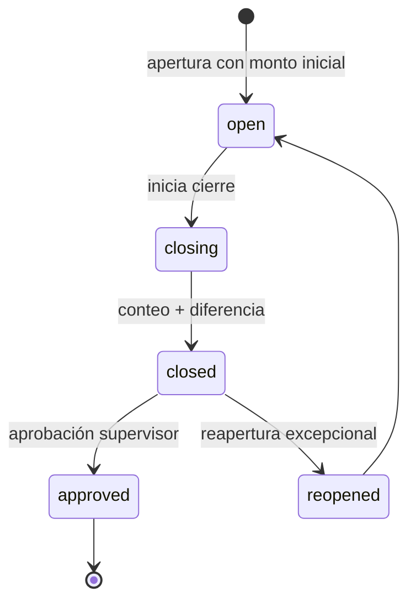
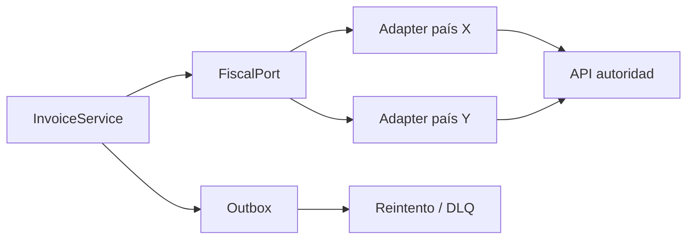

# MD-06 — Finanzas, caja y facturación

| Campo | Valor |
|---|---|
| Módulo | `billing` |
| Requisitos | RF-12, RF-13, RF-17, RN-02, RN-07, RN-10, RN-11 |
| Casos de uso | UC-11, UC-12 |
| Dependencias | Treatments, Patients, Administration, Audit |

---

## 1. Responsabilidad

Registrar cobros, emitir comprobantes, controlar la caja diaria por sede y liquidar
honorarios. Es el módulo con mayor sensibilidad financiera y de control interno.

---

## 2. Caja

### 2.1 Ciclo de vida



| Estado | Quién | Reglas |
|---|---|---|
| `open` | Cajero | Se pueden cobrar y registrar movimientos. |
| `closing` | Cajero | Se ingresó el conteo; aún no aprobado. |
| `closed` | Cajero | Cerrada, pendiente de aprobación. |
| `approved` | Supervisor | Cierre definitivo. |
| `reopened` | Supervisor | Excepcional, con motivo y auditoría. |

**Cierre ciego (RN-02):** el endpoint de totales teóricos devuelve `403` mientras la sesión
esté en `open` y no se haya registrado el conteo físico. La UI nunca muestra el esperado
antes del conteo.

### 2.2 Movimientos

| Tipo | Efecto |
|---|---|
| `sale` | Ingreso por cobro. |
| `withdrawal` | Retiro a tesorería. |
| `expense` | Gasto menor con comprobante. |
| `adjustment` | Corrección con motivo y autorización. |
| `opening` | Monto inicial (solo apertura). |

El total teórico = apertura + ingresos − egresos − retiros ± ajustes.

---

## 3. Cobros y pagos

### 3.1 Reglas

1. No se cobra sin caja abierta en la sede.
2. La suma de pagos no puede superar el total (RN-07).
3. Se admiten pagos mixtos (efectivo, tarjeta, transferencia, seguro, crédito).
4. Un pago puede quedar `pending` si la pasarela aún no confirma; se concilia por webhook.
5. Cada pago tiene `idempotency_key` para evitar duplicados por reintentos.
6. El saldo pendiente se calcula sobre ítems aprobados y se muestra en la ficha.
7. Los pagos con tarjeta se registran con `reference`/`authorization_code`; no se almacenan
   datos de tarjeta (PCI se delega en la pasarela).

### 3.2 Comprobantes

- **Interno (E1):** numeración correlativa por sede y serie, PDF con logo y detalle.
- **Fiscal (E3):** adaptador a la autoridad tributaria; devuelve `fiscal_uuid`, estado y PDF
  autorizado.
- **Inmutabilidad:** un comprobante emitido no se edita; se anula con nota de crédito
  (RN-10).
- **Reimpresión:** permitida y auditada.
- **Envío:** email/WhatsApp con enlace firmado.

---

## 4. Integración fiscal (puerto/adaptador)



| Aspecto | Decisión |
|---|---|
| Contrato | `issue(invoice)`, `void(invoice, reason)`, `status(fiscalId)` |
| Errores | Reintento con backoff; estado `pending_fiscal` visible. |
| Idempotencia | Clave por `invoice_id` + intento. |
| Datos | Se envían solo los campos requeridos por la autoridad. |
| Caída | El cobro interno no se bloquea; se emite en diferido. |

El detalle del país queda pendiente de `Q-01` y `Q-02`.

---

## 5. Comisiones

### 5.1 Reglas configurables

| Campo | Opciones |
|---|---|
| `type` | `percentage`, `fixed`, `net_percentage` |
| `base` | `billed` (facturado) o `collected` (cobrado) — por defecto `collected` |
| `value` | Porcentaje o monto |
| `procedure_id` | Opcional; si es null, aplica a todos |
| `deductions` | Laboratorio/materiales, solo en `net_percentage` |

### 5.2 Cálculo

```text
base = pago cobrado (o ítem facturado, según configuración)
deducción = costo_laboratorio + materiales (si aplica)
comisión = (base − deducción) × porcentaje   |   monto fijo
```

- Se calcula por pago/ítem y se guarda en `commission_item` (snapshot).
- La liquidación agrupa por profesional y período.
- Estados: `draft`, `closed`, `paid`.
- Una liquidación `closed` no se edita; los ajustes se hacen con nota de ajuste auditada.
- Se concilia contra caja y facturación antes de cerrar.

---

## 6. Pantallas

| Pantalla | Contenido |
|---|---|
| POS | Búsqueda de paciente, ítems, totales, medios de pago, botón cobrar. |
| Caja | Apertura, movimientos, cierre ciego, diferencias. |
| Comprobantes | Listado, reimpresión, envío, anulación. |
| Comisiones | Reglas, liquidaciones, detalle. |
| Conciliación | Pagos pendientes, diferencias, notas de crédito. |

---

## 7. API (resumen)

| Método | Ruta | Permiso |
|---|---|---|
| POST | `/api/v1/cash-sessions` | `cash:open` |
| GET | `/api/v1/cash-sessions/current?locationId=` | `cash:read` |
| POST | `/api/v1/cash-sessions/{id}/movements` | `cash:write` |
| POST | `/api/v1/cash-sessions/{id}/close` | `cash:close` |
| POST | `/api/v1/cash-sessions/{id}/approve` | `cash:approve` |
| POST | `/api/v1/cash-sessions/{id}/reopen` | `cash:reopen` |
| POST | `/api/v1/invoices` | `billing:write` |
| GET | `/api/v1/invoices/{id}` | `billing:read` |
| POST | `/api/v1/invoices/{id}/payments` | `billing:pay` |
| POST | `/api/v1/invoices/{id}/credit-note` | `billing:void` |
| POST | `/api/v1/payments/{id}/refund` | `billing:refund` |
| GET | `/api/v1/commissions/rules` | `commissions:read` |
| POST | `/api/v1/commissions/settlements` | `commissions:write` |
| POST | `/api/v1/commissions/settlements/{id}/close` | `commissions:approve` |

---

## 8. Permisos

| Acción | Cajero | Supervisor | Admin | Auditor |
|---|---|---|---|---|
| Abrir caja | ✔ | ✔ | ✔ | ✖ |
| Cobrar | ✔ | ✔ | ✔ | ✖ |
| Ver total teórico antes del conteo | ✖ | ✖ | ✖ | ✖ |
| Cerrar caja | ✔ | ✔ | ✔ | ✖ |
| Aprobar cierre | ✖ | ✔ | ✔ | ✖ |
| Reabrir caja | ✖ | ✔ | ✔ | ✖ |
| Anular comprobante | ✖ | ✔ | ✔ | ✖ |
| Ver comisiones | ✖ | ✔ | ✔ | ✔ |
| Cerrar liquidación | ✖ | ✔ | ✔ | ✖ |

> Ni siquiera el administrador ve el total teórico antes del conteo: la restricción es del
> dominio, no de la UI.

---

## 9. Casos borde

| Caso | Comportamiento |
|---|---|
| Pago duplicado por reintento | Idempotencia por clave; se devuelve el pago existente. |
| Pasarela confirma después del cierre | Se registra como movimiento del día siguiente y se alerta. |
| Diferencia de caja | Se exige observación y aprobación del supervisor. |
| Devolución parcial | Se emite nota de crédito por el monto; el pago original se conserva. |
| Cobro en otra moneda | Solo si está habilitado; se guarda tipo de cambio y moneda. |
| Redondeo | Política half-up documentada; diferencia máxima 0,01 por línea. |
| Factura rechazada por la autoridad | Estado `rejected`, se corrige y reemite; el intento queda auditado. |
| Caja abierta por error | Se cierra con conteo 0 y observación, o se reabre con autorización. |

---

## 10. Controles internos

- Separación de funciones: quien cobra no aprueba el cierre.
- Auditoría de cada anulación, ajuste y reapertura.
- Conciliación diaria automática entre pagos, facturas y movimientos de caja.
- Reporte de diferencias por cajero y sede.
- Alertas por patrones anómalos (anulaciones frecuentes, ajustes reiterados).

---

## 11. Pruebas asociadas

`TP-15` (pagos mixtos, saldo, inmutabilidad), `TP-16` (cierre ciego y diferencias),
`TP-17` (comisiones), `TP-23` (reportes financieros).
