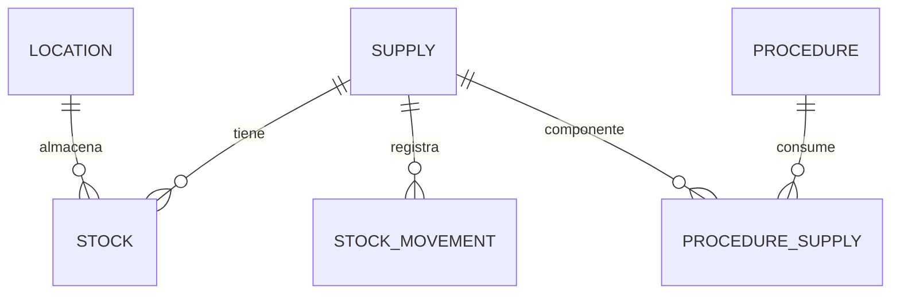
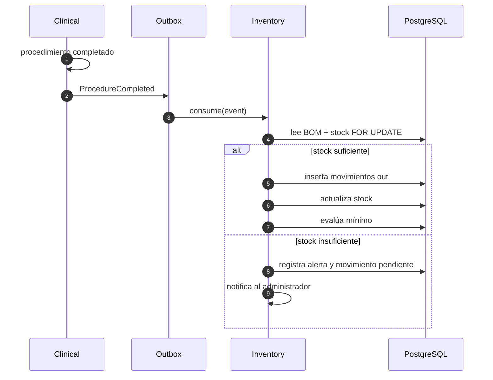

# MD-07 — Inventario

| Campo | Valor |
|---|---|
| Módulo | `inventory` |
| Requisitos | RF-14, RN-06 |
| Casos de uso | UC-13 |
| Dependencias | Clinical, Administration, Audit |

---

## 1. Responsabilidad

Controlar existencias de insumos por sede, registrar movimientos y descontar
automáticamente el consumo al completar procedimientos, con trazabilidad por lote y
vencimiento.

---

## 2. Modelo

| Entidad | Campos clave |
|---|---|
| `supply` | `code`, `name`, `unit`, `min_stock`, `reference_cost`, `active` |
| `stock` | `location_id`, `supply_id`, `quantity`, `updated_at` (PK compuesta) |
| `stock_movement` | `type`, `quantity`, `unit_cost`, `lot`, `expires_at`, `reference_type`, `reference_id`, `reason`, `created_by` |
| `procedure_supply` | `procedure_id`, `supply_id`, `quantity` (BOM) |

**Tipos de movimiento:** `in` (compra/entrada), `out` (consumo), `adjustment` (ajuste),
`transfer_out` / `transfer_in` (traslado entre sedes), `return` (devolución).

---

## 3. Descargo automático

### 3.1 Flujo

### 3.2 Reglas

1. El descargo es **idempotente** por `(procedure_completion_id, supply_id)`.
2. Se descuenta en la sede del turno, no en la sede del usuario.
3. Si falta stock, **no se revierte** la atención clínica: se registra la alerta y se
   regulariza con ajuste autorizado (decisión de negocio).
4. El stock nunca queda negativo (`CHECK quantity >= 0`).
5. Los ajustes requieren motivo y permiso; quedan auditados.
6. Los consumos usan el costo vigente al momento del movimiento (costo promedio ponderado o
   último costo, configurable).

---

## 4. Lotes y vencimientos

- Cada entrada puede registrar `lot` y `expires_at`.
- El consumo sigue FIFO por vencimiento (FEFO: first expired, first out).
- Alertas configurables a 30/60/90 días del vencimiento.
- Los insumos vencidos se bloquean para consumo y se marcan para descarte.
- El reporte de vencimientos se envía al administrador.

---

## 5. Transferencias entre sedes

1. Se solicita el traslado con insumo, cantidad, origen y destino.
2. Se descuenta del origen (`transfer_out`) y se registra en tránsito.
3. Al recepcionar, se suma en destino (`transfer_in`).
4. Si no se recepciona en X días, se alerta.
5. Ambas operaciones quedan vinculadas por `transfer_id`.

---

## 6. Pantallas

| Pantalla | Contenido |
|---|---|
| Catálogo de insumos | CRUD, unidad, mínimo, costo. |
| Stock por sede | Tabla con semáforo (ok/bajo/sin stock). |
| Movimientos | Filtros por tipo, insumo, fecha, usuario. |
| BOM por procedimiento | Edición de consumo estándar. |
| Transferencias | Origen, destino, estado. |
| Vencimientos | Próximos a vencer y vencidos. |

---

## 7. API (resumen)

| Método | Ruta | Permiso |
|---|---|---|
| GET | `/api/v1/supplies?q=` | `inventory:read` |
| POST | `/api/v1/supplies` | `inventory:write` |
| GET | `/api/v1/inventory/stock?locationId=` | `inventory:read` |
| POST | `/api/v1/inventory/movements` | `inventory:write` |
| POST | `/api/v1/inventory/adjustments` | `inventory:adjust` |
| POST | `/api/v1/inventory/transfers` | `inventory:write` |
| POST | `/api/v1/inventory/transfers/{id}/receive` | `inventory:write` |
| GET | `/api/v1/procedures/{id}/supplies` | `inventory:read` |
| PUT | `/api/v1/procedures/{id}/supplies` | `inventory:write` |
| GET | `/api/v1/inventory/expiring?days=90` | `inventory:read` |

---

## 8. Permisos

| Acción | Asistente | Odontólogo | Admin | Auditor |
|---|---|---|---|---|
| Ver stock | ✔ | ✔ | ✔ | ✔ |
| Registrar consumo | ✔ | ✔ | ✔ | ✖ |
| Ajustar stock | ✖ | ✖ | ✔ | ✖ |
| Editar catálogo/BOM | ✖ | ✖ | ✔ | ✖ |
| Transferir | ✖ | ✖ | ✔ | ✖ |
| Ver reporte de consumo | ✖ | ✔ (propio) | ✔ | ✔ |

---

## 9. Casos borde

| Caso | Comportamiento |
|---|---|
| Procedimiento sin BOM | No descuenta; notifica al administrador. |
| Mismo procedimiento dos veces en el día | Descarga dos veces (idempotencia por completion, no por procedimiento). |
| Devolución de insumo no usado | Movimiento `return` con motivo. |
| Ajuste por inventario físico | Movimiento `adjustment` con diferencia y autorización. |
| Insumo compartido entre sedes | Stock separado; transferencia explícita. |
| Vencimiento durante el tratamiento | Se bloquea el consumo y se alerta. |

---

## 10. Métricas

- Consumo por procedimiento vs. BOM (desvío).
- Insumos bajo mínimo.
- Pérdidas por vencimiento.
- Exactitud de inventario (conteo físico vs. sistema).

---

## 11. Pruebas asociadas

`TP-18` (descargo, stock negativo, idempotencia), `TP-23` (reporte de consumo).
