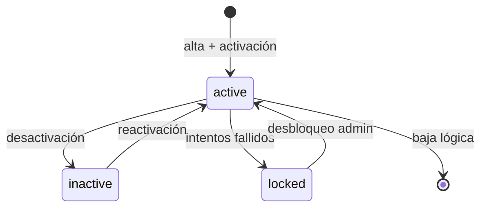

# MD-08 — Administración, usuarios y multi-sede

| Campo | Valor |
|---|---|
| Módulo | `administration` + `identity` |
| Requisitos | RF-15, RF-16, RF-26, RNF-06 |
| Casos de uso | UC-14 |
| Dependencias | Audit, todas (provee contexto) |

---

## 1. Responsabilidad

Administrar identidades, roles, permisos, sedes, sillones, catálogos y parámetros. Es el
módulo que define **quién puede hacer qué y dónde**.

---

## 2. Usuarios

### 2.1 Ciclo de vida

- El alta envía invitación por email con enlace de un solo uso (24 h).
- La contraseña se define en el primer acceso; nunca se envía por email.
- Cambiar rol, sede o estado invalida las sesiones activas.
- No se puede desactivar al último administrador activo.

### 2.2 Datos

`email`, `full_name`, `status`, `mfa_enabled`, `roles[]`, `locations[]`, `professional`
(opcional), `last_login_at`, `failed_attempts`, `locked_until`.

---

## 3. Roles y permisos

### 3.1 Roles base

| Rol | Código | Descripción |
|---|---|---|
| Administrador TI | `ADMIN` | Configuración, usuarios, catálogos, auditoría. |
| Recepcionista / Cajero | `RECEPTION` | Pacientes, agenda, caja. |
| Odontólogo | `DENTIST` | Expediente clínico, presupuestos, firma. |
| Asistente dental | `ASSISTANT` | Apoyo clínico, signos vitales, insumos. |
| Auditor / Contador | `AUDITOR` | Lectura, reportes, conciliación. |

### 3.2 Permisos

Formato `recurso:acción`. Ejemplos: `patients:read`, `clinical:write`, `clinical:sign`,
`budgets:approve`, `cash:close`, `inventory:adjust`, `audit:read`, `reports:export`.

- Los permisos se agrupan por módulo para la UI.
- Se puede crear un rol personalizado (E3) combinando permisos.
- Los permisos sensibles requieren MFA reciente (`auth_time` < 10 min):
  `billing:void`, `cash:reopen`, `audit:export`, `users:write`.

La matriz completa está en
[`SEGURIDAD.md §4`](../06-seguridad/SEGURIDAD.md).

---

## 4. Sedes y sillones

| Entidad | Reglas |
|---|---|
| `location` | Código único, zona horaria IANA, horario, datos fiscales, estado. |
| `chair` | Nombre único por sede; no se elimina si tiene turnos históricos (baja lógica). |
| `user_location` | Un usuario puede tener N sedes; la sede activa se elige al iniciar. |
| `schedule_block` | Bloqueos por sede, profesional o sillón. |

**Scoping:** el `TenantContext` se arma con las sedes del usuario. El backend rechaza
cualquier operación sobre una sede no asignada. Los roles `ADMIN` y `AUDITOR` pueden tener
acceso consolidado (solo lectura agregada).

---

## 5. Catálogos

| Catálogo | Campos | Vigencia |
|---|---|---|
| Procedimientos | código, nombre, categoría, duración, impuesto, activo | Sí (precio por sede) |
| Precios | procedimiento, sede, precio, desde/hasta | Sí |
| Insumos | código, nombre, unidad, mínimo, costo | No |
| Medicamentos | nombre, principio activo, presentación, familia de alergia, dosis máx. | No |
| Coberturas | nombre, tipo, reglas | No |
| Motivos de cancelación | código, descripción, aplica a | No |
| Tipos de documento | código, país, validación | No |
| Plantillas | consentimiento, nota, receta | Sí (versión) |
| Feriados | fecha, sede | No |
| Monedas/impuestos | código, tasa, vigencia | Sí |

Reglas:

1. Un ítem en uso **no se elimina**: se desactiva.
2. Los cambios de precio no alteran documentos históricos (RN-15).
3. La importación CSV valida referencias y muestra errores por fila.
4. Los catálogos se cachean 10 min en Redis y se invalidan al escribir.

---

## 6. Parámetros del sistema

| Clave | Ejemplo | Ámbito |
|---|---|---|
| `clinic.name`, `clinic.tax_id`, `clinic.logo` | Datos de la clínica | Global |
| `timezone` | `America/Argentina/Buenos_Aires` | Global |
| `currency` | `ARS` | Global |
| `tax.default_rate` | `21` | Global |
| `clinical.note_lock_hours` | `24` | Global |
| `budget.validity_days` | `30` | Global |
| `budget.max_discount_without_approval` | `10` | Global |
| `appointment.no_show_grace_min` | `30` | Global/sede |
| `reminder.window_hours` | `08:00–21:00` | Global |
| `inventory.expiry_alert_days` | `60` | Global |
| `files.max_size_mb` | `50` | Global |
| `session.idle_minutes` | `15` | Global |

Los parámetros son tipados y validados; un valor inválido no se guarda. Los cambios se
auditan.

---

## 7. API (resumen)

| Método | Ruta | Permiso |
|---|---|---|
| GET/POST | `/api/v1/users` | `users:read` / `users:write` |
| PATCH | `/api/v1/users/{id}` | `users:write` |
| POST | `/api/v1/users/{id}/reset-password` | `users:write` |
| POST | `/api/v1/users/{id}/unlock` | `users:write` |
| GET/POST | `/api/v1/roles` | `roles:read` / `roles:write` |
| GET | `/api/v1/permissions` | `roles:read` |
| GET/POST | `/api/v1/locations` | `locations:read` / `locations:write` |
| GET/POST | `/api/v1/locations/{id}/chairs` | `locations:read` / `locations:write` |
| GET/PUT | `/api/v1/settings` | `settings:read` / `settings:write` |
| GET/POST | `/api/v1/catalogs/{type}` | `<type>:read` / `<type>:write` |
| POST | `/api/v1/catalogs/{type}/import` | `<type>:write` |

---

## 8. Casos borde

| Caso | Comportamiento |
|---|---|
| Usuario sin sede asignada | No puede operar; mensaje claro. |
| Cambio de sede activa | Se valida contra `user_location`; se refresca el contexto. |
| Rol eliminado con usuarios | No se elimina; se desactiva o se reasigna. |
| Precio solapado en vigencias | Se rechaza; las vigencias no se superponen por procedimiento/sede. |
| Catálogo importado con errores | Se importan las filas válidas solo si el modo es parcial; por defecto es todo o nada. |
| Desactivar un sillón con turnos futuros | Se bloquea hasta reprogramarlos. |
| Cambio de zona horaria de una sede | Se advierte y se audita; los turnos existentes conservan su UTC. |

---

## 9. Pruebas asociadas

`TP-19` (RBAC, MFA, sesión), `TP-20` (catálogos y vigencias), `TP-21` (multi-sede y
scoping), `TP-28` (seguridad de identidad).
