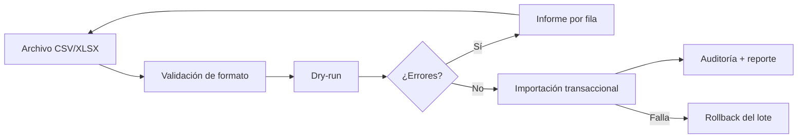

# MD-09 — Gobierno, reportes y migración

| Campo | Valor |
|---|---|
| Módulo | `audit` + `reporting` + `migration` |
| Requisitos | RF-18, RF-22, RF-23, RF-25, RNF-07, RNF-17 |
| Casos de uso | UC-15, UC-16, UC-17 |
| Dependencias | Todos (solo lectura), Audit |

---

## 1. Responsabilidad

Proveer evidencia, información de gestión y el mecanismo controlado de carga inicial de
datos. No modifica el dominio clínico ni financiero.

---

## 2. Auditoría

### 2.1 Qué se registra

| Categoría | Ejemplos |
|---|---|
| Autenticación | login, logout, MFA, fallo, bloqueo, cambio de contraseña. |
| Acceso a datos | apertura de expediente, descarga de documento, exportación. |
| Mutaciones | alta/edición/baja de paciente, nota, presupuesto, pago, stock. |
| Seguridad | acceso denegado, cambio de rol, reapertura de caja, anulación. |
| Administración | cambios de catálogo, parámetros, sedes. |

**No se registra:** contenido clínico completo en el log (solo referencia y diff mínimo),
contraseñas, tokens, datos de tarjeta.

### 2.2 Estructura del evento

```json
{
  "id": "0192fa...",
  "occurredAt": "2026-10-29T14:32:11.482Z",
  "actorId": "0192f0...",
  "actorRole": "DENTIST",
  "locationId": "0192e1...",
  "action": "update",
  "entity": "clinical_note",
  "entityId": "0192fb...",
  "before": { "status": "draft" },
  "after": { "status": "signed" },
  "ip": "10.0.0.12",
  "userAgent": "Mozilla/5.0 ...",
  "correlationId": "01J9Z8K3...",
  "prevHash": "9f2c...",
  "hash": "ab41..."
}
```

### 2.3 Integridad

- `hash = SHA-256(canonical(event) + prevHash)`.
- Job diario calcula el hash ancla del día y lo publica en un archivo firmado.
- Verificación mensual: recalcula la cadena y alerta si hay discontinuidad.
- El log es append-only; la aplicación no tiene `UPDATE`/`DELETE`.

### 2.4 Consulta

- Filtros: fecha, actor, entidad, acción, sede, `correlation_id`.
- Paginación por cursor; límite de rango (90 días por consulta, ampliable con export).
- Export CSV con marca de agua y auditoría de la exportación.
- Solo `AUDITOR` y `ADMIN` con MFA reciente.

---

## 3. Reportes

| Reporte | Contenido | Roles |
|---|---|---|
| Producción | Procedimientos realizados por profesional/período. | Dirección, Auditor |
| Ocupación | Porcentaje de sillones ocupados por sede. | Dirección |
| No-show | Turnos no asistidos y tasa. | Recepción, Dirección |
| Ingresos | Por período, sede, medio de pago. | Dirección, Auditor |
| Deudas | Saldos pendientes por paciente. | Recepción, Auditor |
| Caja | Aperturas, cierres, diferencias. | Auditor, Supervisor |
| Comisiones | Liquidaciones por profesional. | Auditor, Dirección |
| Inventario | Consumo, stock, vencimientos. | Admin, Auditor |
| Auditoría | Eventos filtrados. | Auditor |
| Calidad de datos | Duplicados, campos faltantes, inconsistencias. | Admin |

**Reglas:**

1. Todo reporte respeta permisos y sede activa.
2. Los importes usan la moneda configurada y redondeo consistente.
3. Exportación CSV/PDF; los grandes se generan en background y se notifican.
4. Los reportes no permiten inferir datos de pacientes fuera del alcance del usuario.
5. Se cachean solo agregados no sensibles, con TTL corto.

---

## 4. Tablero operativo

| Rol | Indicadores |
|---|---|
| Recepción | Turnos de hoy, en sala, por confirmar, no-show, caja abierta. |
| Odontólogo | Agenda propia, tareas pendientes, alertas de pacientes. |
| Dirección | Ingresos del día, ocupación, presupuesto aprobado, comparativo semanal. |
| Auditor | Diferencias de caja, anulaciones, accesos denegados. |

Refresco máximo cada 5 minutos; sin datos clínicos innecesarios.

---

## 5. Migración de datos

### 5.1 Pipeline



### 5.2 Reglas

1. Plantillas versionadas y documentadas por entidad.
2. `dry-run` obligatorio antes de la importación real.
3. Idempotencia por clave natural (documento, código).
4. Transacción por lote; rollback completo si falla.
5. Los errores se informan por fila y columna, sin abortar el análisis.
6. Los datos se importan primero en staging y se validan con la clínica.
7. Se registra `import_batch` con usuario, archivo, totales y resultado.
8. Los datos sensibles del archivo se eliminan después de la importación.

### 5.3 Orden de carga

1. Sedes y sillones.
2. Usuarios y profesionales.
3. Catálogos (procedimientos, precios, insumos, medicamentos).
4. Pacientes, tutores y coberturas.
5. Saldos iniciales y deudas.
6. Historial clínico (solo si el formato lo permite; si no, se archiva como documento).

---

## 6. API (resumen)

| Método | Ruta | Permiso |
|---|---|---|
| GET | `/api/v1/audit-events` | `audit:read` |
| GET | `/api/v1/audit-events/{id}` | `audit:read` |
| POST | `/api/v1/audit-events/export` | `audit:export` |
| GET | `/api/v1/reports/{type}` | `reports:read` |
| POST | `/api/v1/reports/{type}/export` | `reports:export` |
| GET | `/api/v1/dashboard` | `dashboard:read` |
| POST | `/api/v1/imports` | `imports:write` |
| POST | `/api/v1/imports/{id}/simulate` | `imports:write` |
| POST | `/api/v1/imports/{id}/execute` | `imports:approve` |
| GET | `/api/v1/imports/{id}` | `imports:read` |

---

## 7. Retención y purga

| Dato | Retención | Proceso |
|---|---|---|
| Auditoría | 5 años | Archivado a almacenamiento frío; purga verificable. |
| Historia clínica | 10 años o normativa | Sin purga automática; revisión de compliance. |
| Documentos financieros | Según ley fiscal | Archivado. |
| Archivos huérfanos | 24 h | Job de limpieza. |
| Lotes de importación | 1 año | Eliminación de archivos y reporte. |

Todo proceso de purga se ejecuta con autorización, se audita y genera evidencia.

---

## 8. Casos borde

| Caso | Comportamiento |
|---|---|
| Exportación muy grande | Se procesa en background y se avisa por email/in-app. |
| Rango de auditoría > 90 días | Se sugiere exportación asíncrona. |
| Archivo de importación con BOM/encoding distinto | Se detecta y se normaliza; si falla, se rechaza con detalle. |
| Fila duplicada | Se omite y se informa (idempotencia). |
| Falla de red durante importación | Rollback del lote; se puede reintentar. |
| Reporte sin datos | Estado vacío claro, no error. |

---

## 9. Pruebas asociadas

`TP-22` (auditoría e integridad), `TP-23` (reportes y exportaciones), `TP-26` (migración y
rollback), `TP-30` (retención/backup).
