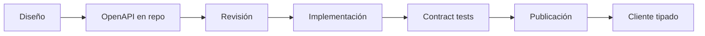

# 05 — Contratos de API e integraciones

| Campo | Valor |
|---|---|
| Documento | Convenciones y catálogo de API |
| Versión | 0.1.0 |
| Estilo | REST / JSON sobre HTTPS |
| Especificación | OpenAPI 3.1 (generada desde NestJS) |
| Base URL | `https://{host}/api/v1` |
| Audiencia | Backend, frontend, integradores, QA |

---

## 1. Principios

1. **Contrato primero:** el endpoint se documenta en OpenAPI antes de implementarse.
2. **Recursos, no acciones:** rutas en plural (`/patients`, `/appointments`); las acciones
   excepcionales usan subrutas (`/appointments/{id}/cancel`).
3. **Versionado en la URL:** `/api/v1`. Un cambio incompatible requiere `/v2`.
4. **Errores estándar:** RFC 7807 (`application/problem+json`).
5. **Idempotencia explícita** en pagos, reservas y jobs.
6. **Nada de datos sensibles en URLs ni logs.**
7. **Respuestas paginadas por cursor** en listados grandes.

---

## 2. Autenticación y contexto

| Header | Uso |
|---|---|
| `Authorization: Bearer <access_token>` | Obligatorio salvo endpoints públicos. |
| `X-Location-Id` | Sede activa; validada contra las sedes del usuario. |
| `X-Correlation-Id` | UUID generado por el cliente; si falta, el servidor lo genera. |
| `Idempotency-Key` | Obligatorio en `POST` de pagos, reservas e importaciones. |
| `If-Match` / `version` | Control de concurrencia optimista en `PATCH`. |
| `Accept-Language` | `es` por defecto. |

- Access token JWT de 15 min; refresh rotativo de 8 h.
- El token incluye `sub`, `roles`, `locations`, `auth_time`, `jti`.
- MFA reciente (`auth_time` < 10 min) para operaciones sensibles.

**Endpoints públicos:** `POST /auth/login`, `POST /auth/refresh`, `POST /auth/mfa/verify`,
`POST /consents/{id}/verify-otp`, `GET /health/*`, `GET /public/verify/{hash}`.

---

## 3. Formato de datos

| Tipo | Formato | Ejemplo |
|---|---|---|
| Fechas/horas | ISO 8601 UTC | `2026-10-29T14:30:00Z` |
| Fechas | `YYYY-MM-DD` | `1984-03-15` |
| Dinero | string decimal + moneda | `{ "amount": "15000.00", "currency": "ARS" }` |
| IDs | UUID v7 | `0192f3a1-...` |
| Enums | `SCREAMING_SNAKE_CASE` | `EN_ATENCION` |
| Booleanos | `true`/`false` | — |
| Nulos | `null` explícito; no se omiten en respuestas | — |

**Nunca** se usan números de punto flotante para dinero.

---

## 4. Paginación, filtros y orden

```http
GET /api/v1/patients?q=gomez&limit=20&cursor=eyJpZCI6...&sort=-lastVisitAt
```

```json
{
  "data": [ ... ],
  "page": { "nextCursor": "eyJpZCI6...", "hasMore": true, "limit": 20 },
  "meta": { "total": 134, "tookMs": 42 }
}
```

- `limit` por defecto 20, máximo 100.
- `sort` con prefijo `-` para descendente; campos permitidos por recurso.
- Filtros por query string; los rangos usan `from`/`to` inclusivos.
- `total` puede ser aproximado en búsquedas grandes (se indica con `totalApprox`).

---

## 5. Errores

```json
{
  "type": "https://api.sigo-dental/errors/appointment-overlap",
  "title": "Horario ocupado",
  "status": 409,
  "code": "APPOINTMENT_OVERLAP",
  "detail": "El sillón 2 ya tiene un turno de 10:00 a 10:45.",
  "instance": "/api/v1/appointments",
  "correlationId": "01J9Z8K3...",
  "errors": [
    { "field": "startsAt", "code": "OVERLAP", "message": "Horario ocupado" }
  ]
}
```

| HTTP | Uso |
|---|---|
| 200 / 201 / 204 | Éxito. |
| 400 | Validación de entrada. |
| 401 | No autenticado / token vencido. |
| 403 | Sin permiso o sede no asignada. |
| 404 | Recurso inexistente o fuera de alcance. |
| 409 | Conflicto de dominio (solapamiento, versión, duplicado). |
| 422 | Regla de negocio no satisfecha. |
| 429 | Rate limit. |
| 500 | Error inesperado (con `correlationId`). |
| 503 | Dependencia no disponible. |

**Códigos de dominio estables:** `PATIENT_DUPLICATE`, `APPOINTMENT_OVERLAP`,
`BUDGET_EXPIRED`, `CASH_SESSION_CLOSED`, `STOCK_INSUFFICIENT`, `CONSENT_REQUIRED`,
`IMMUTABLE_RECORD`, `VERSION_CONFLICT`, `MFA_REQUIRED`.

---

## 6. Idempotencia y concurrencia

### 6.1 Idempotencia

- `POST /invoices/{id}/payments`, `POST /appointments`, `POST /imports/{id}/execute` y
  webhooks exigen `Idempotency-Key`.
- El servidor guarda la clave + hash del body durante 24 h.
- Si se repite con el mismo body, devuelve la misma respuesta (`200`); si el body difiere,
  `409 IDEMPOTENCY_CONFLICT`.

### 6.2 Concurrencia optimista

- Recursos editables devuelven `version`.
- `PATCH` exige `If-Match: "<version>"` o `version` en el body.
- Si la versión no coincide: `409 VERSION_CONFLICT` con el estado actual.

---

## 7. Rate limiting

| Ámbito | Límite |
|---|---|
| Login | 5 intentos / 15 min por usuario + IP. |
| API general | 300 req/min por usuario. |
| Búsqueda | 60 req/min por usuario. |
| Exportaciones | 5 / hora por usuario. |
| Webhooks entrantes | 120 / min por proveedor. |

Respuesta `429` con `Retry-After`.

---

## 8. Catálogo de endpoints (resumen)

### 8.1 Auth

| Método | Ruta | Descripción |
|---|---|---|
| POST | `/auth/login` | Usuario + contraseña; devuelve challenge MFA si aplica. |
| POST | `/auth/mfa/verify` | Código TOTP; devuelve tokens. |
| POST | `/auth/refresh` | Rotación de refresh token. |
| POST | `/auth/logout` | Invalida refresh token. |
| GET | `/auth/me` | Usuario, roles, sedes, permisos. |
| POST | `/auth/password/change` | Cambio de contraseña. |

### 8.2 Pacientes y clínica

| Método | Ruta |
|---|---|
| GET/POST | `/patients` |
| GET/PATCH/DELETE | `/patients/{id}` |
| GET | `/patients/{id}/timeline` |
| POST | `/patients/{id}/medical-history` |
| GET/POST | `/patients/{id}/odontograms` |
| POST | `/odontograms/{id}/findings` |
| POST | `/odontograms/{id}/sign` |
| GET | `/odontograms/{id}/compare` |
| POST | `/patients/{id}/periodontal-exams` |
| POST | `/periodontal-exams/{id}/sign` |
| GET/POST | `/patients/{id}/notes` |
| POST | `/notes/{id}/sign` |
| POST | `/notes/{id}/addendum` |
| GET/POST | `/patients/{id}/prescriptions` |
| POST | `/prescriptions/{id}/sign` |

### 8.3 Agenda

| Método | Ruta |
|---|---|
| GET | `/availability` |
| GET/POST | `/appointments` |
| GET/PATCH | `/appointments/{id}` |
| POST | `/appointments/{id}/transition` |
| POST | `/appointments/{id}/cancel` |
| POST | `/appointments/{id}/reschedule` |
| GET | `/appointments/{id}/history` |
| GET/POST | `/schedule-blocks` |

### 8.4 Tratamientos y finanzas

| Método | Ruta |
|---|---|
| GET/POST | `/patients/{id}/budgets` |
| GET/PATCH | `/budgets/{id}` |
| POST | `/budgets/{id}/send` |
| POST | `/budgets/{id}/approve` |
| POST | `/budgets/{id}/reject` |
| GET | `/patients/{id}/treatment-tasks` |
| PATCH | `/treatment-tasks/{id}` |
| POST | `/cash-sessions` |
| GET | `/cash-sessions/current` |
| POST | `/cash-sessions/{id}/movements` |
| POST | `/cash-sessions/{id}/close` |
| POST | `/cash-sessions/{id}/approve` |
| POST | `/invoices` |
| GET | `/invoices/{id}` |
| POST | `/invoices/{id}/payments` |
| POST | `/invoices/{id}/credit-note` |
| GET | `/commissions/settlements` |

### 8.5 Administración y gobierno

| Método | Ruta |
|---|---|
| GET/POST | `/users` |
| PATCH | `/users/{id}` |
| GET/POST | `/roles` |
| GET | `/permissions` |
| GET/POST | `/locations` |
| GET/POST | `/locations/{id}/chairs` |
| GET/PUT | `/settings` |
| GET/POST | `/catalogs/{type}` |
| GET | `/audit-events` |
| GET | `/reports/{type}` |
| POST | `/reports/{type}/export` |
| POST | `/imports` |
| POST | `/imports/{id}/simulate` |
| POST | `/imports/{id}/execute` |

### 8.6 Archivos

| Método | Ruta |
|---|---|
| POST | `/files/presign` |
| POST | `/files/{id}/confirm` |
| GET | `/files/{id}/download` |
| DELETE | `/files/{id}` (baja lógica) |

### 8.7 Salud

| Método | Ruta | Descripción |
|---|---|---|
| GET | `/health/live` | Proceso vivo. |
| GET | `/health/ready` | Dependencias listas. |
| GET | `/health/version` | Versión y commit. |

---

## 9. Webhooks

| Proveedor | Evento | Verificación |
|---|---|---|
| Pasarela de pagos | `payment.succeeded`, `payment.failed`, `refund.succeeded` | HMAC SHA-256 + timestamp. |
| Facturación fiscal | `invoice.authorized`, `invoice.rejected` | Firma del proveedor. |
| Mensajería | `message.delivered`, `message.failed` | Token + HMAC. |

**Reglas:** responder `2xx` rápido, procesar en cola, idempotencia por `event_id`, registrar
el payload (sin datos sensibles) y reintentar del lado del proveedor.

---

## 10. Ciclo de vida del contrato



- El archivo `openapi.yaml` se versiona y se genera en CI.
- Los cambios incompatibles requieren nueva versión mayor.
- Los endpoints obsoletos se marcan `deprecated` y se mantienen al menos 90 días.
- El frontend usa un cliente generado para evitar divergencias.

---

## 11. Ejemplos

### 11.1 Crear turno

```http
POST /api/v1/appointments
Authorization: Bearer ...
X-Location-Id: 0192e1...
Idempotency-Key: 0f9a1c...
Content-Type: application/json

{
  "patientId": "0192f0...",
  "professionalId": "0192f1...",
  "chairId": "0192f2...",
  "procedureId": "0192f3...",
  "startsAt": "2026-11-03T13:00:00Z",
  "durationMin": 45,
  "reason": "Control"
}
```

```json
{
  "id": "0192fa...",
  "status": "PROGRAMADA",
  "startsAt": "2026-11-03T13:00:00Z",
  "endsAt": "2026-11-03T13:45:00Z",
  "patient": { "id": "0192f0...", "fullName": "María González" },
  "chair": { "id": "0192f2...", "name": "Sillón 1" },
  "professional": { "id": "0192f1...", "fullName": "Dr. Pérez" },
  "version": 1
}
```

### 11.2 Cobro con pago mixto

```http
POST /api/v1/invoices/0192fd.../payments
Idempotency-Key: 7c2b...
Content-Type: application/json

{
  "payments": [
    { "method": "CASH", "amount": { "amount": "10000.00", "currency": "ARS" } },
    { "method": "CARD", "amount": { "amount": "5000.00", "currency": "ARS" }, "reference": "AUTH-123" }
  ]
}
```

Si la suma excede el saldo: `422 PAYMENT_EXCEEDS_BALANCE`.

---

## 12. Pendientes

- Definir el país y la autoridad fiscal (`Q-01`, `Q-02`).
- Confirmar el proveedor de mensajería (`Q-07`).
- Acordar si se expone API pública para el portal del paciente (`Q-08`).
- Especificar los campos fiscales exactos del adaptador correspondiente.
