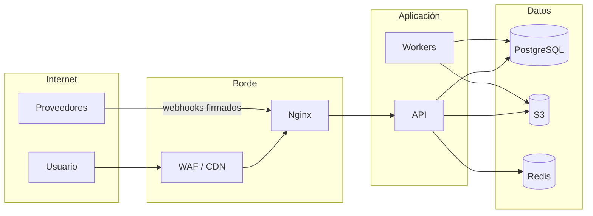
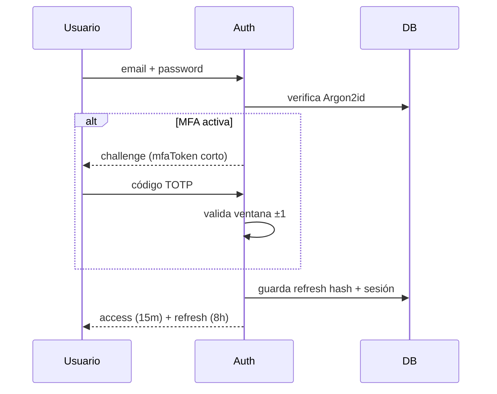
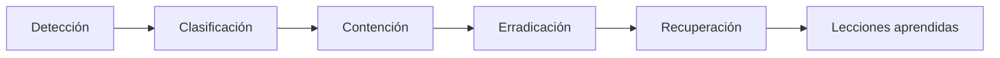

# 06 — Seguridad y privacidad

| Campo | Valor |
|---|---|
| Documento | Diseño de seguridad |
| Versión | 0.1.0 |
| Base | RNF-05 a RNF-10, OWASP ASVS 5.0, OWASP Top 10 |
| Audiencia | Seguridad, desarrollo, DevOps, compliance |

---

## 1. Activos a proteger

| Activo | Sensibilidad | Impacto de compromiso |
|---|---|---|
| Historia clínica y odontogramas | Muy alta | Daño al paciente, sanción legal. |
| Datos de identidad y contacto | Alta | Fraude, phishing, discriminación. |
| Información financiera y de caja | Alta | Fraude, descuadre, sanción fiscal. |
| Documentos firmados | Muy alta | Nulidad legal, suplantación. |
| Credenciales y secretos | Crítica | Compromiso total. |
| Logs de auditoría | Alta | Pérdida de evidencia. |
| Disponibilidad del servicio | Alta | Interrupción de la atención. |

---

## 2. Modelo de amenazas (STRIDE)

| Amenaza | Escenario | Mitigación |
|---|---|---|
| **S**poofing | Robo de credenciales de un odontólogo. | MFA, bloqueo, detección de dispositivo, sesión corta. |
| **T**ampering | Alteración de una nota clínica firmada. | Append-only, hash, triggers, auditoría encadenada. |
| **R**epudiation | Profesional niega haber firmado. | Firma con hash, timestamp, IP, user-agent, evidencia. |
| **I**nformation disclosure | Recepción accede a diagnósticos. | RBAC, separación de permisos, auditoría de accesos. |
| **D**enial of service | Ataque a login o API. | Rate limit, WAF, colas, timeouts, backpressure. |
| **E**levation of privilege | Usuario modifica su rol. | Autorización en servidor, validación de rol, auditoría. |
| Fuga por URL | Enlace de archivo compartido. | URLs firmadas de 5 min, permisos por request. |
| Inyección | SQL/NoSQL/OS en filtros. | ORM parametrizado, validación, sin `eval`. |
| XSS | Contenido de notas o nombres. | Escape, sanitización, CSP estricta. |
| SSRF | URL de webhook manipulada. | Allowlist de destinos. |
| Fuerza bruta | Prueba de contraseñas. | Argon2id, lockout, MFA, rate limit. |
| Insider threat | Empleado exporta datos. | Mínimo privilegio, auditoría, alertas de exportación. |

---

## 3. Límites de confianza

Cada cruce de límite exige autenticación, autorización, validación y registro.

---

## 4. Matriz RBAC

`✔` = permitido · `R` = solo lectura · `—` = denegado · `*` = requiere MFA reciente.

| Recurso:acción | ADMIN | RECEPTION | DENTIST | ASSISTANT | AUDITOR |
|---|---|---|---|---|---|
| `patients:read` | ✔ | ✔ | ✔ | ✔ | R |
| `patients:create/update` | ✔ | ✔ | ✔ | — | — |
| `patients:delete` | ✔ | — | — | — | — |
| `patients:read_deleted` | ✔ | — | — | — | ✔ |
| `clinical:read` | ✔* | — | ✔ | ✔ | R* |
| `clinical:write` | — | — | ✔ | ✔ (borrador) | — |
| `clinical:sign` | — | — | ✔ | — | — |
| `files:read` | ✔ | — | ✔ | ✔ | R |
| `files:write` | ✔ | — | ✔ | ✔ | — |
| `documents:consent` | — | — | ✔ | — | — |
| `prescriptions:write` | — | — | ✔ | — | — |
| `scheduling:read` | ✔ | ✔ | ✔ | ✔ | R |
| `scheduling:write` | ✔ | ✔ | ✔ | — | — |
| `budgets:read` | ✔ | ✔ | ✔ | R | R |
| `budgets:write` | ✔ | ✔ | ✔ | — | — |
| `budgets:approve` | ✔ | ✔ | ✔ | — | — |
| `budgets:approve_discount` | ✔ | — | ✔ | — | — |
| `billing:read` | ✔ | ✔ | — | — | R |
| `billing:write` | ✔ | ✔ | — | — | — |
| `billing:pay` | ✔ | ✔ | — | — | — |
| `billing:void` | ✔* | — | — | — | — |
| `billing:refund` | ✔* | — | — | — | — |
| `cash:open` | ✔ | ✔ | — | — | — |
| `cash:read` | ✔ | ✔ | — | — | R |
| `cash:close` | ✔ | ✔ | — | — | — |
| `cash:approve` | ✔ | — | — | — | — |
| `cash:reopen` | ✔* | — | — | — | — |
| `inventory:read` | ✔ | R | ✔ | ✔ | R |
| `inventory:write` | ✔ | — | — | — | — |
| `inventory:adjust` | ✔* | — | — | — | — |
| `commissions:read` | ✔ | — | — | — | R |
| `commissions:approve` | ✔* | — | — | — | — |
| `users:read` | ✔ | — | — | — | — |
| `users:write` | ✔* | — | — | — | — |
| `roles:write` | ✔* | — | — | — | — |
| `locations:write` | ✔* | — | — | — | — |
| `settings:write` | ✔* | — | — | — | — |
| `audit:read` | ✔* | — | — | — | ✔* |
| `audit:export` | ✔* | — | — | — | ✔* |
| `reports:read` | ✔ | ✔ | ✔ (propias) | — | ✔ |
| `reports:export` | ✔ | — | — | — | ✔ |
| `imports:write` | ✔* | — | — | — | — |
| `imports:approve` | ✔* | — | — | — | — |
| `dashboard:read` | ✔ | ✔ | ✔ | ✔ | ✔ |

**Reglas transversales:**

1. El rol `ADMIN` no accede a contenido clínico sin `clinical:read` y MFA reciente; toda
   lectura se audita con justificación.
2. El `AUDITOR` es solo lectura y no puede exportar datos clínicos identificables.
3. La autorización se valida en el **caso de uso**, no solo en el controlador.
4. El scoping por sede se aplica después del permiso.

---

## 5. Autenticación y sesión

| Control | Implementación |
|---|---|
| Contraseña | Argon2id; mínimo 12 caracteres; verificación contra lista de filtradas. |
| MFA | TOTP obligatorio para `ADMIN`, `DENTIST`, `AUDITOR`, `RECEPTION`. |
| Recuperación | Códigos de un solo uso + email verificado. |
| Bloqueo | 5 intentos → 15 min; alerta al administrador. |
| Sesión | Access 15 min; refresh 8 h rotativo; cierre por inactividad 15 min. |
| Dispositivo | Registro de user-agent/IP; alerta ante cambio significativo. |
| Logout | Invalida refresh y, opcionalmente, todas las sesiones. |
| MFA reciente | `auth_time` < 10 min para operaciones sensibles. |

**Flujo:**

---

## 6. Cifrado y secretos

| Dato | En tránsito | En reposo |
|---|---|---|
| API | TLS 1.3 | — |
| PostgreSQL | TLS | AES-256 (volumen) + backups cifrados |
| S3 | TLS | SSE-S3/SSE-KMS |
| Redis | TLS | Cifrado del proveedor; sin datos clínicos |
| Secretos | — | Vault/Secrets Manager; nunca en repo |
| Campos sensibles | — | Cifrado a nivel de aplicación para `mfa_secret_enc` |

- Rotación de secretos semestral y ante incidente.
- Claves de firma de JWT rotables con `kid`.
- Los backups se cifran y se prueban restaurando.

---

## 7. Privacidad y cumplimiento

| Principio | Implementación |
|---|---|
| Minimización | Solo se recogen datos necesarios; mensajes sin diagnóstico. |
| Finalidad | Datos usados para atención, cobro y obligaciones legales. |
| Consentimiento | Consentimientos informados y aviso de privacidad. |
| Derechos del titular | Acceso, rectificación y copia; solicitudes registradas. |
| Retención | Política por tipo de dato (RNF-20). |
| Seudonimización | Entornos no productivos con datos sintéticos. |
| Acceso | Mínimo privilegio y auditoría. |
| Transferencias | Solo a proveedores con contrato y garantías. |
| Brecha | Procedimiento de notificación según normativa local. |

**Checklist legal pendiente:** país, autoridad, plazos de retención y validez de firma
(`Q-01`, `Q-04`, `Q-09`, `Q-21`).

---

## 8. Seguridad en el ciclo de vida (SSDLC)

| Etapa | Control |
|---|---|
| Diseño | Modelado de amenazas por módulo; revisión de seguridad. |
| Desarrollo | Linter, revisión de pares, prohibición de secretos, dependencias fijadas. |
| CI | SAST, SCA, escaneo de secretos, tests de autorización. |
| Pre-release | DAST, prueba de penetración, verificación ASVS. |
| Producción | WAF, monitoreo, alertas, parcheo mensual. |
| Respuesta | Runbook de incidentes, contacto y plazos. |

**Criterios de bloqueo de release:** vulnerabilidad crítica/alta sin mitigar, secreto
expuesto, falta de MFA en rol clínico, logs con datos sensibles.

---

## 9. Auditoría de seguridad

- Eventos de autenticación y autorización.
- Accesos a expedientes y descargas.
- Exportaciones y cambios de permisos.
- Anulaciones, reaperturas y ajustes.
- Alertas: múltiples 403, exportaciones masivas, accesos fuera de horario, cambio de sede
  inusual.

---

## 10. Respuesta a incidentes

| Severidad | Ejemplo | Respuesta |
|---|---|---|
| S1 | Brecha de datos clínicos. | Inmediata; notificación legal; 24/7. |
| S2 | Acceso no autorizado o caída total. | < 1 h; contención. |
| S3 | Vulnerabilidad alta explotable. | < 24 h. |
| S4 | Hallazgo medio/bajo. | Próximo ciclo. |

El detalle operativo está en [`OPERACIONES.md`](../10-operaciones/OPERACIONES.md).

---

## 11. Pendientes

- Definir el país y la normativa aplicable (`Q-01`).
- Validar la firma electrónica con asesoría legal (`Q-04`).
- Confirmar requisitos de retención (`Q-21`).
- Decidir si se contrata prueba de penetración externa antes de producción (recomendado).
