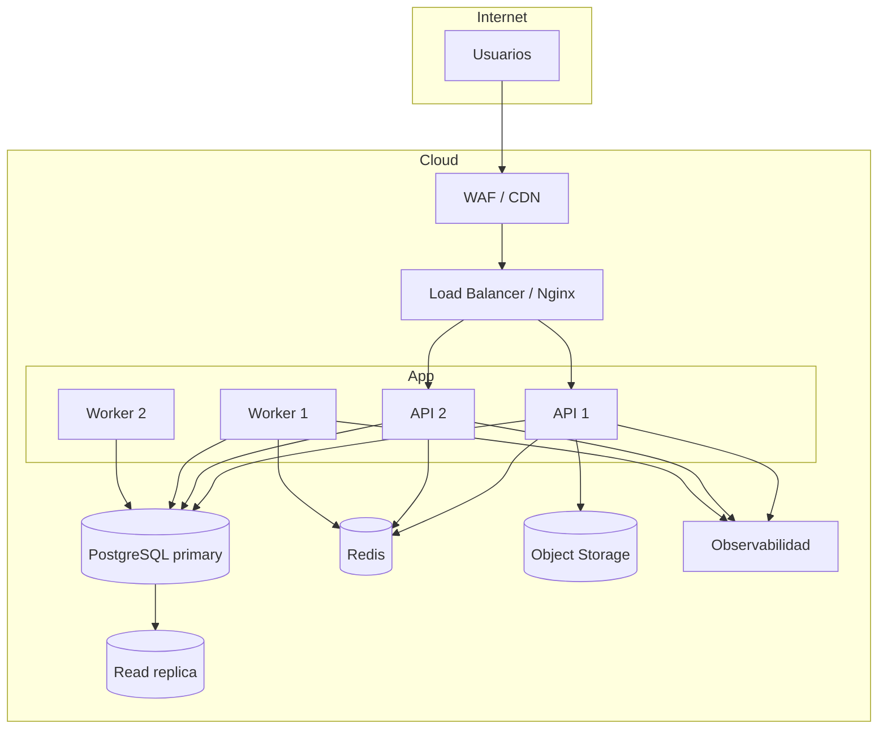

# 07 — Infraestructura y DevOps

| Campo | Valor |
|---|---|
| Documento | Infraestructura, despliegue y operación técnica |
| Versión | 0.1.0 |
| Modelo | Contenedores en una región |
| Base | ADR-002, ADR-005, RNF-17 a RNF-19 |
| Audiencia | DevOps, backend, seguridad |

---

## 1. Entornos

| Entorno | Propósito | Datos | Acceso |
|---|---|---|---|
| `local` | Desarrollo. | Sintéticos. | Desarrolladores. |
| `ci` | Tests automatizados. | Sintéticos efímeros. | Pipeline. |
| `staging` | Validación y UAT. | Seudonimizados. | Equipo + clínica. |
| `production` | Operación real. | Reales. | Producción, mínimo privilegio. |

**Reglas:**

- Aislamiento total de red y credenciales entre entornos.
- Nunca se copian datos reales a `local` o `ci`.
- `staging` reproduce la topología de producción a menor escala.
- Los accesos a producción son nominados, con MFA y auditados.

---

## 2. Topología



**Características:**

- API y workers sin estado (los workers usan Redis/DB para estado).
- Al menos 2 réplicas de API en producción.
- PostgreSQL gestionado o con backups automatizados y réplica.
- Redis gestionado con persistencia mínima (no es fuente de verdad).
- S3 con versionado, cifrado y lifecycle.

---

## 3. Contenedores

| Imagen | Base | Contenido |
|---|---|---|
| `sigo-api` | `node:22-alpine` multi-stage | API NestJS compilada. |
| `sigo-worker` | Igual | Workers BullMQ. |
| `sigo-web` | `nginx:alpine` | Build estático de React. |
| `sigo-migrate` | Igual que API | Job de migraciones. |

**Buenas prácticas:**

- Usuario no root, filesystem read-only salvo `/tmp`.
- Health checks y límites de CPU/memoria.
- Imágenes escaneadas (Trivy) y firmadas.
- Tags inmutables por commit SHA; `latest` solo en desarrollo.

---

## 4. Configuración y secretos

| Variable | Ejemplo | Secreto |
|---|---|---|
| `NODE_ENV` | `production` | No |
| `DATABASE_URL` | `postgres://...` | Sí |
| `REDIS_URL` | `rediss://...` | Sí |
| `JWT_PRIVATE_KEY` / `JWT_PUBLIC_KEY` | PEM | Sí |
| `S3_ENDPOINT`, `S3_BUCKET` | — | Parcial |
| `S3_ACCESS_KEY`, `S3_SECRET_KEY` | — | Sí |
| `SMTP_URL` | — | Sí |
| `WHATSAPP_TOKEN` | — | Sí |
| `PAYMENT_SECRET` | — | Sí |
| `TAX_API_KEY` | — | Sí |
| `SENTRY_DSN` | — | Parcial |
| `OTEL_EXPORTER_OTLP_ENDPOINT` | — | No |

- Secretos en Vault/Secrets Manager, inyectados en runtime.
- Nunca en el repositorio, imágenes ni logs.
- Rotación semestral y ante sospecha.
- `.env.example` documenta las variables sin valores reales.

---

## 5. CI/CD

```mermaid
flowchart LR
    A[Push / PR] --> B[Lint + tipos]
    B --> C[Tests unitarios]
    C --> D[Tests integración]
    D --> E[SAST + SCA + secretos]
    E --> F[Build imágenes]
    F --> G[Deploy staging]
    G --> H[Smoke + E2E]
    H --> I[Aprobación manual]
    I --> J[Migración]
    J --> K[Deploy producción]
    K --> L[Smoke + monitoreo]
```



| Etapa | Herramienta | Bloqueante |
|---|---|---|
| Lint/format | ESLint + Prettier | Sí |
| Tipos | `tsc --noEmit` | Sí |
| Unitarias | Vitest | Sí (cobertura mínima) |
| Integración | Supertest + Testcontainers | Sí |
| E2E | Playwright | Sí en staging |
| SAST | CodeQL/Semgrep | Sí (alto/crítico) |
| SCA | `npm audit`/Dependabot | Sí (crítico) |
| Secretos | Gitleaks | Sí |
| Imagen | Trivy | Sí (crítico) |
| Deploy | GitHub Actions | Manual a producción |

**Estrategia de despliegue:** rolling update con health checks; rollback a la imagen anterior
si falla el smoke test.

---

## 6. Migraciones

1. Se generan con Prisma y se revisan en PR.
2. Se aplican como job previo al despliegue.
3. Estrategia `expand → migrate → contract`:
   - Agregar columnas/tablas compatibles.
   - Desplegar código que escribe en ambos formatos si hace falta.
   - Migrar datos por job.
   - Eliminar lo viejo en un release posterior.
4. Nunca se ejecuta `DROP` en el mismo release que deja de usarse.
5. Cada migración se prueba en staging con volumen representativo.
6. Backup antes de migraciones destructivas (con aprobación).

---

## 7. Backups y recuperación

| Elemento | Frecuencia | Retención | Prueba |
|---|---|---|---|
| PostgreSQL (full) | Diario | 30 días | Restauración trimestral. |
| PostgreSQL (WAL) | Continuo | 7 días | PITR trimestral. |
| S3 | Versionado + replicación | Según política | Acceso y restauración trimestral. |
| Configuración/secretos | En repositorio seguro | Histórico | Revisión semestral. |

- **RPO ≤ 15 min**, **RTO ≤ 4 h** (RNF-19).
- Los backups se cifran y se almacenan en otra zona.
- Se documenta cada prueba de restauración con fecha, resultado y responsable.
- Prueba de recuperación completa antes de la salida a producción.

---

## 8. Observabilidad y SLO

| Señal | Implementación |
|---|---|
| Métricas | Prometheus: latencia, errores, throughput, saturación, colas. |
| Logs | JSON estructurado a Loki; sin datos sensibles. |
| Trazas | OpenTelemetry a Tempo/Jaeger. |
| Errores | Sentry con release y `correlation_id`. |
| Uptime | Monitoreo sintético externo. |
| Dashboards | API, agenda, caja, jobs, base de datos. |

**SLO propuestos:**

| SLO | Objetivo | Ventana |
|---|---|---|
| Disponibilidad | 99,9 % (07:00–21:00) | 30 días |
| Latencia API p95 | < 500 ms | 30 días |
| Odontograma p95 | < 1,5 s | 30 días |
| Tasa de error 5xx | < 0,5 % | 30 días |
| Jobs fallidos | < 1 % | 24 h |
| Retraso de recordatorios | < 5 min | 24 h |

**Alertas:** error rate, latencia, cola acumulada, disco, conexiones DB, fallos de backup,
certificado por vencer, jobs en DLQ.

---

## 9. Capacidad y costos

| Recurso | Base | Crecimiento |
|---|---|---|
| API | 2 × 1 vCPU / 1 GB | Horizontal. |
| Workers | 2 × 1 vCPU / 1 GB | Por cola. |
| PostgreSQL | 2 vCPU / 4 GB / 100 GB | Vertical + réplica. |
| Redis | 1 GB | Gestionado. |
| S3 | 100 GB inicial | ~20 GB/año estimado (ajustar). |

- Se revisa mensualmente el uso y se ajusta.
- Alertas al 70 % de disco/CPU/memoria.
- Presupuesto de egreso de S3 monitoreado.

---

## 10. Seguridad de infraestructura

- Red privada para DB, Redis y workers; solo el LB expuesto.
- Security groups con mínimo privilegio.
- TLS gestionado y renovación automática.
- WAF con reglas OWASP y rate limiting.
- Parches mensuales; críticos en 72 h.
- Acceso a producción por bastión/VPN + MFA + auditoría.
- Sin acceso directo a la base de datos desde internet.
- Escaneo de imágenes y dependencias en CI.

---

## 11. Entorno local

```bash
# Requisitos: Docker Desktop, Node 22, pnpm
cp .env.example .env
docker compose up -d        # postgres, redis, minio, mailhog
pnpm install
pnpm prisma migrate dev
pnpm seed
pnpm dev                    # api + web
```

Servicios locales: API `http://localhost:3000`, web `http://localhost:5173`, MinIO
`http://localhost:9001`, MailHog `http://localhost:8025`.

**Datos de prueba:** seed reproducible con 3 sedes, 10 profesionales, 200 pacientes y
turnos de ejemplo; nunca datos reales.

---

## 12. Pendientes

- Definir nube/proveedor y región (`Q-17`).
- Confirmar si se requiere hosting on-premise por normativa.
- Estimar volumen real de adjuntos y retención.
- Definir presupuesto mensual de infraestructura.
