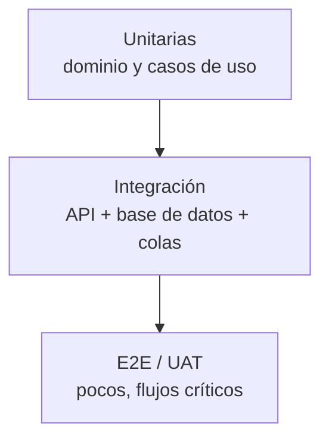

# 09 — Plan de pruebas y calidad

| Campo | Valor |
|---|---|
| Documento | Estrategia y plan de pruebas |
| Versión | 0.1.0 |
| Base | SRS §10, RNF-01 a RNF-23 |
| Audiencia | QA, desarrollo, PO, seguridad |

---

## 1. Objetivos

1. Verificar que cada requisito `Must` cumple sus criterios de aceptación.
2. Prevenir regresiones en flujos clínicos y financieros.
3. Demostrar seguridad, rendimiento y accesibilidad antes de producción.
4. Producir evidencia trazable para auditoría y aceptación.

**Principio:** ninguna funcionalidad se considera terminada sin prueba automatizada o
evidencia manual documentada.

---

## 2. Pirámide de pruebas

| Nivel | Herramienta | Alcance | Objetivo |
|---|---|---|---|
| Unitarias | Vitest | Entidades, cálculos, validaciones. | ≥ 80 % en dominio crítico. |
| Integración | Supertest + Testcontainers | Endpoints, transacciones, autorización, outbox. | Cubrir todos los endpoints. |
| Contrato | OpenAPI + Schemathesis | Contratos y validación. | Sin divergencias. |
| E2E | Playwright | Flujos de usuario en navegador. | 15–20 flujos críticos. |
| Rendimiento | k6 | Carga y estrés. | Cumplir RNF-01/03. |
| Seguridad | SAST, DAST, SCA, ZAP | OWASP. | Sin altos/críticos. |
| Accesibilidad | axe + manual | WCAG 2.2 AA. | Sin bloqueantes. |
| UAT | Guiones con usuarios | Aceptación del negocio. | Firma del PO/Sponsor. |

---

## 3. Ambientes y datos

| Ambiente | Uso | Datos |
|---|---|---|
| CI | Unitarias, integración, contrato. | Efímeros, sembrados por test. |
| Staging | E2E, performance, UAT, seguridad. | Seudonimizados, volumen representativo. |
| Producción | Smoke tests post-deploy y monitoreo. | Reales (solo lectura). |

- Datos sintéticos reproducibles; nunca datos reales en CI.
- Set de datos de performance: 100k pacientes, 1M notas, 500k turnos, 200 GB de objetos
  simulados.
- Reset de base entre suites de integración.

---

## 4. Casos de prueba

| ID | Nombre | Requisitos | Nivel | Automatizable | Evidencia |
|---|---|---|---|---|---|
| TP-01 | Alta, edición y duplicados de paciente | RF-01, RN-09 | Integración/E2E | Sí | Reporte + captura |
| TP-02 | Tutor legal y paciente menor | RF-01, RN-08 | Integración | Sí | Reporte |
| TP-03 | Anamnesis, alertas y bloqueo de prescripción | RF-02, RN-16 | Integración/E2E | Sí | Reporte |
| TP-04 | Búsqueda y scoping por sede | RF-19 | Integración | Sí | Reporte + tiempos |
| TP-05 | Odontograma: FDI/Universal, superficies, condiciones | RF-03 | E2E | Parcial | Captura + reporte |
| TP-06 | Inmutabilidad de hallazgos y adendas | RF-03, RN-01, RN-13 | Integración | Sí | Reporte |
| TP-07 | Periodontograma y cálculo de NIC | RF-04 | Integración | Sí | Reporte |
| TP-08 | SOEP: bloqueo 24 h, firma y adenda | RF-05 | Integración/E2E | Sí | Reporte |
| TP-09 | Consentimiento: firma, OTP, PDF y bloqueo | RF-06, RN-12 | E2E | Parcial | PDF + hash |
| TP-10 | Presupuesto: versiones, precios, descuentos | RF-07, RN-05, RN-15 | Integración | Sí | Reporte |
| TP-11 | Aprobación parcial y generación de tareas | RF-08 | Integración | Sí | Reporte |
| TP-12 | Agenda: solapamiento de sillón/profesional y concurrencia | RF-09, RN-03, RN-04 | Integración + carga | Sí | Reporte |
| TP-13 | Máquina de estados de turno | RF-10 | Integración | Sí | Reporte |
| TP-14 | Recordatorios: idempotencia, fallback, opt-out | RF-11 | Integración | Sí | Logs + reporte |
| TP-15 | POS: pagos mixtos, saldo, inmutabilidad | RF-12, RN-07, RN-10 | Integración/E2E | Sí | Reporte |
| TP-16 | Cierre de caja ciego y diferencias | RF-17, RN-02 | E2E | Sí | PDF + reporte |
| TP-17 | Comisiones y liquidaciones | RF-13, RN-11 | Integración | Sí | Reporte |
| TP-18 | Inventario: descargo, stock negativo, idempotencia | RF-14, RN-06 | Integración | Sí | Reporte |
| TP-19 | RBAC, MFA, bloqueo y sesión | RF-15, RNF-06 | Integración/E2E | Sí | Reporte |
| TP-20 | Catálogos, vigencias e importación | RF-16 | Integración | Sí | Reporte |
| TP-21 | Multi-sede: scoping y consolidado | RF-26 | Integración | Sí | Reporte |
| TP-22 | Auditoría: append-only e integridad de cadena | RF-18, RNF-07 | Integración | Sí | Reporte + verificación |
| TP-23 | Reportes y exportaciones | RF-22, RF-23 | Integración | Sí | Archivos |
| TP-24 | Adjuntos: carga, antivirus, versión, descarga | RF-20 | Integración | Sí | Reporte |
| TP-25 | Recetas y validación de alergias | RF-21 | Integración | Sí | PDF + reporte |
| TP-26 | Migración: dry-run, errores, rollback | RF-25 | Integración | Sí | Informe |
| TP-27 | Rendimiento y concurrencia | RNF-01, 03, 18 | Carga | Sí | Dashboard k6 |
| TP-28 | Seguridad: SAST/DAST, ASVS, authz | RNF-05 a 10 | Seguridad | Parcial | Informe |
| TP-29 | Responsive, accesibilidad e impresión | RNF-11 a 14, 23 | E2E + manual | Parcial | axe + capturas |
| TP-30 | Backup, restauración, observabilidad y alertas | RNF-17, 19 | Operación | Parcial | Acta de prueba |

---

## 5. UAT (aceptación de usuario)

| ID | Guion | Participantes | Criterio |
|---|---|---|---|
| UAT-01 | Recepción → agenda → atención → presupuesto → cobro → cierre | Recepción, odontólogo, cajero | Flujo completo sin bloqueos. |
| UAT-02 | Usabilidad clínica en tablet | 3–5 odontólogos | Nota SOEP ≤ 3 min; hallazgo ≤ 10 s. |
| UAT-03 | Cierre contable y comisiones | Contador, supervisor | Reportes conciliados. |
| UAT-04 | Auditoría y documentos legales | Auditor, asesor legal | Evidencia completa y verificable. |

**Reglas de UAT:**

- Ambiente `staging` con datos representativos.
- Guiones escritos y aprobados antes de la sesión.
- Defectos clasificados por severidad; los críticos/altos bloquean la aceptación.
- Acta firmada por PO y Sponsor.

---

## 6. Rendimiento

| Prueba | Escenario | Criterio |
|---|---|---|
| Carga normal | 150 usuarios concurrentes, 1 h. | p95 API < 500 ms; errores < 0,5 %. |
| Pico | 200 usuarios, 15 min. | Sin degradación > 20 % del p95. |
| Expediente | Abrir paciente con 10 estudios. | p95 < 1,5 s. |
| Agenda | Consultar disponibilidad semanal. | p95 < 800 ms. |
| Búsqueda | 100k pacientes. | p95 < 1 s. |
| Cierre de caja | 500 movimientos. | < 2 s. |
| Soak | 8 h sostenidas. | Sin fuga de memoria; colas estables. |

Resultados y gráficos se adjuntan al release.

---

## 7. Seguridad

| Prueba | Herramienta | Criterio |
|---|---|---|
| SAST | CodeQL / Semgrep | 0 altos/críticos. |
| SCA | Dependabot / npm audit | 0 críticos sin mitigar. |
| Secretos | Gitleaks | 0 hallazgos. |
| DAST | OWASP ZAP | 0 altos/críticos. |
| Autorización | Tests dedicados | 100 % de endpoints con matriz. |
| ASVS | Checklist nivel 2 | 100 % de controles aplicables. |
| Pentest | Externo (recomendado) | Altos remediados antes de prod. |

Casos específicos: IDOR en expedientes, elevación de rol, acceso a archivos de otra sede,
replay de webhooks, fuerza bruta, XSS en notas, SQLi en filtros, CSRF (cookie/token),
exfiltración por exportación.

---

## 8. Accesibilidad y compatibilidad

- axe-core en CI sobre pantallas críticas (0 violaciones serias/críticas).
- Navegación completa por teclado en agenda, odontograma y POS.
- Lector de pantalla en flujo de alta de paciente y nota SOEP.
- Contraste verificado con herramienta.
- Pruebas en Chrome, Edge, Firefox y Safari (últimas 2 versiones).
- Tablets: iPad (Safari) y Android (Chrome) de 10.5" o más.
- Impresión A4 y térmica 80 mm.

---

## 9. Criterios de entrada y salida

### 9.1 Entrada a QA

- [ ] Requisito con criterios de aceptación.
- [ ] Diseño de UI/API disponible.
- [ ] Build desplegado en staging.
- [ ] Datos de prueba cargados.
- [ ] Migraciones aplicadas.

### 9.2 Salida de release

- [ ] 100 % de TP `Must` ejecutados y aprobados.
- [ ] Cobertura ≥ 80 % en endpoints críticos.
- [ ] 0 defectos críticos/altos abiertos.
- [ ] SAST/DAST sin altos/críticos.
- [ ] Performance dentro de SLO.
- [ ] Accesibilidad sin bloqueantes.
- [ ] UAT firmada.
- [ ] Backup/restauración probados.
- [ ] Documentación y OpenAPI actualizados.

---

## 10. Gestión de defectos

| Severidad | Definición | Respuesta |
|---|---|---|
| S1 Crítico | Pérdida de datos, brecha, caída total, error clínico grave. | Inmediata; bloquea release. |
| S2 Alto | Función principal inoperante o dato incorrecto. | < 24 h; bloquea release. |
| S3 Medio | Workaround disponible. | Próximo sprint. |
| S4 Bajo | Cosmético o mejora. | Backlog. |

Cada defecto incluye: pasos, esperado, obtenido, evidencia, ambiente, versión y
`correlation_id`.

---

## 11. Automatización y CI

- Unitarias e integración en cada PR.
- E2E en staging en cada merge a `main`.
- Performance semanal y antes de release.
- Seguridad en cada PR (SAST/SCA/secretos) y DAST semanal.
- Accesibilidad en cada PR de UI.
- Reportes publicados como artefactos del pipeline.

**Cobertura objetivo:** dominio crítico ≥ 90 %; global ≥ 80 % en endpoints críticos.

---

## 12. Métricas de calidad

| Métrica | Objetivo |
|---|---|
| Defectos escapados a producción | < 2 por release. |
| Cobertura de requisitos `Must` con prueba | 100 %. |
| Tiempo medio de resolución S1/S2 | < 1 día / < 3 días. |
| Estabilidad de E2E | > 95 % (flaky < 5 %). |
| Cobertura de código crítica | ≥ 80 %. |
| Hallazgos de seguridad abiertos | 0 altos/críticos. |

---

## 13. Riesgos de prueba

| Riesgo | Mitigación |
|---|---|
| Datos de prueba poco realistas | Set sintético con volumen representativo. |
| Flujos E2E inestables | Selectores estables, reintentos controlados, aislamiento. |
| Falta de disponibilidad de usuarios para UAT | Agendar desde Fase 1; sesiones cortas. |
| Ambiente staging inestable | Pipeline reproducible; datos resetables. |
| Pruebas de seguridad tardías | Integrarlas desde el inicio (shift-left). |
