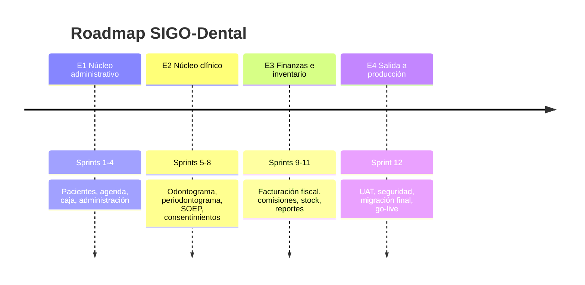
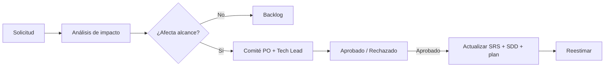

# 11 — Plan de entrega, riesgos y gobernanza

| Campo | Valor |
|---|---|
| Documento | Plan de entrega y gestión |
| Versión | 0.1.0 |
| Base | SRS §4, §10; [PLAN-PRUEBAS](../09-pruebas/PLAN-PRUEBAS.md) |
| Audiencia | Sponsor, PO, TI, desarrollo |

---

## 1. Estrategia de entrega

Se entrega en **4 etapas** y **12 sprints de 2 semanas**, con incrementos desplegables y
validación continua. Cada etapa termina con una demo, un conjunto de pruebas aprobado y una
retrospectiva.

| Etapa | Sprints | Objetivo | Hito de salida |
|---|---|---|---|
| **E1** | 1–4 | Operación administrativa funcionando. | Demo de agenda + caja + pacientes; UAT parcial. |
| **E2** | 5–8 | Atención clínica digital completa. | Odontograma y SOEP validados por odontólogos. |
| **E3** | 9–11 | Control financiero e insumos. | Cierre contable y reportes conciliados. |
| **E4** | 12 | Producción segura y adoptada. | Go-live + acta de aceptación. |

---

## 2. Detalle por sprint

### E1 — Núcleo administrativo

| Sprint | Contenido | Requisitos |
|---|---|---|
| 1 | Fundaciones: auth, usuarios, roles, sedes, catálogos base, auditoría, CI/CD, entorno staging. | RF-15, 16, 18, 26 |
| 2 | Pacientes, tutores, coberturas, búsqueda, alertas médicas. | RF-01, 02, 19 |
| 3 | Agenda, sillones, disponibilidad, estados, notificaciones email. | RF-09, 10, 11 |
| 4 | Caja, POS, comprobantes internos, cierre ciego e importación inicial de pacientes. | RF-12 (POS), 17, 25 |

**Demo E1:** recepción crea paciente, agenda turno, confirma, cobra y cierra caja; todo
auditado.

### E2 — Núcleo clínico

| Sprint | Contenido | Requisitos |
|---|---|---|
| 5 | Odontograma: modelo, SVG, notaciones, hallazgos, firma. | RF-03 |
| 6 | Periodontograma, comparación, export PDF. | RF-04 |
| 7 | Notas SOEP, bloqueo, adendas, adjuntos. | RF-05, 20 |
| 8 | Consentimientos, firma/OTP, recetas, presupuestos. | RF-06, 07, 08, 21 |

**Demo E2:** odontólogo atiende, registra odontograma y nota, emite consentimiento y
presupuesto, paciente aprueba y se generan tareas.

### E3 — Finanzas avanzadas e inventario

| Sprint | Contenido | Requisitos |
|---|---|---|
| 9 | Facturación fiscal, notas de crédito, conciliación. | RF-12 (fiscal) |
| 10 | Comisiones, liquidaciones, reportes financieros. | RF-13, 22 |
| 11 | Inventario, BOM, descargo automático, vencimientos, tablero. | RF-14, 23, 11 (WhatsApp/SMS) |

**Demo E3:** cierre de mes con liquidación de honorarios y reporte de consumo.

### E4 — Producción

| Sprint | Contenido | Requisitos |
|---|---|---|
| 12 | Migración final, UAT, pentest, performance, runbooks, capacitación, go-live. | RF-25, RNF-19, 22 |

---

## 3. Hitos

| Hito | Fecha objetivo | Criterio |
|---|---|---|
| M0 — SRS aprobado | Fin de Fase 1 | Firmas + ADR aprobados. |
| M1 — E1 en staging | Sprint 4 | Demo + UAT parcial. |
| M2 — E2 en staging | Sprint 8 | Validación clínica. |
| M3 — E3 en staging | Sprint 11 | Conciliación contable. |
| M4 — Go-live | Sprint 12 | Checklist de release completo. |
| M5 — Estabilización | +30 días | Sin S1/S2 abiertos; adopción ≥ 80 %. |

> Las fechas se confirman al cierre de la Fase 1; dependen de las respuestas `Q-01` a `Q-05`
> y de la disponibilidad de los stakeholders.

---

## 4. Equipo y roles

| Rol | Dedicación | Responsabilidad |
|---|---|---|
| Product Owner | 1 | Alcance, prioridades, validación. |
| Tech Lead / Arquitecto | 1 | Arquitectura, revisión, decisiones. |
| Backend | 2 | API, dominio, integraciones. |
| Frontend | 2 | SPA, odontograma, accesibilidad. |
| QA | 1 | Automatización, UAT, calidad. |
| DevOps | 0.5 | Infra, CI/CD, observabilidad. |
| UX/UI | 0.5 | Prototipo, design system. |
| Referente clínico | 0.2 | Validación de flujos y textos. |
| Asesor legal | 0.1 | Consentimientos, privacidad. |

**Capacidad asumida:** 10 días hábiles por sprint, 80 % de dedicación efectiva.

---

## 5. Estimación

| Etapa | Sprints | Esfuerzo relativo | Riesgo |
|---|---|---|---|
| E1 | 4 | Alto (fundaciones). | Medio |
| E2 | 4 | Muy alto (odontograma). | Alto |
| E3 | 3 | Alto (fiscal/inventario). | Alto |
| E4 | 1 | Medio (cierre). | Medio |

**Técnica:** planning poker con historia de usuario y criterios de aceptación. La estimación
detallada se hace al inicio de cada etapa, no al inicio del proyecto.

**Supuestos de estimación:**

- Requisitos estables dentro de cada etapa.
- Un país, un idioma, una moneda.
- Integraciones fiscales con API disponible.
- Sin app móvil nativa.
- Datos históricos migrables con limpieza moderada.

---

## 6. Dependencias

| Dependencia | Impacto | Dueño | Fecha límite |
|---|---|---|---|
| Definición de país/impuestos (Q-01) | Bloquea facturación y documentos. | Sponsor | Antes de E3. |
| Proveedor fiscal (Q-02) | Bloquea integración E3. | TI | Sprint 8. |
| Textos legales (Q-09) | Bloquea consentimientos E2. | Legal | Sprint 6. |
| Validez de firma (Q-04) | Bloquea RF-06. | Legal | Sprint 5. |
| Datos históricos (Q-05) | Bloquea migración E4. | Administración | Sprint 10. |
| Proveedor WhatsApp (Q-07) | Bloquea RF-11 completo. | Dirección | Sprint 9. |
| Tablets y conectividad (Q-18) | Afecta UAT y adopción. | Dirección | Sprint 8. |
| Hosting/región (Q-17) | Afecta infra y cumplimiento. | TI | Sprint 2. |

---

## 7. Riesgos (RAID)

| ID | Riesgo | Prob. | Impacto | Mitigación | Dueño |
|---|---|---|---|---|---|
| R-01 | Odontograma más complejo de lo estimado. | Alta | Alto | Spike en Sprint 1; prototipo validado; alcance por capas. | Tech Lead |
| R-02 | Requisitos legales/fiscales tardíos. | Media | Alto | Cerrar Q-01/Q-02/Q-04 antes de E2/E3. | PO |
| R-03 | Baja adopción por usabilidad. | Media | Alto | UAT temprana, capacitación, campeones internos. | PO |
| R-04 | Datos históricos de mala calidad. | Alta | Medio | Perfilado, dry-run, limpieza y migración por lotes. | TI |
| R-05 | Cambios de alcance. | Alta | Medio | Control de cambios y baseline por etapa. | PO |
| R-06 | Falta de disponibilidad de stakeholders. | Media | Medio | Agenda fija, representantes, decisiones por escrito. | PO |
| R-07 | Incidente de seguridad. | Baja | Muy alto | SSDLC, pentest, MFA, monitoreo, plan de respuesta. | Seguridad |
| R-08 | Dependencia de proveedor de mensajería. | Media | Medio | Adaptador + fallback email. | Backend |
| R-09 | Performance del odontograma en tablet. | Media | Alto | Pruebas tempranas, SVG optimizado, medición. | Frontend |
| R-10 | Rotación del equipo. | Media | Medio | Documentación, pair programming, ADR. | Tech Lead |

**Issues abiertos:** ver [`PREGUNTAS-ABIERTAS`](../../levantamiento/PREGUNTAS-ABIERTAS.md).

---

## 8. Definition of Ready (DoR)

Una historia entra a sprint si:

- [ ] Tiene criterios de aceptación verificables.
- [ ] Está trazada a un `RF`/`RN`.
- [ ] Tiene diseño de UI o contrato de API.
- [ ] Las dependencias están resueltas o identificadas.
- [ ] Los datos de prueba están definidos.
- [ ] Fue estimada por el equipo.
- [ ] Cumple las reglas de negocio documentadas.

## 9. Definition of Done (DoD)

Una historia se considera terminada si:

- [ ] Código revisado y mergeado.
- [ ] Pruebas unitarias e integración verdes.
- [ ] Criterios de aceptación demostrados en staging.
- [ ] Sin hallazgos de seguridad altos/críticos.
- [ ] Accesibilidad verificada (si aplica UI).
- [ ] OpenAPI y documentación actualizados.
- [ ] Migración aplicada y reversible.
- [ ] QA aprobó y el PO validó.
- [ ] Desplegado en staging.

---

## 10. Control de cambios

- Toda solicitud se registra con ID, origen, motivo e impacto.
- Los cambios aprobados se documentan antes de implementarse.
- Los cambios que afectan un hito requieren aprobación del Sponsor.

---

## 11. Comunicación

| Ceremonia | Frecuencia | Participantes | Salida |
|---|---|---|---|
| Daily | Diaria (15 min) | Equipo | Bloqueos. |
| Planning | Inicio de sprint | Equipo + PO | Sprint backlog. |
| Review/Demo | Fin de sprint | Stakeholders | Feedback y aceptación. |
| Retrospectiva | Fin de sprint | Equipo | Acciones de mejora. |
| Comité de proyecto | Quincenal | Sponsor, PO, Tech Lead | Decisiones y riesgos. |
| Reporte ejecutivo | Mensual | Dirección | Avance, riesgos, métricas. |

---

## 12. Métricas de éxito

| Métrica | Objetivo |
|---|---|
| Predictibilidad (historias completadas/comprometidas) | ≥ 85 %. |
| Cobertura de requisitos `Must` con prueba | 100 % al go-live. |
| Defectos escapados | < 2 por release. |
| Adopción a 30 días | ≥ 80 % de turnos registrados en el sistema. |
| Tiempo de alta de paciente | < 2 min. |
| No-show | Reducción ≥ 20 % a 90 días. |
| Satisfacción de usuarios (SUS) | ≥ 75. |
| Disponibilidad | ≥ 99,9 % en horario clínico. |

---

## 13. Próximos pasos inmediatos

1. Validar el SRS con los stakeholders y firmar la versión `1.0.0`.
2. Cerrar `Q-01` a `Q-05`.
3. Aprobar los ADR `001`–`006`.
4. Validar el modelo de datos con el equipo técnico.
5. Construir el prototipo de agenda y odontograma y probarlo en tablet.
6. Estimar E1 (Sprints 1–4) y confirmar fechas.
7. Preparar el entorno de staging y el repositorio de código.
