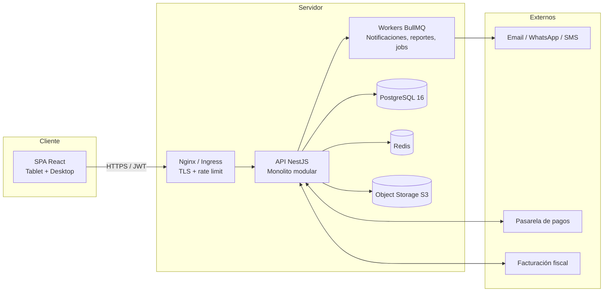

# SDD — Software Design Document · SIGO-Dental

| Campo | Valor |
|---|---|
| Documento | Software Design Document (índice maestro) |
| Proyecto | SIGO-Dental |
| Versión | 0.1.0 (borrador) |
| Fecha | 2026-10-29 |
| Estado | En revisión |
| Base | [SRS v0.1.0](../SRS/SRS-SIGO-Dental.md) |
| Estándar | ISO/IEC/IEEE 42010 (descripción de arquitectura) + C4 model |

---

## 1. Propósito

El SDD describe **cómo** se construye SIGO-Dental para satisfacer el SRS: arquitectura,
modelo de datos, diseño de cada módulo, contratos de API, seguridad, infraestructura, UI/UX,
pruebas, operación y plan de entrega.

Está dividido en carpetas por dominio para que cada documento sea legible y mantenible de
forma independiente. El índice maestro (este archivo) es el punto de entrada.

---

## 2. Cómo leer el SDD

| Si usted es… | Lea en este orden |
|---|---|
| Nuevo en el proyecto | 01 → 02 → 03 → 04 (visión general) |
| Desarrollador backend | 02 → 03 → 04 → 05 → 06 |
| Desarrollador frontend | 01 → 02 → 04 → 05 → 08 |
| DevOps / SRE | 02 → 07 → 10 |
| QA | 01 → 04 → 05 → 09 |
| Seguridad / auditoría | 02 → 06 → 10 |
| Dirección / PO | 01 → 11 → (resumen de 02) |

---

## 3. Mapa de documentos

| # | Documento | Contenido | Estado |
|---|---|---|---|
| 01 | [Visión y alcance del diseño](01-vision-alcance/DESIGN-VISION.md) | Objetivos, principios, atributos de calidad, límites. | Borrador |
| 02 | [Arquitectura](02-arquitectura/ARQUITECTURA.md) | C4, monolito modular, capas, flujos, despliegue. | Borrador |
| 02 | [ADR](02-arquitectura/adr/) | Decisiones de arquitectura con alternativas. | Borrador |
| 03 | [Modelo de datos](03-modelo-datos/MODELO-DATOS.md) | ERD, diccionario, restricciones, índices. | Borrador |
| 04 | [Diseño funcional](04-diseno-funcional/) | Módulos MD-01 a MD-09. | Borrador |
| 05 | [Contratos de API](05-apis/API-CONTRATOS.md) | Convenciones REST, endpoints, errores, webhooks. | Borrador |
| 06 | [Seguridad](06-seguridad/SEGURIDAD.md) | RBAC, amenazas, privacidad, auditoría. | Borrador |
| 07 | [Infraestructura y DevOps](07-infraestructura/INFRAESTRUCTURA-DEVOPS.md) | Entornos, CI/CD, observabilidad, backups. | Borrador |
| 08 | [UI/UX](08-ui-ux/UI-UX.md) | Design system, pantallas, odontograma, accesibilidad. | Borrador |
| 09 | [Pruebas](09-pruebas/PLAN-PRUEBAS.md) | Estrategia, TP-01 a TP-30, UAT. | Borrador |
| 10 | [Operaciones](10-operaciones/OPERACIONES.md) | Runbook, SLO, incidentes, continuidad. | Borrador |
| 11 | [Plan de entrega](11-plan-entrega/PLAN-ENTREGA.md) | Fases, hitos, riesgos, DoR/DoD. | Borrador |

### 3.1 Diseño funcional (detalle)

| ID | Módulo | Documento | Requisitos |
|---|---|---|---|
| MD-01 | Pacientes y expediente base | [`01-pacientes.md`](04-diseno-funcional/01-pacientes.md) | RF-01, 02, 19 |
| MD-02 | Odontograma, periodontograma y SOEP | [`02-odontograma.md`](04-diseno-funcional/02-odontograma.md) | RF-03, 04, 05, 20 |
| MD-03 | Consentimientos y recetas | [`03-legal-recetas.md`](04-diseno-funcional/03-legal-recetas.md) | RF-06, 21 |
| MD-04 | Tratamientos y presupuestos | [`04-tratamientos.md`](04-diseno-funcional/04-tratamientos.md) | RF-07, 08 |
| MD-05 | Agenda y notificaciones | [`05-agenda.md`](04-diseno-funcional/05-agenda.md) | RF-09, 10, 11 |
| MD-06 | Finanzas y caja | [`06-finanzas.md`](04-diseno-funcional/06-finanzas.md) | RF-12, 13, 17 |
| MD-07 | Inventario | [`07-inventario.md`](04-diseno-funcional/07-inventario.md) | RF-14 |
| MD-08 | Administración y multi-sede | [`08-administracion.md`](04-diseno-funcional/08-administracion.md) | RF-15, 16, 26 |
| MD-09 | Gobierno, reportes y migración | [`09-gobierno.md`](04-diseno-funcional/09-gobierno.md) | RF-18, 22, 23, 25 |

---

## 4. Arquitectura en una página

**Decisiones clave:** monolito modular (ADR-001), React + NestJS + PostgreSQL (ADR-002),
aislamiento por sede (ADR-003), inmutabilidad clínica y auditoría encadenada (ADR-004),
almacenamiento de objetos con URLs firmadas (ADR-005) y autenticación propia con MFA
(ADR-006).

---

## 5. Convenciones de diseño

1. **Lenguaje ubicuo:** los nombres del dominio en español en la documentación; en código,
   entidades y tablas en inglés (`patient`, `appointment`, `odontogram_finding`).
2. **Módulos:** cada módulo expone una API interna explícita; no accede a tablas de otro
   módulo.
3. **Contratos:** toda API pública se documenta en OpenAPI 3.1 antes de implementarse.
4. **Diagramas:** Mermaid, versionados en Markdown.
5. **Decisiones:** toda decisión con impacto estructural se registra como ADR.
6. **Trazabilidad:** cada componente de diseño referencia al menos un `RF`.
7. **Seguridad por defecto:** todo endpoint nace autenticado y con permiso explícito; lo
   público se declara.
8. **Sin secretos en el repositorio.**

---

## 6. Estado y control de cambios

- Este conjunto documental se encuentra en `v0.1.0` y **no habilita desarrollo** hasta la
  aprobación del SRS y de los ADR `001`–`006`.
- Cambios de alcance: primero SRS, luego SDD, luego trazabilidad.
- Los ADR no se editan una vez aceptados: se sustituyen por uno nuevo que los referencia.
- Versionado SemVer igual que el resto de la documentación.
