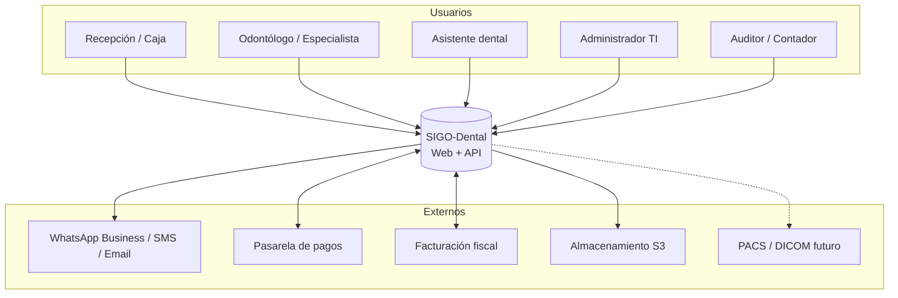

# SRS — Sistema Integral de Gestión Odontológica y Expediente Clínico Digital (SIGO-Dental)

| Campo | Valor |
|---|---|
| **Documento** | Especificación de Requisitos de Software (SRS) — versión de referencia |
| **Proyecto** | SIGO-Dental (MVP de 1 hora) |
| **Versión** | 0.2.0 (modo prototipo) |
| **Fecha** | 2026-10-29 |
| **Estado** | Documento vivo, sin aprobaciones formales |
| **Autor** | Equipo de Análisis Funcional / Arquitectura |
| **Fuente** | Documento de Requerimientos v1.0 (29/10/2026) + sesiones de análisis |
| **Estándar de referencia** | ISO/IEC/IEEE 29148:2018 (adaptado) |
| **Audiencia** | Desarrollo y demo del prototipo |

> **Modo MVP:** este proyecto se implementa como prototipo funcional en una hora. No hay
> comité, stakeholders formales, firmas ni actas de aprobación. El SRS completo queda como
> referencia de lo que se podría construir después; el alcance realmente implementado está
> en [`MVP-1-HORA.md`](../MVP-1-HORA.md).

---

## 1. Control de versiones

### 1.1 Historial de cambios

| Versión | Fecha | Autor / Rol | Descripción |
|---|---|---|---|
| 1.0 (fuente) | 29/10/2026 | Líder Funcional / Clínica | Levantamiento inicial consolidado. |
| 0.1.0 | 29/10/2026 | Análisis Funcional / Arquitectura | Reestructuración ISO 29148, criterios de aceptación, requisitos derivados, trazabilidad. |
| 0.2.0 | 29/10/2026 | Análisis Funcional / Arquitectura | Modo MVP: se eliminan aprobaciones y firmas formales; se agrega alcance de 1 hora. |

### 1.2 Regla de este modo

No se requieren firmas ni aprobaciones. El documento se actualiza a medida que se construye
el prototipo. Las decisiones se anotan directamente en el código y en
[`MVP-1-HORA.md`](../MVP-1-HORA.md).

---

## 2. Introducción

### 2.1 Propósito

Definir de forma completa, verificable y no ambigua los requisitos funcionales, no
funcionales, reglas de negocio e interfaces del sistema SIGO-Dental, de modo que sirva como
base contractual para el diseño, la estimación, el desarrollo, las pruebas y la aceptación
del software.

Este documento responde a **qué** debe hacer el sistema y **con qué calidad**; el **cómo**
se documenta en el [SDD](../SDD/README.md).

### 2.2 Alcance del producto

SIGO-Dental es una aplicación **web responsive** para clínicas odontológicas, operada por
personal clínico y administrativo desde escritorio y tablet. Cubre el ciclo completo:
recepción → agenda → atención clínica → tratamiento → cobro → control de insumos →
auditoría.

**Incluido en la versión 1:**

- Gestión de pacientes, tutores, seguros y alertas médicas.
- Expediente clínico con odontograma, periodontograma, notas SOEP, recetas y consentimientos.
- Agenda multi-sede por sillón y profesional, con estados y recordatorios.
- Presupuestos por fases y conversión de ítems aprobados en tareas agendables.
- Caja, pagos mixtos, comprobantes, liquidación de honorarios e inventario.
- Administración de usuarios, roles, catálogos y parámetros.
- Auditoría inmutable y reportes operativos/financieros.

**Excluido de la versión 1** (ver §3.7):

- App móvil nativa para pacientes (se evaluará PWA en el roadmap).
- Procesamiento/visualización DICOM nativa e integración PACS en tiempo real.
- Facturación electrónica multi-país simultánea (se implementa el adaptador del país
  objetivo; ver `Q-02`).
- Teleodontología con videollamada integrada.
- Gestión contable completa (mayor, balances, impuestos) más allá de caja y facturación.

### 2.3 Audiencia y lectura recomendada

| Audiencia | Secciones prioritarias |
|---|---|
| Sponsor / dirección clínica | 3, 4 (resumen), 5, 10 |
| Recepción / administración | 3.3, 4.1, 4.4, 4.5, 6 |
| Odontólogos y asistentes | 4.2, 4.3, 6, 7 |
| TI / desarrollo | 4, 5, 7, 8, 9 |
| QA | 4, 5, 9, 10 |
| Auditoría / legales | 5.2, 5.3, 6, 7.4 |

### 2.4 Referencias

| ID | Documento |
|---|---|
| REF-01 | Documento de Requerimientos de Software — Sistema Odontológico v1.0. |
| REF-02 | [Casos de uso detallados](A-casos-de-uso.md). |
| REF-03 | [Matriz de trazabilidad](B-matriz-trazabilidad.md). |
| REF-04 | [Glosario](../GLOSARIO.md). |
| REF-05 | [SDD](../SDD/README.md). |
| REF-06 | ISO/IEC/IEEE 29148:2018 — Requirements engineering. |
| REF-07 | OWASP ASVS 5.0 y OWASP Top 10 (2021). |
| REF-08 | WCAG 2.2, nivel AA. |
| REF-09 | HL7 FHIR R4 (hoja de ruta de interoperabilidad). |

### 2.5 Visión general del documento

§3 describe el contexto y los usuarios. §4 enumera los requisitos funcionales con criterios
de aceptación. §5 define los requisitos no funcionales medibles. §6 fija las reglas de
negocio. §7 cubre datos, retención e interfaces. §8 detalla integraciones externas. §9
resume la trazabilidad. §10 establece los criterios de aceptación del proyecto y §11 los
anexos.

---

## 3. Descripción general

### 3.1 Contexto del producto

### 3.2 Funciones principales

| Módulo | Función | Requisitos |
|---|---|---|
| M1. Pacientes | Ficha única, tutores, seguros, alertas médicas | RF-01, RF-02, RF-19 |
| M2. Expediente clínico | Odontograma, periodontograma, SOEP, documentos | RF-03, RF-04, RF-05, RF-20 |
| M3. Documentos legales | Consentimientos, firmas, recetas | RF-06, RF-21 |
| M4. Tratamientos | Presupuestos, aprobación, tareas | RF-07, RF-08 |
| M5. Agenda | Turnos, estados, recordatorios | RF-09, RF-10, RF-11 |
| M6. Finanzas | Caja, pagos, facturación, comisiones | RF-12, RF-13, RF-17 |
| M7. Inventario | Stock, descargo, alertas | RF-14 |
| M8. Administración | Usuarios, roles, catálogos, sedes | RF-15, RF-16, RF-26 |
| M9. Gobierno | Auditoría, reportes, tablero, migración | RF-18, RF-22, RF-23, RF-25 |

### 3.3 Usuarios y roles

| Rol | Descripción | Necesidad principal | Restricciones |
|---|---|---|---|
| Administrador TI | Configura infraestructura, usuarios y catálogos. | Control total y trazabilidad. | No debe poder leer notas clínicas sin justificación auditada. |
| Recepcionista / Cajero | Agenda, registra pacientes, cobra. | Rapidez y claridad. | Sin acceso a notas clínicas; caja ciega (`RN-02`). |
| Odontólogo general / Especialista | Atiende y documenta. | Registro clínico ágil en tablet. | Solo pacientes de sus sedes asignadas; firma obligatoria. |
| Asistente dental | Apoya el acto clínico. | Signos vitales, insumos, notas. | No firma notas ni aprueba presupuestos. |
| Auditor / Contador | Concilia y reporta. | Reportes y evidencia. | Solo lectura; sin edición clínica. |

**Matriz RACI (resumen de responsabilidades):**

| Actividad | Sponsor | Product Owner | TI / Arquitectura | Clínica | QA |
|---|---|---|---|---|---|
| Definir alcance | A | R | C | C | I |
| Aprobar requisitos | A | R | C | C | I |
| Diseñar arquitectura | I | C | R/A | I | C |
| Validar flujos clínicos | A | C | I | R | C |
| Aceptar releases | A | R | C | C | R |
| Auditoría de seguridad | I | I | R | I | A |

`R` = responsable, `A` = aprueba, `C` = consultado, `I` = informado.

### 3.4 Entorno operativo

- **Cliente:** navegadores de escritorio y tablet (ver RNF-11/RNF-12). No requiere
  instalación.
- **Red:** clínica con internet ≥ 15 Mbps; se asume conectividad continua (ver `Q-06` sobre
  operación degradada).
- **Servidor:** contenedores Linux en nube o VPS; PostgreSQL gestionado o autoalojado.
- **Dispositivos clínicos:** tablet ≥ 10.5", opcional lápiz para firma; impresora térmica o
  láser para comprobantes y recetas.
- **Zona horaria:** única por instalación, configurable (`America/Argentina/Buenos_Aires`
  por defecto, ajustable).

### 3.5 Restricciones

| ID | Restricción | Impacto |
|---|---|---|
| C-01 | Datos de salud son sensibles: aplicación obligatoria de la normativa local de protección de datos. | Cifrado, minimización, auditoría, retención. |
| C-02 | La firma digital con certificado no es requisito de v1; se usa firma electrónica simple con evidencia. | Diseño de firma y validez legal a validar (`Q-04`). |
| C-03 | La integración fiscal depende de la autoridad tributaria del país objetivo. | Adaptador aislado; no bloquea el POS interno. |
| C-04 | Presupuesto de infraestructura acotado para v1 (una región, un clúster). | Monolito modular, escalado vertical/horizontal simple. |
| C-05 | El odontograma debe funcionar en tablet sin pérdida de precisión táctil. | UI con áreas de toque ≥ 44 px y zoom. |
| C-06 | El equipo de desarrollo es reducido (≤ 8 personas). | Evitar microservicios prematuros (ADR-001). |

### 3.6 Supuestos y dependencias

| ID | Supuesto / dependencia | Si no se cumple |
|---|---|---|
| S-01 | La clínica opera en un solo país y una sola moneda. | Se requiere multi-moneda y multi-impuesto (`Q-03`). |
| S-02 | Existe conectividad estable durante el horario clínico. | Evaluar modo degradado (`Q-06`). |
| S-03 | El proveedor de WhatsApp Business está disponible y con plantillas aprobadas. | Fallback a SMS/email (RF-11). |
| S-04 | La clínica cuenta con tabletas y navegadores actualizados. | Plan de renovación de hardware. |
| S-05 | Los datos históricos están en papel, Excel o un sistema previo exportable. | Migración manual asistida (RF-25). |
| S-06 | La autoridad fiscal expone API o servicio de timbrado. | Emisión diferida / integración por archivo. |

### 3.7 Fuera de alcance (v1)

- App nativa iOS/Android para pacientes; se evalúa PWA en Fase 2 del roadmap.
- Visor DICOM con mediciones y PACS bidireccional.
- Historia clínica interoperable FHIR en producción (solo diseño de extensibilidad).
- Facturación multi-país simultánea y contabilidad general.
- Gestión de recursos humanos, nómina y compras a proveedores.
- Marketing automation y fidelización.
- Telemedicina.

Cada exclusión puede convertirse en requisito futuro mediante control de cambios.

---

## 4. Requisitos funcionales

**Formato:** cada requisito incluye identificador, prioridad MoSCoW, etapa de entrega
(`E1`–`E4`), descripción y criterios de aceptación verificables.

**Etapas de entrega del software** (independientes de la Fase 1 documental):

| Etapa | Sprints | Contenido |
|---|---|---|
| E1 | 1–4 | Núcleo administrativo: pacientes, agenda, caja, administración. |
| E2 | 5–8 | Núcleo clínico: odontograma, periodontograma, SOEP, consentimientos, recetas. |
| E3 | 9–11 | Finanzas avanzadas, inventario, reportes, facturación fiscal. |
| E4 | 12 | UAT, seguridad, migración final y salida a producción. |

### 4.1 M1 — Pacientes y filiación

#### RF-01 · Registro unificado de pacientes — `Must` · E1

El sistema debe permitir crear, consultar, modificar y dar de baja lógica la ficha única del
paciente, con datos demográficos, contacto, contacto de emergencia, tutor legal y cobertura.

**Criterios de aceptación:**

1. Campos obligatorios: nombres, apellidos, tipo y número de documento, fecha de nacimiento,
   sexo, teléfono, dirección y contacto de emergencia.
2. El documento es único por tipo y país; un intento de duplicado se bloquea con mensaje
   claro.
3. Ante coincidencia difusa (nombre + fecha de nacimiento + teléfono), el sistema advierte
   posible duplicado y exige confirmación explícita.
4. Si el paciente es menor de 18 años, se exige al menos un tutor legal con documento,
   parentesco y teléfono.
5. La baja es lógica: el paciente deja de aparecer en búsquedas activas pero su historial se
   conserva y es consultable por roles autorizados.
6. Todo cambio queda auditado con usuario, timestamp y valores anterior/nuevo (RF-18).
7. La ficha muestra la cobertura vigente (seguro/convenio, plan, número de afiliado,
   vigencia) y permite múltiples coberturas con una principal.

#### RF-02 · Anamnesis y alertas médicas — `Must` · E1

El sistema debe registrar antecedentes médicos estructurados y generar alertas visibles en
la cabecera del expediente.

**Criterios de aceptación:**

1. Registra: enfermedades sistémicas, alergias (con sustancia y severidad), medicación
   habitual, antecedentes quirúrgicos, coagulopatías, embarazo/lactancia y hábitos.
2. Toda alergia o condición marcada como crítica genera un badge persistente en la cabecera
   del paciente y en la pantalla de prescripción.
3. Al prescribir un fármaco relacionado con una alergia registrada, el sistema bloquea la
   acción y permite continuar solo con justificación escrita y firma del profesional,
   dejando registro de auditoría.
4. La anamnesis se versiona: se conserva el historial de actualizaciones con profesional,
   fecha y motivo.
5. El profesional puede marcar "sin antecedentes relevantes" como declaración explícita,
   que también se firma y versiona.
6. Las alertas no pueden ser eliminadas por recepción ni administración; solo un profesional
   autorizado puede resolverlas dejando constancia.

#### RF-19 · Búsqueda de pacientes — `Must` · E1

Búsqueda global por nombre, apellido, documento, teléfono, email o fecha de nacimiento, con
tolerancia a errores de tipeo y acentos.

**Criterios de aceptación:**

1. Resultados en menos de 1 segundo para una base de 100.000 pacientes.
2. Mínimo 3 caracteres; búsqueda por documento exacta desde el primer carácter.
3. Los resultados respetan el alcance de sede y permisos del usuario.
4. Muestra nombre, documento, edad, teléfono, última visita y badge de alerta.
5. No expone datos clínicos en el listado de resultados.

### 4.2 M2 — Expediente clínico

#### RF-03 · Odontograma gráfico interactivo — `Must` · E2

Representación anatómica interactiva de la dentición permanente (32) y decidua (20), con
notación FDI y Universal, marcado por superficies y catálogo visual estandarizado.

**Criterios de aceptación:**

1. Alterna entre dentición permanente, decidua y mixta, y entre notación FDI y Universal sin
   perder datos.
2. Cada diente admite estado general y marcado por superficie: mesial, distal,
   oclusal/incisal, vestibular y lingual/palatino.
3. Catálogo mínimo: caries, restauración existente, endodoncia realizada, endodoncia
   requerida, implante, prótesis fija, prótesis removible, exodoncia, sellante, corona,
   ausente y en tratamiento.
4. Cada hallazgo registra estado (`existente`, `requerido`, `realizado`), profesional, fecha
   y nota opcional.
5. Un hallazgo `realizado` no puede eliminarse; se corrige por adenda (`RN-01`).
6. El odontograma se versiona y permite comparar dos fechas.
7. Exporta a PDF con leyenda, fecha, paciente y profesional.
8. La información no depende solo del color: cada estado tiene además ícono/patrón y texto
   alternativo (RNF-13).
9. Renderiza en menos de 1,5 s en tablet con conexión ≥ 15 Mbps (RNF-01).
10. El zoom y las áreas táctiles permiten seleccionar una superficie sin ambigüedad en
    pantalla de 10.5".

#### RF-04 · Periodontograma digital — `Should` · E2

Registro de seis sitios por diente con cálculo de nivel de inserción clínica.

**Criterios de aceptación:**

1. Captura profundidad de sondaje, margen gingival, sangrado al sondaje, supuración,
   movilidad (Miller 0–III), furca (I–III) y placa, por diente y sitio.
2. Calcula NIC = margen gingival + profundidad de sondaje y lo muestra por sitio y diente.
3. Permite comparar dos estudios y resaltar cambios ≥ 2 mm.
4. Genera gráfico y tabla exportable a PDF.
5. Valida rangos clínicos (0–15 mm) y advierte valores fuera de rango sin bloquear.
6. Solo odontólogos y asistentes autorizados pueden registrar; la firma del odontólogo
   cierra el estudio.

#### RF-05 · Evolución y notas SOEP — `Must` · E2

Bitácora cronológica de notas clínicas en formato Subjetivo, Objetivo, Evaluación y Plan.

**Criterios de aceptación:**

1. Cada nota se asocia a paciente, profesional, fecha/hora y, opcionalmente, a un turno y a
   un procedimiento.
2. La nota se bloquea para edición tras un plazo configurable (por defecto 24 h) o al
   firmarse, lo que ocurra primero.
3. Después del bloqueo solo se permiten adendas firmadas, vinculadas a la nota original.
4. No existe borrado físico de notas; la baja es lógica y auditada.
5. La firma registra profesional, timestamp, hash del contenido y dirección IP/dispositivo.
6. La línea de tiempo es inmutable y ordenada; muestra autoría y versión.
7. Búsqueda y filtro por fecha, profesional y texto.

#### RF-20 · Gestión documental y adjuntos — `Should` · E2

Almacenamiento y visualización de radiografías, fotos clínicas, PDFs y documentos firmados.

**Criterios de aceptación:**

1. Carga por arrastre o selector, con límite configurable (por defecto 50 MB por archivo).
2. Formatos permitidos configurables: JPG, PNG, WEBP, PDF, DICOM (sin visualización nativa).
3. Escaneo antivirus antes de disponibilizar el archivo.
4. Metadatos: tipo, fecha, profesional, descripción, vínculo a paciente/tratamiento/diente.
5. Control de acceso por rol y sede; URL firmada con expiración.
6. Versionado: reemplazar un archivo genera nueva versión, conservando la anterior.
7. Los archivos se almacenan cifrados en reposo (RNF-05).

#### RF-21 · Recetas digitales — `Should` · E2

Emisión de recetas con validación de alergias e interacciones básicas.

**Criterios de aceptación:**

1. Catálogo de medicamentos con principio activo, presentación y concentración.
2. Campos: medicamento, dosis, vía, frecuencia, duración e indicaciones.
3. Alerta bloqueante ante alergia registrada (RF-02) y advertencia ante interacción
   conocida de la lista configurada.
4. Firma del profesional y generación de PDF con datos de la clínica, paciente, profesional
   y matrícula.
5. Envío por email/WhatsApp si el paciente lo autorizó; registro del estado de entrega.
6. Las recetas emitidas no se editan; se anulan con motivo y trazabilidad.

### 4.3 M3 — Documentos legales

#### RF-06 · Consentimiento informado digital — `Must` · E2

Generación y firma de consentimientos por procedimiento.

**Criterios de aceptación:**

1. Plantillas versionadas por tipo de procedimiento, con texto legal aprobado por la clínica.
2. El documento incluye paciente/tutor, profesional, procedimiento, riesgos, alternativas,
   fecha y lugar.
3. Firma por canvas táctil (con captura de trazo) o validación por OTP enviado al paciente.
4. El PDF firmado se sella con hash SHA-256 y timestamp; se almacena inmutable (RF-20).
5. No se puede registrar un procedimiento invasivo sin consentimiento vigente asociado
   (`RN-12`), salvo urgencia justificada y auditada.
6. Permite revocación con motivo, sin eliminar el documento original.
7. El paciente o tutor recibe copia por email si está disponible.

### 4.4 M4 — Tratamientos y presupuestos

#### RF-07 · Presupuestos multinivel — `Must` · E2

Armado de presupuestos por fases/sesiones con honorarios, laboratorio, descuentos e
impuestos.

**Criterios de aceptación:**

1. Ítems con procedimiento, diente/superficie (opcional), cantidad, precio unitario,
   descuento y total.
2. Agrupación por fases y sesiones, con subtotales y total general.
3. Costo de laboratorio por ítem o por fase, visible según permisos.
4. Descuentos limitados por umbral configurable; por encima requiere autorización
   registrada.
5. Impuestos configurables por ítem o global.
6. Moneda y vigencia del presupuesto (por defecto 30 días, configurable).
7. Versionado: modificar un presupuesto enviado genera nueva versión; la anterior queda
   consultable.
8. PDF con identidad de la clínica, datos del paciente, detalle, validez y condiciones.

#### RF-08 · Aprobación y transición a citas — `Must` · E2

Registro de aceptación total o parcial y conversión de ítems aprobados en tareas
agendables.

**Criterios de aceptación:**

1. El paciente/tutor aprueba el total o selecciona ítems.
2. La aprobación se registra con firma (canvas u OTP), fecha y usuario que la cargó.
3. Los ítems aprobados generan tareas de tratamiento con estado `pendiente`, asociadas a
   presupuesto y paciente.
4. Cada tarea puede agendarse desde la agenda (RF-09) y al completarse marca el ítem como
   `realizado`.
5. El rechazo requiere motivo; el presupuesto queda `rechazado`.
6. Un presupuesto vencido no puede aprobarse sin reactivación autorizada.
7. El saldo pendiente se calcula sobre ítems aprobados y se refleja en finanzas.

### 4.5 M5 — Agenda y turnos

#### RF-09 · Agendamiento multi-sede — `Must` · E1

Calendario con vistas por día, semana y mes, filtrable por sede, consultorio/sillón y
profesional.

**Criterios de aceptación:**

1. Vista día/semana/mes con arrastrar y soltar para reprogramar.
2. Filtros combinables por sede, sillón, profesional, estado y tipo de procedimiento.
3. La duración sugerida se toma del catálogo de procedimientos y es editable.
4. Bloqueos de agenda por vacaciones, reuniones o mantenimiento.
5. Validación de solapamiento por sillón (`RN-03`) y por profesional (`RN-04`).
6. Considera zona horaria y horario de atención por sede.
7. Identifica visualmente turnos confirmados, en sala, atendidos, cancelados y no-show.
8. Registra quién creó/reprogramó y motivo del cambio.

#### RF-10 · Control de estados de cita — `Must` · E1

Máquina de estados explícita con historial de transiciones.

**Criterios de aceptación:**

1. Estados: `PROGRAMADA`, `CONFIRMADA`, `EN_SALA`, `EN_ATENCION`, `ATENDIDA`,
   `CANCELADA`, `NO_ASISTIO`.
2. Transiciones válidas según matriz de §4.5.1; las inválidas se rechazan.
3. Cada transición registra usuario, timestamp y motivo cuando corresponda.
4. Cancelación requiere motivo de catálogo y, si aplica, política de cargo.
5. `NO_ASISTIO` puede marcarse manualmente o por job tras el fin del turno + gracia
   configurable.
6. El historial es inmutable.

**4.5.1 Matriz de transiciones**

| Desde \ Hacia | CONFIRMADA | EN_SALA | EN_ATENCION | ATENDIDA | CANCELADA | NO_ASISTIO |
|---|---|---|---|---|---|---|
| PROGRAMADA | ✔ (paciente/recepción) | ✔ (recepción) | ✖ | ✖ | ✔ | ✔ (tras gracia) |
| CONFIRMADA | — | ✔ | ✖ | ✖ | ✔ | ✔ (tras gracia) |
| EN_SALA | ✖ | — | ✔ (odontólogo) | ✖ | ✔ | ✖ |
| EN_ATENCION | ✖ | ✖ | — | ✔ (odontólogo) | ✔ (excepcional) | ✖ |
| ATENDIDA | ✖ | ✖ | ✖ | — | ✖ | ✖ |
| CANCELADA | ✖ | ✖ | ✖ | ✖ | — | ✖ |
| NO_ASISTIO | ✖ | ✖ | ✖ | ✖ | ✖ | — |

#### RF-11 · Notificaciones automáticas — `Should` · E1 (email) / E3 (WhatsApp/SMS)

Envío de confirmaciones y recordatorios transaccionales.

**Criterios de aceptación:**

1. Disparadores: creación, confirmación, recordatorio 48 h y 24 h antes, cancelación y
   reprogramación.
2. Canales: email en E1; WhatsApp Business y SMS en E3.
3. Plantillas versionadas y aprobadas por canal, con variables acotadas.
4. El mensaje no incluye datos clínicos ni diagnóstico (minimización).
5. Registra estado por destinatario: `encolado`, `enviado`, `entregado`, `leído`, `fallido`.
6. Reintentos con backoff y límite; los fallos quedan visibles para recepción.
7. Respeta opt-out del paciente y ventanas horarias configuradas.
8. Idempotencia: un mismo recordatorio no se envía dos veces al mismo destinatario.

### 4.6 M6 — Finanzas

#### RF-12 · Punto de venta y facturación — `Must` · E1 (POS) / E3 (fiscal)

Cobro de prestaciones con pagos mixtos y emisión de comprobantes.

**Criterios de aceptación:**

1. Carrito de cobro con ítems de presupuesto, ventas directas y ajustes autorizados.
2. Medios de pago: efectivo, tarjeta débito/crédito, transferencia, seguro/convenio y
   crédito a cuenta.
3. Pagos mixtos: la suma de pagos debe igualar el total o quedar explícitamente como saldo
   pendiente (`RN-07`).
4. Comprobante interno con numeración correlativa por sede y punto de emisión.
5. En E3, integración con la autoridad fiscal: emisión, consulta de estado y nota de
   crédito; los comprobantes emitidos son inmutables (`RN-10`).
6. Reimpresión y envío por email del comprobante.
7. Todo cobro queda asociado a caja y turno de caja abierto (RF-17).
8. La pasarela de pagos (si está habilitada) confirma por webhook idempotente.

#### RF-13 · Liquidación de honorarios — `Should` · E3

Cálculo de comisiones a profesionales según reglas configurables.

**Criterios de aceptación:**

1. Reglas por profesional y/o procedimiento: porcentaje fijo, monto fijo o porcentaje sobre
   el neto tras deducir laboratorio/materiales.
2. Base configurable: facturado o efectivamente cobrado (`RN-11`).
3. Liquidación por período con detalle de ítems, deducciones y total.
4. Estado: `borrador`, `cerrada`, `pagada`; una liquidación cerrada no se edita.
5. Reporte exportable y trazabilidad de ajustes manuales con autorización.

#### RF-17 · Apertura y cierre de caja — `Must` · E1

Control diario de caja por sede con cierre ciego.

**Criterios de aceptación:**

1. Apertura con monto inicial, usuario, sede y turno.
2. Registra ingresos, egresos, retiros y ajustes con motivo.
3. Cierre ciego: el cajero ingresa el conteo físico antes de ver el total teórico (`RN-02`).
4. Calcula diferencia (sobrante/faltante) y exige observación si es distinta de cero.
5. Un supervisor autorizado aprueba el cierre; la reapertura es excepcional y auditada.
6. Reporte de cierre en PDF con desglose por medio de pago.
7. No se puede cobrar sin caja abierta.

### 4.7 M7 — Inventario

#### RF-14 · Descargo automático de insumos — `Should` · E3

Deducción de stock al completar procedimientos según receta estándar de consumo.

**Criterios de aceptación:**

1. Catálogo de insumos con unidad, costo, stock mínimo y ubicación.
2. Receta de consumo (BOM) por procedimiento, editable por el administrador.
3. Al pasar un procedimiento a `realizado`, descuenta stock de la sede del turno.
4. Si el stock es insuficiente, alerta y permite continuar solo con autorización registrada
   (`RN-06`).
5. Movimientos: entrada, salida, ajuste, devolución y transferencia entre sedes.
6. Lotes y vencimientos con alerta previa configurable.
7. Reporte de consumo por período, profesional y procedimiento.
8. El stock nunca queda negativo; los ajustes requieren motivo.

### 4.8 M8 — Administración

#### RF-15 · Usuarios, roles y permisos — `Must` · E1

Administración de identidades y control de acceso.

**Criterios de aceptación:**

1. Alta, edición, desactivación y desbloqueo de usuarios.
2. Roles con permisos granulares por módulo y acción (`crear`, `leer`, `editar`, `eliminar`,
   `aprobar`, `exportar`).
3. Asignación de una o más sedes por usuario.
4. MFA obligatoria para roles clínicos y financieros (RNF-06).
5. Bloqueo tras 5 intentos fallidos y desbloqueo administrativo.
6. Cierre de sesión por inactividad a los 15 minutos en estaciones clínicas.
7. Todo cambio de permisos queda auditado.
8. No se puede eliminar el último administrador activo.

#### RF-16 · Catálogos y parametrización — `Must` · E1

Administración de catálogos maestros y parámetros del sistema.

**Criterios de aceptación:**

1. Catálogos: procedimientos y precios por sede, insumos, especialidades, motivos de
   cancelación, tipos de documento, coberturas, medicamentos, plantillas de consentimiento y
   de notas.
2. Parámetros: zona horaria, moneda, impuestos, umbral de descuento, plazo de bloqueo de
   notas, ventana de recordatorios, política de no-show.
3. Cambios con vigencia (fecha desde/hasta) para no alterar documentos históricos.
4. Importación/exportación CSV validada.
5. Los catálogos en uso no se eliminan: se desactivan.

#### RF-26 · Gestión multi-sede — `Must` · E1

Modelo de sedes, consultorios y sillones.

**Criterios de aceptación:**

1. CRUD de sedes con dirección, horario, zona horaria y datos fiscales.
2. CRUD de consultorios y sillones por sede.
3. Profesionales asignados a una o más sedes con horarios.
4. Todos los datos operativos (agenda, caja, stock, reportes) se filtran por sede.
5. Un usuario solo accede a las sedes asignadas; el administrador puede ver el consolidado.
6. Reportes consolidados multi-sede para roles autorizados.

### 4.9 M9 — Gobierno, reportes y migración

#### RF-18 · Auditoría y bitácora consultable — `Must` · E1

Registro inmutable y consulta de acciones sobre datos sensibles.

**Criterios de aceptación:**

1. Registra al menos: login/logout, accesos a expediente, altas/modificaciones/bajas,
   exportaciones, impresiones, cambios de permisos y accesos a archivos.
2. Campos: usuario, rol, sede, acción, entidad, ID afectado, timestamp ISO-8601 con zona,
   IP, user-agent, valores anterior/nuevo (cuando aplique).
3. El log es append-only: no se edita ni se borra desde la aplicación.
4. Consulta filtrable por fecha, usuario, entidad y acción, con exportación CSV autorizada.
5. Retención mínima de 5 años (configurable, RNF-20).
6. Verificación de integridad por hash encadenado o firma periódica.

#### RF-22 · Reportes operativos y financieros — `Should` · E3

Reportes para gestión y conciliación.

**Criterios de aceptación:**

1. Reportes: producción por profesional, ocupación de sillones, no-show, ingresos por
   período y medio de pago, deudas, comisiones, consumo de insumos, auditoría.
2. Filtros por rango de fechas, sede y profesional.
3. Exportación CSV y PDF.
4. Los importes respetan la moneda y el redondeo configurados.
5. Acceso restringido por rol; los reportes clínicos no exponen datos innecesarios.

#### RF-23 · Tablero operativo — `Could` · E3

Panel de indicadores diarios por rol.

**Criterios de aceptación:**

1. Recepción: turnos del día, en sala, pendientes de confirmar, no-show.
2. Odontólogo: agenda propia, tareas de tratamiento pendientes, alertas de pacientes.
3. Dirección: ingresos del día, ocupación, comparativo semanal.
4. Los datos se actualizan con un refresco máximo de 5 minutos.
5. Cada rol ve solo los indicadores permitidos.

#### RF-25 · Migración e importación de datos — `Should` · E1 (pacientes) / E4 (cierre)

Importación controlada desde el sistema anterior o planillas.

**Criterios de aceptación:**

1. Importación de pacientes, tutores, coberturas, catálogo de procedimientos y saldos
   iniciales.
2. Plantillas CSV/Excel documentadas y validadas (tipos, longitudes, referencias).
3. Ejecución en modo simulación (dry-run) con informe de errores por fila.
4. Idempotencia por clave natural (documento, código de procedimiento).
5. Importación transaccional con posibilidad de rollback por lote.
6. Registro de auditoría de cada lote y de los errores.
7. Los datos importados se validan en staging antes de producción.

#### RF-24 · Portal del paciente (PWA) — `Won't` (v1) · Roadmap

Autogestión del paciente: ver turnos, confirmar/cancelar, descargar recetas y comprobantes,
pagar en línea.

> **No forma parte de v1.** Se documenta para preservar la extensibilidad del modelo y de la
> API (ver `Q-08`).

---

## 5. Requisitos no funcionales

Cada RNF es medible y verificable. La evidencia de cumplimiento se registra en el
[plan de pruebas](../SDD/09-pruebas/PLAN-PRUEBAS.md).

### 5.1 Rendimiento y disponibilidad

| ID | Requisito | Métrica / verificación |
|---|---|---|
| RNF-01 | Tiempo de respuesta | p95 < 1,5 s para abrir expediente y renderizar odontograma; p95 < 500 ms en APIs CRUD; búsqueda < 1 s con 100k pacientes. Medición con k6 en staging. |
| RNF-02 | Disponibilidad | ≥ 99,9 % en horario 07:00–21:00 local; ≥ 99,5 % 24/7. Medición mensual sobre monitoreo sintético. |
| RNF-03 | Concurrencia | 150 usuarios concurrentes sin degradar p95; diseño preparado para 300. Prueba de carga sostenida 1 h. |
| RNF-04 | Escalabilidad | Backend sin estado; escalado horizontal del servicio web y workers. Crecimiento a 100k pacientes / 1M notas sin rediseño (RNF-18). |

### 5.2 Seguridad y privacidad

| ID | Requisito | Métrica / verificación |
|---|---|---|
| RNF-05 | Cifrado | TLS 1.3 en tránsito; AES-256 en reposo para BD, backups, objetos y secretos. Verificación por configuración y escaneo. |
| RNF-06 | Autenticación y autorización | RBAC + MFA obligatoria para roles clínicos/financieros; sesión 15 min; bloqueo tras 5 intentos; contraseñas con Argon2id. |
| RNF-07 | Auditoría | 100 % de accesos y mutaciones sobre datos clínicos registrados; log inmutable con retención ≥ 5 años. |
| RNF-08 | Seguridad de aplicación | OWASP ASVS nivel 2; SAST/DAST sin hallazgos altos/críticos; dependencias sin CVEs críticas. |
| RNF-09 | Privacidad por diseño | Minimización de datos, seudonimización en entornos no productivos, consentimiento y derechos del titular documentados. |
| RNF-10 | Gestión de secretos | Credenciales fuera del código; rotación al menos semestral; acceso auditado. |

### 5.3 Usabilidad, accesibilidad y compatibilidad

| ID | Requisito | Métrica / verificación |
|---|---|---|
| RNF-11 | Diseño responsive | Correcto en 1920×1080, 1366×768 y tablets ≥ 10,5"; sin scroll horizontal en flujos críticos. |
| RNF-12 | Navegadores | Últimas 2 versiones estables de Chrome, Firefox, Edge y Safari. |
| RNF-13 | Accesibilidad | WCAG 2.2 AA: contraste, foco visible, navegación por teclado, alternativas al color, etiquetas ARIA. Auditoría con axe + revisión manual. |
| RNF-14 | Localización | Español por defecto; formatos de fecha/hora y moneda configurables; textos externalizados para i18n. |
| RNF-15 | Usabilidad clínica | Un odontólogo completa una nota SOEP estándar en ≤ 3 minutos; registrar un hallazgo en odontograma en ≤ 10 s. Prueba con 5 usuarios. |

### 5.4 Mantenibilidad, operación y datos

| ID | Requisito | Métrica / verificación |
|---|---|---|
| RNF-16 | Mantenibilidad | Monolito modular con límites explícitos; cobertura ≥ 80 % en endpoints críticos; análisis estático sin errores; documentación OpenAPI 3.1. |
| RNF-17 | Observabilidad | Métricas, logs estructurados y trazas correlacionadas; dashboards de SLO; alertas de error rate, latencia y saturación. |
| RNF-18 | Capacidad | Soporta 100k pacientes, 1M notas clínicas y 500 GB de adjuntos con los SLO vigentes. |
| RNF-19 | Respaldo y recuperación | RPO ≤ 15 min; RTO ≤ 4 h; backups diarios + WAL; prueba de restauración trimestral documentada. |
| RNF-20 | Retención y ciclo de vida | Historia clínica ≥ 10 años o según normativa local; auditoría ≥ 5 años; borrado/anonimización verificable al vencer. |
| RNF-21 | Interoperabilidad | API REST/JSON documentada en OpenAPI 3.1; exportación CSV; modelo preparado para FHIR R4 (hoja de ruta). |
| RNF-22 | Documentación | ADR, runbooks, contratos de API y manual de usuario entregados antes de producción. |
| RNF-23 | Compatibilidad de impresión | Comprobantes y recetas imprimibles en A4 y térmica de 80 mm. |

---

## 6. Reglas de negocio

| ID | Regla | Verificación |
|---|---|---|
| RN-01 | **Inmutabilidad clínica.** Ningún procedimiento `realizado` se borra. Las correcciones se hacen por adenda firmada. | Prueba de intento de borrado → rechazado; adenda visible. |
| RN-02 | **Cierre de caja ciego.** El cajero ingresa el conteo físico antes de ver el total teórico. | El endpoint de totales responde 403 hasta registrar el conteo. |
| RN-03 | **No superposición de sillones.** No puede haber dos citas activas en el mismo sillón y horario. | Restricción en BD + validación en servicio; prueba concurrente. |
| RN-04 | **No superposición de profesionales.** Un profesional no puede tener dos citas activas simultáneas, aunque sean en sedes distintas (salvo modalidad virtual explícita). | Igual que RN-03 sobre `professional_id`. |
| RN-05 | **Presupuesto aprobado inmutable.** Modificar un presupuesto aprobado genera nueva versión; no altera ítems ya aceptados. | Prueba de edición → nueva versión. |
| RN-06 | **Stock no negativo.** Un movimiento que deje stock < 0 se bloquea salvo autorización registrada. | Prueba de descargo con stock insuficiente. |
| RN-07 | **Cuadre de pagos.** La suma de pagos no puede superar el total; el faltante queda como saldo pendiente explícito. | Validación en POS y en API. |
| RN-08 | **Tutor legal.** Paciente menor de 18 años requiere tutor para consentimientos y presupuestos. | Bloqueo de firma sin tutor. |
| RN-09 | **Baja lógica.** Pacientes, profesionales, catálogos y documentos no se eliminan físicamente. | Borrado físico deshabilitado a nivel aplicación/BD. |
| RN-10 | **Comprobante emitido inmutable.** Se anula con nota de crédito, nunca se edita. | Prueba de edición → rechazada. |
| RN-11 | **Comisión sobre cobrado.** Por defecto la comisión se calcula sobre pagos efectivamente cobrados, no sobre facturado. | Reporte de liquidación conciliado con caja. |
| RN-12 | **Consentimiento previo.** Procedimientos invasivos requieren consentimiento vigente. | Bloqueo de registro sin consentimiento. |
| RN-13 | **Odontograma firmado bloqueado.** Un estudio firmado no se edita; se corrige por adenda o nuevo estudio. | Prueba de mutación → rechazada. |
| RN-14 | **Zona horaria única.** Todas las fechas se almacenan en UTC y se muestran en la zona de la sede. | Prueba con cambio de zona y horario de verano. |
| RN-15 | **Precio histórico.** Un ítem conserva el precio vigente al momento de su creación, aunque el catálogo cambie. | Verificación de snapshot de precio. |
| RN-16 | **Alertas médicas prevalecen.** Ninguna alerta crítica puede ocultarse por configuración de UI. | Prueba de configuración → alerta visible. |

---

## 7. Requisitos de datos

### 7.1 Entidades principales

Paciente, tutor, cobertura, profesional, usuario, rol, permiso, sede, sillón, turno,
historial de turno, nota clínica, adenda, odontograma, hallazgo dental, estudio periodontal,
sitio periodontal, presupuesto, ítem de presupuesto, aprobación, tarea de tratamiento,
procedimiento, insumo, movimiento de stock, receta, consentimiento, documento, pago, factura,
sesión de caja, movimiento de caja, liquidación, notificación, auditoría y parámetro.

El modelo lógico completo, con claves, relaciones e índices, está en
[`MODELO-DATOS.md`](../SDD/03-modelo-datos/MODELO-DATOS.md).

### 7.2 Reglas de integridad

1. Toda entidad clínica referencia paciente y sede; las operaciones son transaccionales.
2. Los documentos firmados almacenan hash y timestamp; cualquier alteración es detectable.
3. Las claves naturales (documento de paciente, código de procedimiento) son únicas por
   ámbito.
4. Las fechas se guardan en UTC; la zona de la sede se aplica en presentación.
5. Los importes se guardan en decimal (no flotante) con la moneda y escala configuradas.
6. Los borrados son lógicos (`deleted_at`) salvo tablas de auditoría, que son append-only.
7. Las migraciones de esquema son versionadas y reversibles.

### 7.3 Calidad de datos

- Validación en formulario, API y base de datos.
- Normalización de nombres y teléfonos; detección de duplicados (RF-01).
- Campos clínicos obligatorios por tipo de nota, configurables.
- Reporte de inconsistencias (pacientes sin tutor siendo menores, turnos sin profesional,
  etc.).

### 7.4 Retención y privacidad

| Dato | Retención base | Acción al vencer |
|---|---|---|
| Historia clínica | 10 años desde la última atención (o normativa local) | Conservar; revisar con compliance. |
| Auditoría | 5 años | Archivar y purgar. |
| Documentos financieros | Según legislación fiscal | Archivar. |
| Adjuntos | Ligados a la vida del expediente | Eliminación lógica y purga programada. |
| Datos de marketing | Hasta revocación del consentimiento | Eliminar. |

Los entornos de desarrollo y prueba usan datos sintéticos o seudonimizados; nunca datos
reales sin autorización y contrato de tratamiento.

---

## 8. Interfaces externas

### 8.1 Interfaces de usuario

- Aplicación web responsive (escritorio/tablet).
- Visor de odontograma y periodontograma interactivo.
- Impresión de comprobantes, recetas y consentimientos.
- Notificaciones in-app (turnos por confirmar, caja pendiente, stock bajo).

### 8.2 Interfaces de software

| ID | Sistema | Dirección | Protocolo | Criticidad | Fallback |
|---|---|---|---|---|---|
| IF-01 | Pasarela de pagos | Bidireccional | REST + webhook | Media | Registrar pago manual y conciliar. |
| IF-02 | Facturación fiscal | Bidireccional | REST/SOAP según país | Alta (E3) | Emisión diferida en cola. |
| IF-03 | WhatsApp Business / SMS / Email | Salida | REST / SMTP | Media | Reintento y canal alternativo. |
| IF-04 | Almacenamiento de objetos | Bidireccional | S3 API | Alta | Reintento; bloquear carga si falla. |
| IF-05 | PACS / DICOM (futuro) | Entrada | DICOMweb | Baja | Fuera de v1. |
| IF-06 | FHIR R4 (futuro) | Bidireccional | REST/JSON | Baja | Fuera de v1. |

### 8.3 Interfaces de comunicación

- HTTPS/TLS 1.3 para todo el tráfico.
- WebSocket (WSS) para actualizaciones de agenda en tiempo real (opcional en E1).
- Webhooks firmados (HMAC) con reintentos y verificación de idempotencia.

---

## 9. Trazabilidad

La matriz completa está en [`B-matriz-trazabilidad.md`](B-matriz-trazabilidad.md). Resumen:

| Requisito | Caso de uso | Módulo de diseño | Etapa |
|---|---|---|---|
| RF-01, RF-02, RF-19 | UC-01, UC-02 | MD-01 | E1 |
| RF-03, RF-04, RF-05 | UC-03, UC-04 | MD-02 | E2 |
| RF-06, RF-21 | UC-05 | MD-03 | E2 |
| RF-07, RF-08 | UC-06, UC-07 | MD-04 | E2 |
| RF-09, RF-10, RF-11 | UC-08, UC-09, UC-10 | MD-05 | E1/E3 |
| RF-12, RF-13, RF-17 | UC-11, UC-12 | MD-06 | E1/E3 |
| RF-14 | UC-13 | MD-07 | E3 |
| RF-15, RF-16, RF-26 | UC-14 | MD-08 | E1 |
| RF-18, RF-22, RF-23, RF-25 | UC-15, UC-16, UC-17 | MD-09 | E1/E3/E4 |

---

## 10. Criterios de aceptación del proyecto

La versión 1 se acepta cuando:

1. **Funcional:** el 100 % de los requisitos `Must` está implementado y aprobado en UAT;
   los `Should` no implementados están documentados y aceptados por el Sponsor.
2. **Calidad:** cobertura ≥ 80 % en endpoints críticos; cero defectos abiertos de severidad
   crítica o alta.
3. **Seguridad:** SAST/DAST sin vulnerabilidades altas/críticas; prueba de penetración
   externa con hallazgos altos remediados; OWASP ASVS nivel 2 verificado.
4. **Rendimiento:** SLO de RNF-01 y RNF-03 cumplidos en staging con volumen representativo.
5. **Disponibilidad:** monitoreo, alertas, backups y restauración probada (RNF-19).
6. **Documentación:** SRS aprobado, SDD actualizado, OpenAPI 3.1 publicado, manual de usuario
   y runbook entregados.
7. **Legal:** consentimientos, aviso de privacidad y retención validados por asesoría legal.
8. **Operación:** capacitación al personal y acta de salida a producción firmada.

---

## 11. Anexos

| Anexo | Contenido |
|---|---|
| [A — Casos de uso](A-casos-de-uso.md) | Flujos detallados UC-01 a UC-16. |
| [B — Matriz de trazabilidad](B-matriz-trazabilidad.md) | Requisito → caso de uso → módulo → prueba. |
| [C — Catálogo de requisitos](C-catalogo-requisitos.csv) | Requisitos tabulares para importación. |
| [Glosario](../GLOSARIO.md) | Vocabulario del dominio. |
| [Preguntas abiertas](../levantamiento/PREGUNTAS-ABIERTAS.md) | Decisiones pendientes y supuestos. |
| [SDD](../SDD/README.md) | Diseño del software. |
