# Plan de levantamiento de requerimientos — Fase 1

| Campo | Valor |
|---|---|
| Proyecto | SIGO-Dental |
| Etapa | Fase 1 — Levantamiento y diseño |
| Versión | 0.1.0 |
| Fecha | 2026-10-29 |
| Responsable | Product Owner / Analista Funcional |
| Duración estimada | 3 semanas |
| Salida | SRS aprobado + SDD preliminar + alcance de E1 congelado |

---

## 1. Objetivo

Obtener, validar y documentar las necesidades reales de la clínica para convertir el
documento de requerimientos inicial en una **línea base verificable**, resolver las
ambigüedades que bloquean el diseño y acordar el alcance de la primera entrega (E1).

**No es objetivo de esta fase** escribir código, contratar infraestructura definitiva ni
capacitar al personal.

---

## 2. Alcance del levantamiento

| Incluido | Excluido |
|---|---|
| Procesos de recepción, agenda, atención, cobro e inventario. | Contabilidad general y nómina. |
| Necesidades de información de dirección y auditoría. | Estrategia de marketing. |
| Restricciones legales y de protección de datos. | Licencias y compras de hardware (solo se relevan). |
| Volumetría y calidad de datos históricos. | Integraciones no prioritarias (PACS, FHIR). |
| Requisitos de usabilidad en tablet y sillón. | Desarrollo de la app de pacientes. |

---

## 3. Stakeholders

| ID | Rol | Interés principal | Influencia | Estrategia |
|---|---|---|---|---|
| SH-01 | Director Médico / Sponsor | Calidad clínica, cumplimiento, retorno de inversión. | Alta | Entrevista ejecutiva + aprobación formal. |
| SH-02 | Dueño / Gerente de la clínica | Costos, operación, crecimiento. | Alta | Validación de alcance y prioridades. |
| SH-03 | Odontólogo referente | Que el registro clínico no entorpezca la atención. | Alta | Observación en sillón + prototipo. |
| SH-04 | Recepcionista / Cajera | Velocidad, claridad, menos errores de caja. | Media | Entrevista + shadowing. |
| SH-05 | Asistente dental | Registro rápido de signos vitales e insumos. | Media | Entrevista grupal. |
| SH-06 | Contador / Auditor externo | Conciliación, reportes, evidencia. | Media | Entrevista + revisión de reportes actuales. |
| SH-07 | Responsable de TI / proveedor actual | Infraestructura, migración, continuidad. | Media | Reunión técnica. |
| SH-08 | Asesor legal / compliance | Consentimientos, privacidad, retención. | Alta | Revisión documental. |
| SH-09 | Pacientes (muestra) | Turnos, información clara, privacidad. | Baja | 5 entrevistas breves o encuesta. |

---

## 4. Técnicas y artefactos

| Técnica | Objetivo | Artefacto |
|---|---|---|
| Revisión documental | Entender el documento fuente, formularios y contratos. | Inventario de formularios y reportes actuales. |
| Entrevistas semiestructuradas | Capturar necesidades y excepciones. | Notas + [`plantilla de entrevista`](../plantillas/entrevista.md). |
| Observación (shadowing) | Ver el flujo real de recepción y sillón. | Diagrama AS-IS + fricciones. |
| Taller de procesos | Acordar el flujo TO-BE. | Diagrama BPMN/Mermaid validado. |
| Análisis de datos históricos | Medir volumen, duplicados y calidad. | Perfilado de datos + plan de migración. |
| Prototipado de baja fidelidad | Validar agenda y odontograma. | Wireframes en [`UI-UX`](../SDD/08-ui-ux/UI-UX.md). |
| Revisión de requisitos | Confirmar criterios de aceptación. | SRS firmado. |

---

## 5. Cronograma

| Semana | Actividades | Entregable |
|---|---|---|
| S1 | Kickoff, revisión documental, entrevistas SH-01/02/07, shadowing en recepción. | Mapa de stakeholders, AS-IS preliminar, preguntas abiertas. |
| S2 | Entrevistas SH-03/04/05/06/08, taller de procesos, perfilado de datos. | TO-BE validado, volumetría, requisitos ajustados. |
| S3 | Prototipo de agenda/odontograma, revisión del SRS, estimación de E1, cierre de preguntas bloqueantes. | SRS v1.0, SDD v0.2, acta de aprobación. |

**Sesiones sugeridas (90 min cada una):**

1. Kickoff y objetivos del negocio (SH-01, SH-02, SH-07).
2. Recepción, agenda y cobro (SH-04).
3. Clínica y odontograma (SH-03, SH-05).
4. Finanzas, inventario y reportes (SH-06).
5. Legal, privacidad y consentimientos (SH-08).
6. Validación de prototipo y cierre de alcance (todos).

---

## 6. Proceso actual (AS-IS) — hipótesis a validar

```mermaid
flowchart LR
    A[Paciente llama o llega] --> B[Recepción busca en planilla o sistema]
    B --> C[Agenda en papel o calendario]
    C --> D[Confirmación manual por WhatsApp]
    D --> E[Paciente llega]
    E --> F[Ficha en papel]
    F --> G[Atención y anotaciones]
    G --> H[Presupuesto manual]
    H --> I[Cobro en efectivo/tarjeta]
    I --> J[Cierre de caja en Excel]
    J --> K[Reportes manuales]
```

**Fricciones esperadas a confirmar:**

- Duplicidad de pacientes y datos incompletos.
- Confirmaciones manuales y alto no-show.
- Presupuestos en Word/Excel sin trazabilidad.
- Caja conciliada a mano, diferencias sin evidencia.
- Inventario estimado, sin descargo por procedimiento.
- Historia clínica en papel: difícil de consultar y de auditar.

Cada fricción debe convertirse en un requisito o en una decisión explícita.

---

## 7. Guion de entrevista (resumen)

### 7.1 Dirección

- ¿Cómo se mide el éxito de la clínica? (ocupación, ingresos, no-show, ticket promedio)
- ¿Qué decisiones necesita tomar con información y hoy no puede?
- ¿Qué riesgo legal o clínico le preocupa más?
- ¿Cuántas sedes y profesionales prevé en 24 meses?

### 7.2 Recepción

- Describa un día típico, desde que suena el teléfono hasta el cierre.
- ¿Qué hace cuando hay dos pacientes para el mismo sillón?
- ¿Cómo confirma turnos y qué pasa cuando el paciente no asiste?
- ¿Qué datos pide siempre y cuáles faltan?
- ¿Cómo cobra, qué medios usa y cómo cierra la caja?

### 7.3 Odontología

- ¿Cómo registra el odontograma hoy? ¿Qué notación usa?
- ¿Qué información necesita ver antes de atender?
- ¿Qué le haría perder tiempo en una tablet?
- ¿Cómo documenta evolución, consentimientos y recetas?
- ¿Qué alertas médicas son críticas y cómo se enteran?

### 7.4 Administración y auditoría

- ¿Qué reportes usa y con qué frecuencia?
- ¿Cómo liquida honorarios y descuenta insumos?
- ¿Qué evidencia necesita para una auditoría?
- ¿Qué datos son confidenciales y quién no debe verlos?

---

## 8. Reglas para el relevamiento

1. Toda afirmación del usuario se registra como **necesidad**, no como solución.
2. Cada necesidad se traza a un `RF`/`RN` o se descarta con justificación.
3. Las excepciones se documentan tanto como el flujo feliz.
4. Los términos nuevos se agregan al [glosario](../GLOSARIO.md).
5. Las decisiones se registran en [`PREGUNTAS-ABIERTAS`](PREGUNTAS-ABIERTAS.md) con
   responsable y fecha.
6. No se promete funcionalidad sin pasar por control de cambios.

---

## 9. Criterios de salida de la Fase 1

- [ ] SRS `v1.0.0` revisado por todos los stakeholders y firmado por Sponsor, PO y
      Arquitectura.
- [ ] 100 % de los requisitos `Must` con criterio de aceptación verificable.
- [ ] Preguntas bloqueantes `Q-01` a `Q-05` resueltas o con supuesto aprobado.
- [ ] Modelo de datos preliminar validado con el equipo técnico.
- [ ] ADR `001`–`005` aprobados.
- [ ] Alcance de E1 congelado y estimado (Sprints 1–4).
- [ ] Plan de migración de datos inicial acordado.
- [ ] Riesgos principales con dueño y mitigación.
- [ ] Acta de cierre de Fase 1 firmada.

---

## 10. Riesgos del levantamiento

| ID | Riesgo | Prob. | Impacto | Mitigación |
|---|---|---|---|---|
| R-01 | Disponibilidad limitada de odontólogos para entrevistas. | Alta | Medio | Sesiones cortas, observación y representante. |
| R-02 | Requisitos legales ambiguos por país. | Media | Alto | Asesoría legal temprana (`Q-01`, `Q-04`). |
| R-03 | Datos históricos de baja calidad. | Alta | Alto | Perfilado en S2 y plan de limpieza. |
| R-04 | Cambios de alcance durante el diseño. | Media | Alto | Control de cambios y baseline. |
| R-05 | Expectativas tecnológicas no alineadas (app nativa, IA, etc.). | Media | Medio | Roadmap explícito y gestión del Sponsor. |
| R-06 | Subestimación de la complejidad del odontograma. | Media | Alto | Prototipo temprano y spike técnico en E1. |
